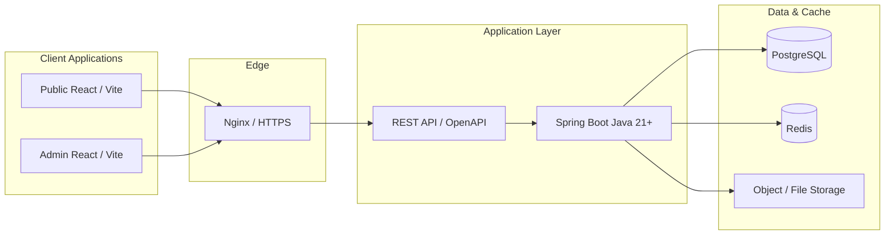

# 00 — Project Vision

## Purpose

Define why the Neurolinx digital platform exists, what experience it must deliver, and the master architectural principle that guides all subsequent documentation and implementation.

**Audience:** stakeholders, product owners, designers, frontend/backend engineers, and AI agents implementing the platform.

**Related docs:** [01_PROJECT_OBJECTIVES.md](./01_PROJECT_OBJECTIVES.md) · [02_BUSINESS_REQUIREMENTS.md](./02_BUSINESS_REQUIREMENTS.md) · [10_BRAND_GUIDELINES.md](./10_BRAND_GUIDELINES.md) · [docs/README.md](./README.md)

---

## Why Neurolinx exists

Neurolinx is modernizing its digital presence into a **high-end, enterprise-grade technology company and e-commerce platform**. The current market expectation for industrial and electronics brands is no longer a static brochure site: buyers expect credible engineering storytelling, rich product discovery, interactive visualization, and frictionless B2C purchase or B2B enquiry paths.

This platform exists to:

1. Establish Neurolinx as a **technology and engineering leader** with clear corporate credibility.
2. Showcase products with **premium presentation**, technical depth, and optional **interactive 3D**.
3. Support **B2C commerce** for suitable catalog items.
4. Support **B2B enquiry and quotation** for enterprise and project-based buying.
5. Enable authorized teams to operate content, catalog, orders, and media through an **admin platform**—without editing source code.

---

## Vision statement

> Neurolinx should feel like a global premium technology and electronics company: precise engineering, credible industrial expertise, and a modern product experience—backed by a scalable commerce and operations platform.

The experience combines:

| Dimension | Intent |
| --- | --- |
| Premium tech company | Trust, clarity, leadership messaging |
| Electronics / engineering | Specs, datasheets, R&D, manufacturing context |
| High-end product showcase | Visual hierarchy, authentic media, 3D where it helps |
| Professional B2B | Enquiry, quotation, account context (**TBD** exact commercial rules) |
| Modern B2C e-commerce | Cart, checkout, orders for sellable SKUs |
| Interactive 3D | WebGL product exploration without harming performance or a11y |

---

## Communication pillars

The platform must consistently communicate:

| Pillar | Manifestation on the platform |
| --- | --- |
| Technology leadership | Clear positioning, technology pages, innovation narratives |
| Engineering capability | Engineering / R&D sections, project evidence, specs |
| Innovation | New products, configurators, interactive experiences |
| Reliability | Stable UX, security, order accuracy, operational clarity |
| Premium product quality | Design system discipline, photography, packaging of PDPs |
| Industrial expertise | Industry pages, use cases, certifications (**TBD** list) |
| Research & Development | R&D storytelling and technical depth |
| IoT and automation | Dedicated technology and solution content |
| Professional corporate identity | Company pages, careers, contact, consistent brand system |
| E-commerce capability | Shop, cart, checkout, accounts, admin commerce ops |

---

## Target experience

### First impression (public site)

- Brand-first hero composition (not a dashboard).
- One primary headline, short supporting sentence, clear CTA group.
- Dominant visual plane (product, engineering context, or approved hero media)—not decorative abstraction alone.
- Motion used for presence and hierarchy, never for noise.

See [23_HOMEPAGE_DESIGN.md](./23_HOMEPAGE_DESIGN.md) and [10_BRAND_GUIDELINES.md](./10_BRAND_GUIDELINES.md).

### Product discovery

- Catalog browsing with filters, search, and comparison (**TBD** which attributes are filterable at launch).
- Product detail pages with media, specs, documents, and optional 3D.
- Clear paths: **Buy** (B2C) and/or **Enquire** (B2B), driven by product configuration.

### Commerce & accounts

- Guest browsing; registered customers for accounts, orders, wishlist (**TBD** guest checkout policy).
- Premium electronics marketplace feel—not consumer gadget gimmicks.

### Operations

- Admin React application for catalog, orders, content, media, analytics.
- Role-based access per [04_USER_ROLES.md](./04_USER_ROLES.md).

---

## Master architecture principle

Public and Admin frontends are separate React applications (or clearly separated apps/surfaces) that communicate with a shared Spring Boot REST API. Persistence and caching use PostgreSQL and Redis; binary assets use dedicated storage.

### Architecture principles (non-negotiable)

| Principle | Requirement |
| --- | --- |
| Documentation first | No feature implementation without reading relevant docs |
| Separation of concerns | UI, API, domain, persistence clearly separated |
| Security by default | AuthN/AuthZ, validation, least privilege—see `90`–`94` |
| Performance budgets | Motion and 3D must not violate [102_PERFORMANCE_STANDARDS.md](./102_PERFORMANCE_STANDARDS.md) |
| Accessibility | WCAG-oriented delivery—see [101_ACCESSIBILITY.md](./101_ACCESSIBILITY.md) |
| Operability | Dockerized deploy, monitoring, backups—see `120`–`125` |
| Extensibility | New products, 3D assets, and content addable via admin |

---

## Functional requirements (vision-level)

| ID | Requirement |
| --- | --- |
| VIS-F-01 | Platform delivers corporate presence, product showcase, B2C commerce, and B2B enquiry capability. |
| VIS-F-02 | Public experience is React/TypeScript/Vite with design system compliance. |
| VIS-F-03 | Backend is Spring Boot (Java 21+) exposing versioned REST APIs. |
| VIS-F-04 | Suitable products support interactive 3D (Three.js / R3F) with mobile-aware fallbacks. |
| VIS-F-05 | Admin users manage catalog, content, media, and orders without source-code edits. |

## Non-functional requirements (vision-level)

| ID | Requirement |
| --- | --- |
| VIS-N-01 | Experience must feel premium, modern, and enterprise-grade—not gadget-like or overly futuristic. |
| VIS-N-02 | Responsive across desktop and mobile; custom cursor disabled on touch / reduced motion. |
| VIS-N-03 | Prefer authentic Neurolinx imagery over generic stock when available. |
| VIS-N-04 | Production readiness: HTTPS, CI/CD, backups, health checks, logging. |

---

## Dependencies

- Confirmed brand assets (logo, photography set)—**TBD** if incomplete.
- Legal/compliance inputs (privacy, terms, tax, shipping)—**TBD**.
- Payment provider selection—**TBD** (see [43_PAYMENT.md](./43_PAYMENT.md)).
- Hosting / domain decisions—**TBD** (see [120_DEPLOYMENT_ARCHITECTURE.md](./120_DEPLOYMENT_ARCHITECTURE.md)).

## Constraints

- Do not invent unknown business rules (pricing, margins, B2B discount logic, territories).
- Avoid purple-on-white / cream-terracotta AI cliché palettes; follow [12_COLOR_SYSTEM.md](./12_COLOR_SYSTEM.md).
- Cards are interaction containers, not default decoration (see design rules in `10`–`15`).

## Acceptance criteria

- [ ] Vision and architecture principle understood by delivery team.
- [ ] All subsequent docs cross-reference this vision where relevant.
- [ ] Implementation plans map to communication pillars and dual B2B/B2C intent.
- [ ] TBD items tracked for stakeholder resolution before affecting launch scope.

---

## Out of scope (initial vision)

Items that may be future expansion (**TBD** prioritization):

- Multi-region storefronts and multi-currency beyond launch decisions.
- Native mobile apps (platform is web-first).
- Marketplace multi-vendor selling (Neurolinx is the merchant of record unless later specified).

---

## Summary

Neurolinx is building a unified digital platform that earns enterprise trust, sells with premium product presentation, and operates through a secure modular backend. Every feature must reinforce **corporate credibility + advanced technology + premium product design**.
