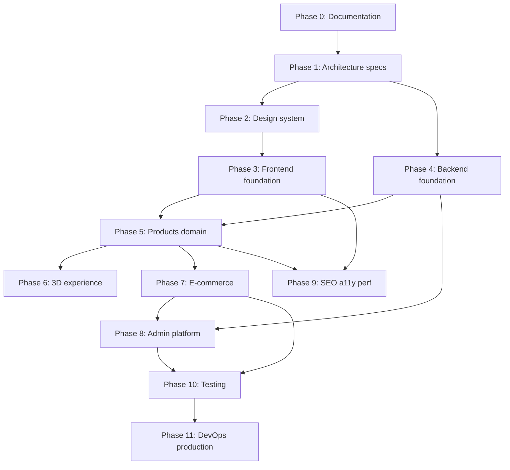

# 01 — Project Objectives

## Purpose

Define measurable business and product objectives for the Neurolinx platform, success criteria, and phased delivery objectives aligned with the documentation-first development order.

**Related docs:** [00_PROJECT_VISION.md](./00_PROJECT_VISION.md) · [02_BUSINESS_REQUIREMENTS.md](./02_BUSINESS_REQUIREMENTS.md) · [03_PRODUCT_REQUIREMENTS.md](./03_PRODUCT_REQUIREMENTS.md) · [docs/README.md](./README.md)

---

## Business goals

| ID | Goal | Notes |
| --- | --- | --- |
| BG-01 | Strengthen Neurolinx as a credible technology and engineering brand online. | Corporate + tech storytelling |
| BG-02 | Increase qualified product discovery and engagement. | Catalog, search, 3D, resources |
| BG-03 | Enable digital revenue via B2C e-commerce for eligible SKUs. | Payment provider **TBD** |
| BG-04 | Capture and route B2B enquiries / quotation requests efficiently. | Quotation workflow detail **TBD** |
| BG-05 | Reduce operational friction via admin self-service for catalog, content, and orders. | Role-based admin |
| BG-06 | Build a maintainable platform that can expand (new products, 3D, markets). | Modular architecture |

---

## Product goals

| ID | Goal | Related areas |
| --- | --- | --- |
| PG-01 | Ship a premium, accessible, responsive public website. | Design system `10`–`19`, pages `20`–`27` |
| PG-02 | Deliver a product architecture supporting variants, media, docs, and 3D. | `30`–`36`, `80`–`84` |
| PG-03 | Deliver modern B2C commerce (cart → checkout → order). | `40`–`48` |
| PG-04 | Deliver B2B enquiry paths alongside or instead of purchase where configured. | `27`, product flags |
| PG-05 | Deliver Admin React for day-to-day operations. | `70`–`77` |
| PG-06 | Meet security, SEO, a11y, and performance standards. | `90`–`94`, `100`–`103` |
| PG-07 | Establish testable, deployable production baseline. | `110`–`114`, `120`–`125` |

---

## Success criteria

### Launch readiness (definition of done — platform)

| Criterion | Measure | Status owner |
| --- | --- | --- |
| Documentation complete | All docs in [README.md](./README.md) exist with non-placeholder content | Docs / PM |
| Design system implemented | Tokens and core components match `10`–`19` | Frontend |
| Public IA live | Core pages from inventory implemented | Frontend |
| Catalog operable | Products creatable via admin; visible on public site | Full stack |
| Commerce path | Eligible SKU can be purchased end-to-end in staging | Full stack |
| Enquiry path | B2B enquiry submitted and visible in admin | Full stack |
| AuthZ | Roles enforce permissions matrix | Backend / Admin |
| Security baseline | Auth, validation, rate limits, upload controls | Security |
| Perf / a11y | Budgets and WCAG targets from docs met on critical paths | QA |
| Ops | Docker deploy, HTTPS, backups, monitoring smoke-tested | DevOps |

### Business success (post-launch) — TBD metrics

Concrete KPIs require stakeholder input. Track as **TBD** until confirmed:

| Metric | Example (not committed) | Decision |
| --- | --- | --- |
| Organic traffic / rankings | TBD | SEO targets TBD |
| Conversion rate (B2C) | TBD | Baseline TBD |
| Enquiry volume / response SLA | TBD | Sales process TBD |
| Average order value | TBD | Catalog mix TBD |
| Admin task time reduction | TBD | Ops baseline TBD |

---

## Phased objectives (development order)

Phases follow the master specification: **documentation first**, then architecture, design, implementation layers.

### Phase 0 — Documentation

| Objective | Exit criteria |
| --- | --- |
| Create complete `docs/` set | Files listed in README present with structured content |
| Resolve or label unknowns | All open decisions marked TBD with owners |

### Phase 1 — Architecture

| Objective | Exit criteria |
| --- | --- |
| Website IA and page inventory | `20`–`27` approved |
| Product / commerce / API / DB architecture | `30`–`36`, `40`–`48`, `60`–`68` approved |
| Security and deployment architecture | `90`–`94`, `120`–`125` drafted |

### Phase 2 — Design

| Objective | Exit criteria |
| --- | --- |
| Brand and tokens locked for v1 | `10`–`14` with provisional colors marked TBD where needed |
| Component and motion standards | `15`–`19` agreed |

### Phase 3 — Frontend foundation

| Objective | Exit criteria |
| --- | --- |
| Vite/React/TS app skeleton | Routing, layout, design tokens, a11y baseline |
| Core marketing pages shell | Home + company navigation structure |

### Phase 4 — Backend foundation

| Objective | Exit criteria |
| --- | --- |
| Spring Boot modular skeleton | Auth, health, OpenAPI, Flyway, Redis wiring |
| RBAC model | Roles from [04_USER_ROLES.md](./04_USER_ROLES.md) enforceable |

### Phase 5 — Products

| Objective | Exit criteria |
| --- | --- |
| Product APIs + listing + PDP | Specs, media, documents attachable |
| Admin product CRUD | Per `72_ADMIN_PRODUCTS.md` |

### Phase 6 — 3D

| Objective | Exit criteria |
| --- | --- |
| Viewer for GLB/GLTF | Rotate/zoom/pan; mobile fallback |
| Performance budget compliance | Per `84_3D_PERFORMANCE.md` |

### Phase 7 — E-commerce

| Objective | Exit criteria |
| --- | --- |
| Cart, checkout, orders | Staging payment path (**provider TBD**) |
| Customer account basics | Orders, addresses (**wishlist TBD** priority) |

### Phase 8 — Admin platform

| Objective | Exit criteria |
| --- | --- |
| Dashboard + core modules | Products, orders, customers, content, media |
| Analytics views | **TBD** which metrics in v1 |

### Phase 9 — SEO, accessibility, performance

| Objective | Exit criteria |
| --- | --- |
| SEO fundamentals | Sitemap, meta, product schema where applicable |
| A11y / CWV | Documented budgets met on critical templates |

### Phase 10 — Testing

| Objective | Exit criteria |
| --- | --- |
| Automated coverage for critical paths | Auth, catalog, cart, checkout, enquiry |
| Security testing baseline | Per `114_SECURITY_TESTING.md` |

### Phase 11 — DevOps & production

| Objective | Exit criteria |
| --- | --- |
| Staging + production pipelines | Docker, Nginx, HTTPS, backups, monitoring |

---

## Functional requirements

| ID | Requirement |
| --- | --- |
| OBJ-F-01 | Delivery follows documentation-first order unless stakeholders explicitly re-prioritize. |
| OBJ-F-02 | Each phase has exit criteria before heavy investment in the next layer. |
| OBJ-F-03 | Dual commerce modes (B2C purchase and B2B enquiry) are first-class product goals. |

## Non-functional requirements

| ID | Requirement |
| --- | --- |
| OBJ-N-01 | Objectives remain traceable to BR/PR IDs. |
| OBJ-N-02 | Success metrics that are unknown remain TBD—no fake KPIs. |
| OBJ-N-03 | Premium brand quality is a release gate, not a polish-only afterthought. |

## Dependencies

- Stakeholder approval of IA, brand tokens, payment provider, and shipping regions.
- Availability of product data, photography, and 3D assets for pilot SKUs.

## Constraints

- Do not start feature coding before relevant docs exist for that feature area.
- Do not expand scope into multi-vendor marketplace or native apps without vision update.

## Acceptance criteria

- [ ] Team can map every epic to a phase and to BR/PR IDs.
- [ ] TBD KPIs listed with owners and decision dates.
- [ ] Phase exit criteria used in sprint/release planning.

---

## Summary

Objectives balance **brand credibility**, **product excellence**, **commerce**, and **operability**. Delivery is phased from documentation through production so architecture and design decisions stay intentional.
