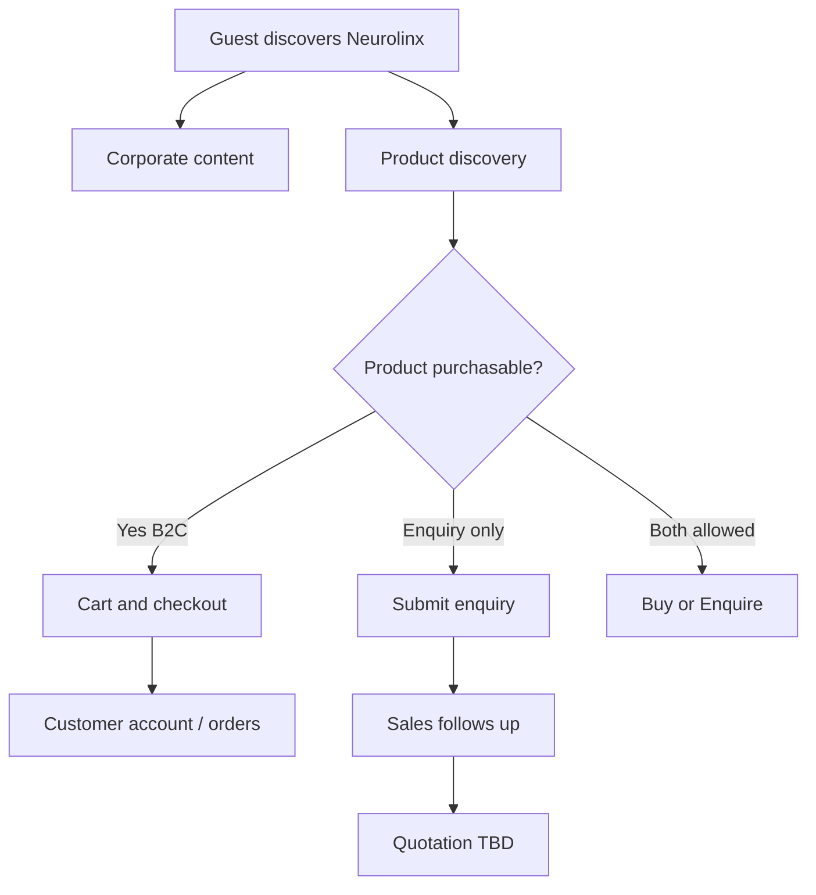

# 02 — Business Requirements

## Purpose

Capture business requirements for the Neurolinx platform across corporate presence, product showcase, B2C commerce, B2B enquiry/quotation, and admin operations. Each requirement has a stable **BR ID** for traceability.

**Related docs:** [00_PROJECT_VISION.md](./00_PROJECT_VISION.md) · [01_PROJECT_OBJECTIVES.md](./01_PROJECT_OBJECTIVES.md) · [03_PRODUCT_REQUIREMENTS.md](./03_PRODUCT_REQUIREMENTS.md) · [04_USER_ROLES.md](./04_USER_ROLES.md) · [27_CONTACT_AND_ENQUIRY.md](./27_CONTACT_AND_ENQUIRY.md) · [40_ECOMMERCE_ARCHITECTURE.md](./40_ECOMMERCE_ARCHITECTURE.md)

---

## Scope

| In scope | Out of scope / TBD |
| --- | --- |
| Public corporate website | Multi-vendor marketplace |
| Product catalog & showcase | Native mobile apps |
| B2C purchase for eligible products | Full ERP replacement |
| B2B enquiry / quotation intake | Complex CPQ rules (**TBD**) |
| Admin operations for catalog, content, orders | Offline POS |

---

## Requirement format

| Field | Meaning |
| --- | --- |
| ID | `BR-AREA-##` |
| Priority | Must / Should / Could |
| Status | Approved / Proposed / TBD |

---

## BR — Corporate presence

| ID | Requirement | Priority | Status |
| --- | --- | --- | --- |
| BR-CORP-01 | Neurolinx must present a professional corporate identity communicating technology leadership, engineering capability, and reliability. | Must | Approved |
| BR-CORP-02 | The site must include company, technology, industry, engineering/R&D, projects, resources, and contact areas as defined in IA docs. | Must | Approved |
| BR-CORP-03 | Corporate messaging must prioritize credibility over speculative futuristic effects. | Must | Approved |
| BR-CORP-04 | Certifications, manufacturing claims, and partnership logos must only display approved content. | Must | Approved |
| BR-CORP-05 | Careers content structure must be supported. Exact ATS integration **TBD**. | Should | TBD |
| BR-CORP-06 | Multi-language support for launch **TBD** (default assumed English until confirmed). | Could | TBD |

---

## BR — Product showcase

| ID | Requirement | Priority | Status |
| --- | --- | --- | --- |
| BR-PROD-01 | Products must be discoverable via categories, search, and filters. | Must | Approved |
| BR-PROD-02 | Product pages must present media, specifications, and downloadable technical documents where available. | Must | Approved |
| BR-PROD-03 | Suitable physical products should support interactive 3D visualization. | Should | Approved |
| BR-PROD-04 | Product comparison must be supported for selected catalog types. | Should | Approved |
| BR-PROD-05 | Product configurator / variant selection must support sellable or enquirable configurations. | Should | Approved |
| BR-PROD-06 | Pricing visibility rules (public vs logged-in vs B2B) **TBD**. | Must | TBD |
| BR-PROD-07 | Stock visibility and backorder messaging rules **TBD**. | Must | TBD |

---

## BR — B2C commerce

| ID | Requirement | Priority | Status |
| --- | --- | --- | --- |
| BR-B2C-01 | Eligible products must support add-to-cart and checkout. | Must | Approved |
| BR-B2C-02 | Customers must be able to create accounts, manage addresses, and view orders. | Must | Approved |
| BR-B2C-03 | Wishlist support is required for registered users unless deprioritized. | Should | Proposed |
| BR-B2C-04 | Coupons / promotions engine is required for marketing campaigns. | Should | Proposed |
| BR-B2C-05 | Reviews may be collected and moderated before public display. | Should | Proposed |
| BR-B2C-06 | Payment provider(s), currencies, and tax calculation approach **TBD**. | Must | TBD |
| BR-B2C-07 | Shipping regions, methods, and rates **TBD**. | Must | TBD |
| BR-B2C-08 | Guest checkout allowed or denied **TBD**. | Must | TBD |
| BR-B2C-09 | Return / refund policy workflow **TBD**. | Should | TBD |
| BR-B2C-10 | Invoice generation format and numbering **TBD**. | Should | TBD |

---

## BR — B2B enquiry & quotation

| ID | Requirement | Priority | Status |
| --- | --- | --- | --- |
| BR-B2B-01 | Buyers must be able to submit product or project enquiries from contact and product contexts. | Must | Approved |
| BR-B2B-02 | Enquiry submissions must be stored and visible to Sales / Admin roles. | Must | Approved |
| BR-B2B-03 | Products may be marked enquiry-only (not purchasable online). | Must | Approved |
| BR-B2B-04 | Quotation response process (manual email vs in-platform quotes) **TBD**. | Must | TBD |
| BR-B2B-05 | B2B account approval / company verification workflow **TBD**. | Should | TBD |
| BR-B2B-06 | Contract pricing / volume discounts **TBD**. | Could | TBD |
| BR-B2B-07 | Purchase-order based checkout **TBD**. | Could | TBD |

---

## BR — Admin operations

| ID | Requirement | Priority | Status |
| --- | --- | --- | --- |
| BR-ADM-01 | Authorized staff must manage products, categories, inventory, and media without code changes. | Must | Approved |
| BR-ADM-02 | Staff must manage orders, customers, enquiries, and content per role permissions. | Must | Approved |
| BR-ADM-03 | Admin must support user management and audit logging for sensitive actions. | Must | Approved |
| BR-ADM-04 | Analytics dashboard must show operational KPIs; exact KPI set **TBD**. | Should | TBD |
| BR-ADM-05 | Blog/resources CMS capabilities required for marketing content. | Should | Approved |
| BR-ADM-06 | Coupon and review moderation tools required when those features are enabled. | Should | Proposed |

---

## Business journeys (summary)

---

## Functional requirements (business-derived)

| ID | Requirement |
| --- | --- |
| BR-F-01 | Platform must support dual commercial intents: purchase and enquiry. |
| BR-F-02 | Product commercial mode must be configurable per product/variant. |
| BR-F-03 | Corporate and shop experiences share brand system and navigation coherence. |

## Non-functional requirements

| ID | Requirement |
| --- | --- |
| BR-N-01 | Business operations must not require developer intervention for routine catalog/content updates. |
| BR-N-02 | Sensitive commercial data access must follow RBAC ([04_USER_ROLES.md](./04_USER_ROLES.md)). |
| BR-N-03 | Legal pages (privacy, terms, cookies) required before public launch—copy **TBD**. |

## Dependencies

- Legal counsel for privacy/terms.
- Finance for tax/payment.
- Sales for B2B SLA and quotation tooling.
- Marketing for brand assets and messaging approval.

## Constraints

- Do not invent tax rates, shipping fees, discount matrices, or warranty terms.
- Do not display certifications or claims without approved source assets.

## Acceptance criteria

- [ ] Every Must BR is mapped to one or more PR IDs in [03_PRODUCT_REQUIREMENTS.md](./03_PRODUCT_REQUIREMENTS.md).
- [ ] All TBD BRs have named owners.
- [ ] Launch checklist blocks on unresolved Must-priority TBDs (payment, shipping, pricing visibility, guest checkout, enquiry follow-up).

---

## TBD register (Must priority)

| BR ID | Decision needed | Owner |
| --- | --- | --- |
| BR-PROD-06 | Pricing visibility rules | Product / Sales |
| BR-PROD-07 | Stock / backorder messaging | Ops |
| BR-B2C-06 | Payments, currency, tax | Finance |
| BR-B2C-07 | Shipping model | Ops |
| BR-B2C-08 | Guest checkout | Product |
| BR-B2B-04 | Quotation process | Sales |

---

## Summary

Business requirements establish Neurolinx as a **credible corporate tech brand** with a **premium product showcase**, **B2C commerce**, **B2B enquiry**, and **admin-operated** catalog/content. Unknown commercial rules remain explicitly TBD.
