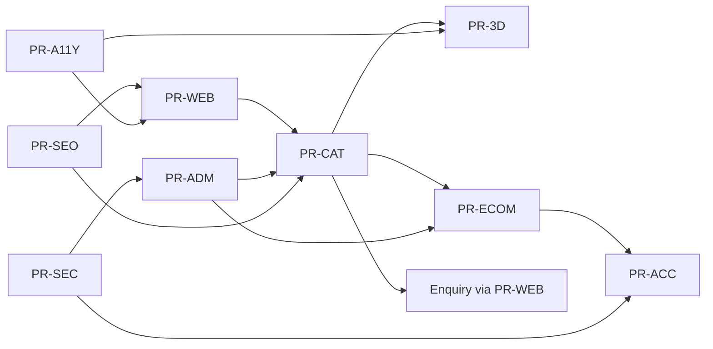

# 03 — Product Requirements

## Purpose

Define product and feature requirements for the Neurolinx platform with stable **PR IDs**, covering website, products, 3D, ecommerce, accounts, admin, security, SEO, and accessibility.

**Related docs:** [02_BUSINESS_REQUIREMENTS.md](./02_BUSINESS_REQUIREMENTS.md) · [04_USER_ROLES.md](./04_USER_ROLES.md) · [30_PRODUCT_ARCHITECTURE.md](./30_PRODUCT_ARCHITECTURE.md) · [40_ECOMMERCE_ARCHITECTURE.md](./40_ECOMMERCE_ARCHITECTURE.md) · [80_3D_ARCHITECTURE.md](./80_3D_ARCHITECTURE.md) · [90_SECURITY_ARCHITECTURE.md](./90_SECURITY_ARCHITECTURE.md) · [100_SEO_STRATEGY.md](./100_SEO_STRATEGY.md) · [101_ACCESSIBILITY.md](./101_ACCESSIBILITY.md)

---

## Priority legend

| Priority | Meaning |
| --- | --- |
| P0 | Launch blocker |
| P1 | Launch important |
| P2 | Post-launch / stretch |

Status: Approved · Proposed · TBD

---

## Website & corporate experience

| ID | Requirement | Priority | Status | Maps to |
| --- | --- | --- | --- | --- |
| PR-WEB-01 | Implement IA and page inventory per `20`–`27`. | P0 | Approved | BR-CORP-02 |
| PR-WEB-02 | Homepage is brand-first single composition with CTA group and dominant visual. | P0 | Approved | BR-CORP-01 |
| PR-WEB-03 | Global navigation and footer provide coherent access to company, products, shop, contact. | P0 | Approved | BR-CORP-02 |
| PR-WEB-04 | Contact form with validation and spam protection. | P0 | Approved | BR-B2B-01 |
| PR-WEB-05 | Resources/blog listing and article templates. | P1 | Approved | BR-ADM-05 |
| PR-WEB-06 | Careers page template; ATS integration **TBD**. | P2 | TBD | BR-CORP-05 |
| PR-WEB-07 | Cookie consent / privacy UX aligned with legal requirements **TBD**. | P0 | TBD | BR-N-03 |

---

## Products & catalog

| ID | Requirement | Priority | Status | Maps to |
| --- | --- | --- | --- | --- |
| PR-CAT-01 | Category tree and product listing with pagination. | P0 | Approved | BR-PROD-01 |
| PR-CAT-02 | Search with relevant ranking for product name/SKU/attributes (**ranking TBD**). | P0 | Approved | BR-PROD-01 |
| PR-CAT-03 | Faceted filters for approved attributes. | P1 | Approved | BR-PROD-01 |
| PR-CAT-04 | Product detail page: gallery, specs table, documents, related products. | P0 | Approved | BR-PROD-02 |
| PR-CAT-05 | Variants (e.g., color/config) with SKU-level stock/price hooks. | P0 | Approved | BR-PROD-05 |
| PR-CAT-06 | Product comparison (select N products; N max **TBD**, suggest 3–4). | P1 | Approved | BR-PROD-04 |
| PR-CAT-07 | Per-product flags: purchasable, enquiry-only, or both. | P0 | Approved | BR-B2B-03 |
| PR-CAT-08 | Datasheets/manuals download with access rules **TBD** (public vs auth). | P1 | TBD | BR-PROD-02 |
| PR-CAT-09 | Configurator UX for supported products. | P2 | Proposed | BR-PROD-05 |

---

## 3D product experience

| ID | Requirement | Priority | Status | Maps to |
| --- | --- | --- | --- | --- |
| PR-3D-01 | GLB/GLTF viewer via Three.js + R3F + Drei. | P1 | Approved | BR-PROD-03 |
| PR-3D-02 | Controls: rotate, zoom, pan; optional explode/hotspots per `83`. | P1 | Approved | BR-PROD-03 |
| PR-3D-03 | Mobile-optimized quality tiers or static fallback. | P0 | Approved | VIS-N-02 |
| PR-3D-04 | Lazy-load 3D; never block primary PDP content. | P0 | Approved | Perf |
| PR-3D-05 | Admin association of 3D assets to products. | P1 | Approved | BR-ADM-01 |
| PR-3D-06 | Accessibility: keyboard alternatives / reduced-motion disable auto-spin. | P0 | Approved | a11y |

---

## E-commerce

| ID | Requirement | Priority | Status | Maps to |
| --- | --- | --- | --- | --- |
| PR-ECOM-01 | Persistent cart for guests (local) and users (server) strategy documented in `41`. | P0 | Approved | BR-B2C-01 |
| PR-ECOM-02 | Checkout collecting shipping/billing; fields depend on region **TBD**. | P0 | Approved | BR-B2C-01 |
| PR-ECOM-03 | Payment integration per selected provider **TBD**. | P0 | TBD | BR-B2C-06 |
| PR-ECOM-04 | Order confirmation, history, and basic tracking status. | P0 | Approved | BR-B2C-02 |
| PR-ECOM-05 | Wishlist for authenticated customers. | P1 | Proposed | BR-B2C-03 |
| PR-ECOM-06 | Coupon apply at cart/checkout with validation. | P1 | Proposed | BR-B2C-04 |
| PR-ECOM-07 | Reviews with moderation workflow. | P2 | Proposed | BR-B2C-05 |
| PR-ECOM-08 | Tax and shipping calculators per business rules **TBD**. | P0 | TBD | BR-B2C-06/07 |
| PR-ECOM-09 | Inventory decrement / reservation behavior **TBD**. | P0 | TBD | BR-PROD-07 |

---

## Accounts

| ID | Requirement | Priority | Status | Maps to |
| --- | --- | --- | --- | --- |
| PR-ACC-01 | Customer registration, login, logout, password reset. | P0 | Approved | BR-B2C-02 |
| PR-ACC-02 | Profile and address book management. | P0 | Approved | BR-B2C-02 |
| PR-ACC-03 | Order history and invoice download (**invoice format TBD**). | P0 | TBD | BR-B2C-10 |
| PR-ACC-04 | Optional B2B company profile fields **TBD**. | P1 | TBD | BR-B2B-05 |
| PR-ACC-05 | Session security aligned with `63` / `90`. | P0 | Approved | Security |

---

## Admin platform

| ID | Requirement | Priority | Status | Maps to |
| --- | --- | --- | --- | --- |
| PR-ADM-01 | Separate Admin React app/surface with authenticated access only. | P0 | Approved | BR-ADM-01 |
| PR-ADM-02 | Dashboard with key operational metrics (**exact widgets TBD**). | P1 | TBD | BR-ADM-04 |
| PR-ADM-03 | Product/category/inventory CRUD + media attach. | P0 | Approved | BR-ADM-01 |
| PR-ADM-04 | Order management and status updates. | P0 | Approved | BR-ADM-02 |
| PR-ADM-05 | Customer and enquiry management. | P0 | Approved | BR-ADM-02 |
| PR-ADM-06 | Content/CMS for pages/blog as scoped in `75`. | P1 | Approved | BR-ADM-05 |
| PR-ADM-07 | Media library with secure upload pipeline. | P0 | Approved | BR-ADM-01 |
| PR-ADM-08 | User/role management for staff accounts. | P0 | Approved | BR-ADM-03 |
| PR-ADM-09 | Audit log for sensitive admin actions. | P0 | Approved | BR-ADM-03 |

---

## Security

| ID | Requirement | Priority | Status |
| --- | --- | --- | --- |
| PR-SEC-01 | Authentication via Spring Security with JWT/refresh strategy per `63`. | P0 | Approved |
| PR-SEC-02 | RBAC enforcement matching [04_USER_ROLES.md](./04_USER_ROLES.md). | P0 | Approved |
| PR-SEC-03 | Input validation, XSS/SQL injection protections, rate limiting. | P0 | Approved |
| PR-SEC-04 | Secure file uploads (type/size/malware policy per `93`). | P0 | Approved |
| PR-SEC-05 | Payment security practices; no raw card storage (**provider TBD**). | P0 | TBD |
| PR-SEC-06 | HTTPS everywhere in staging/production. | P0 | Approved |

---

## SEO

| ID | Requirement | Priority | Status |
| --- | --- | --- | --- |
| PR-SEO-01 | Semantic HTML, unique titles/descriptions per page. | P0 | Approved |
| PR-SEO-02 | XML sitemap and robots.txt. | P0 | Approved |
| PR-SEO-03 | Canonical URLs; Open Graph / Twitter cards. | P1 | Approved |
| PR-SEO-04 | Product structured data (schema.org) for purchasable items. | P1 | Approved |
| PR-SEO-05 | Performant CWV to support SEO—see `102`. | P0 | Approved |

---

## Accessibility

| ID | Requirement | Priority | Status |
| --- | --- | --- | --- |
| PR-A11Y-01 | Target WCAG 2.2 AA for core templates (**exact conformance claim TBD** legal). | P0 | Proposed |
| PR-A11Y-02 | Keyboard operable navigation and forms. | P0 | Approved |
| PR-A11Y-03 | Honor `prefers-reduced-motion`; disable custom cursor when required. | P0 | Approved |
| PR-A11Y-04 | Sufficient color contrast per [12_COLOR_SYSTEM.md](./12_COLOR_SYSTEM.md). | P0 | Approved |
| PR-A11Y-05 | Meaningful alt text for product/corporate images; decorative images marked appropriately. | P0 | Approved |

---

## Requirement relationships

---

## Non-functional product requirements

| ID | Requirement |
| --- | --- |
| PR-NF-01 | Public UI built with React/TS/Vite; design system tokens mandatory. |
| PR-NF-02 | APIs versioned REST + OpenAPI; PostgreSQL source of truth; Redis for cache/session/rate limits as designed. |
| PR-NF-03 | Motion and 3D must not violate performance or accessibility budgets. |
| PR-NF-04 | Feature flags or product flags enable gradual rollout of commerce/3D. |

## Dependencies

- Design tokens (`10`–`19`) before UI polish.
- Backend modules (`60`–`68`) before admin/commerce completion.
- Payment/shipping decisions before checkout go-live.

## Constraints

- Do not implement payment or tax logic until provider/rules confirmed.
- Do not require 3D for every SKU; capability is opt-in per product.

## Acceptance criteria

- [ ] P0 PRs implemented or explicitly deferred with stakeholder sign-off.
- [ ] Each P0 PR has test coverage mapping in `110`–`114`.
- [ ] TBD P0 items resolved or launch-blocked.

---

## Summary

Product requirements translate business needs into implementable features across **website, catalog, 3D, commerce, accounts, admin, security, SEO, and a11y**, with explicit TBDs for unresolved commercial and legal decisions.
