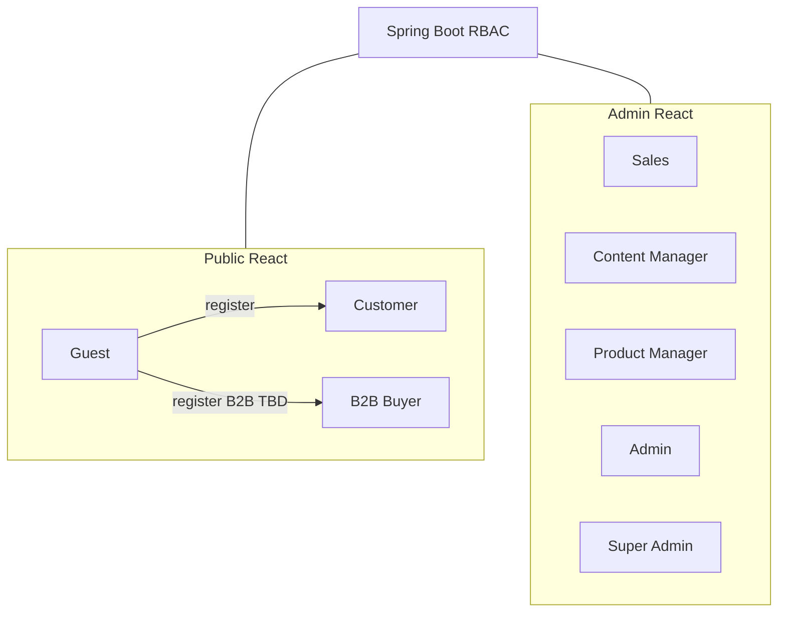

# 04 — User Roles

## Purpose

Define platform roles, responsibilities, and a permissions matrix for public and admin surfaces. Authorization implementation details live in [64_AUTHORIZATION_RBAC.md](./64_AUTHORIZATION_RBAC.md) and [63_AUTHENTICATION.md](./63_AUTHENTICATION.md).

**Related docs:** [02_BUSINESS_REQUIREMENTS.md](./02_BUSINESS_REQUIREMENTS.md) · [03_PRODUCT_REQUIREMENTS.md](./03_PRODUCT_REQUIREMENTS.md) · [70_ADMIN_ARCHITECTURE.md](./70_ADMIN_ARCHITECTURE.md) · [90_SECURITY_ARCHITECTURE.md](./90_SECURITY_ARCHITECTURE.md)

---

## Role overview

| Role | Surface | Description |
| --- | --- | --- |
| Guest | Public | Unauthenticated visitor; browse and limited actions |
| Customer | Public | Registered B2C shopper with account |
| B2B Buyer | Public | Registered business buyer; enquiry-focused (**approval TBD**) |
| Sales | Admin | Handles enquiries, customer follow-up, limited order visibility |
| Content Manager | Admin | Manages marketing/corporate content and blog |
| Product Manager | Admin | Manages catalog, media attachments, product flags |
| Admin | Admin | Broad operational control excluding break-glass controls |
| Super Admin | Admin | Full platform control including user/role and critical settings |

---

## Role details

### Guest

- Browse corporate pages, catalog, and product details (subject to pricing visibility **TBD**).
- Use contact/enquiry forms.
- Maintain local cart (**merge behavior TBD** on login).
- Cannot access account, admin, or moderated-only content.

### Customer

- All Guest capabilities plus authenticated account features.
- Manage profile, addresses, wishlist (**if enabled**), orders.
- Submit reviews (**if enabled**, subject to moderation).
- Checkout for purchasable SKUs.

### B2B Buyer

- Customer-like account with company fields (**schema TBD**).
- Emphasize enquiry / quotation requests.
- May see contract pricing **TBD**.
- May require approval before B2B privileges **TBD** (BR-B2B-05).

### Sales

- View and update enquiry pipeline.
- View customers and orders needed for fulfillment conversations.
- Cannot change global settings or manage staff users.
- Cannot delete products without Product Manager/Admin rights.

### Content Manager

- Create/edit/publish corporate and blog content.
- Manage selected media for content (not full catalog ops unless also Product Manager).
- Cannot process payments or alter inventory.

### Product Manager

- Full catalog CRUD: products, categories, variants, documents, 3D associations.
- Inventory adjustments within policy (**policy TBD**).
- Cannot manage Super Admin users or security settings.

### Admin

- Operational control across products, orders, customers, content, media, coupons, reviews.
- Manage staff users except Super Admin elevation (**exact elevation rules TBD**).
- Configure non-critical settings.

### Super Admin

- All Admin permissions.
- Role assignment, critical security settings, environment-level configuration.
- Access to audit logs and break-glass operations.
- Production secret management remains in DevOps tooling—not necessarily UI (**TBD**).

---

## Permissions matrix

Legend: **Y** = allowed · **N** = denied · **L** = limited / own-resource · **TBD** = decision pending

| Permission | Guest | Customer | B2B Buyer | Sales | Content Mgr | Product Mgr | Admin | Super Admin |
| --- | --- | --- | --- | --- | --- | --- | --- | --- |
| Browse public pages | Y | Y | Y | Y | Y | Y | Y | Y |
| View product catalog | Y | Y | Y | Y | Y | Y | Y | Y |
| View public prices | TBD | TBD | TBD | Y | Y | Y | Y | Y |
| Add to cart / checkout | Y* | Y | TBD | N | N | N | N | N |
| Submit enquiry | Y | Y | Y | N | N | N | N | N |
| Manage own account | N | Y | Y | N | N | N | N | N |
| View own orders | N | Y | Y | N | N | N | N | N |
| Wishlist | N | Y | Y | N | N | N | N | N |
| Submit review | N | Y | Y | N | N | N | N | N |
| Access Admin app | N | N | N | Y | Y | Y | Y | Y |
| Manage enquiries | N | N | N | Y | N | L | Y | Y |
| Manage content / blog | N | N | N | N | Y | N | Y | Y |
| Manage products / categories | N | N | N | N | N | Y | Y | Y |
| Manage inventory | N | N | N | N | N | Y | Y | Y |
| Manage media library | N | N | N | N | L | Y | Y | Y |
| Manage orders | N | N | N | L | N | N | Y | Y |
| Manage customers | N | N | N | L | N | N | Y | Y |
| Manage coupons | N | N | N | N | N | L | Y | Y |
| Moderate reviews | N | N | N | N | L | L | Y | Y |
| View analytics | N | N | N | L | L | L | Y | Y |
| Manage staff users | N | N | N | N | N | N | L | Y |
| Manage roles / security settings | N | N | N | N | N | N | N | Y |
| View full audit logs | N | N | N | N | N | N | L | Y |

\*Guest checkout subject to **BR-B2C-08 TBD**.

---

## Technical decisions

| Decision | Choice |
| --- | --- |
| Auth model | Spring Security + token strategy per `63` |
| Authorization | RBAC with role → permission mapping in `64` |
| Admin isolation | Admin routes/app require staff roles; never rely on UI hiding alone |
| Principle | Least privilege; deny by default |

## Functional requirements

| ID | Requirement |
| --- | --- |
| ROLE-F-01 | Every API mutation checks server-side permissions. |
| ROLE-F-02 | UI may hide unauthorized actions but must not be the only control. |
| ROLE-F-03 | Role changes are audited. |

## Non-functional requirements

| ID | Requirement |
| --- | --- |
| ROLE-N-01 | Permission checks must be consistent across Public API and Admin API. |
| ROLE-N-02 | Role names are stable identifiers in code and docs. |

## Dependencies

- [63_AUTHENTICATION.md](./63_AUTHENTICATION.md)
- [64_AUTHORIZATION_RBAC.md](./64_AUTHORIZATION_RBAC.md)
- [70_ADMIN_ARCHITECTURE.md](./70_ADMIN_ARCHITECTURE.md)

## Constraints

- Do not grant Super Admin broadly.
- Do not invent B2B approval states until BR-B2B-05 is decided—document as TBD in schema.

## Acceptance criteria

- [ ] Matrix implemented as permission constants / policies in backend.
- [ ] Admin navigation filtered by role.
- [ ] Automated tests cover deny paths for each staff role on sensitive endpoints.
- [ ] TBD cells resolved before production hardening sign-off.

---

## Cross-reference: authorization docs

| Topic | Document |
| --- | --- |
| Login, JWT, refresh, password | [63_AUTHENTICATION.md](./63_AUTHENTICATION.md) |
| RBAC policies, permission catalog | [64_AUTHORIZATION_RBAC.md](./64_AUTHORIZATION_RBAC.md) |
| Security architecture | [90_SECURITY_ARCHITECTURE.md](./90_SECURITY_ARCHITECTURE.md) |
| API hardening | [91_API_SECURITY.md](./91_API_SECURITY.md) |

---

## Summary

Eight roles span anonymous browsing through Super Admin control. The permissions matrix is the contract for UI and API enforcement; unresolved pricing and B2B approval rules remain TBD without blocking the role model itself.
