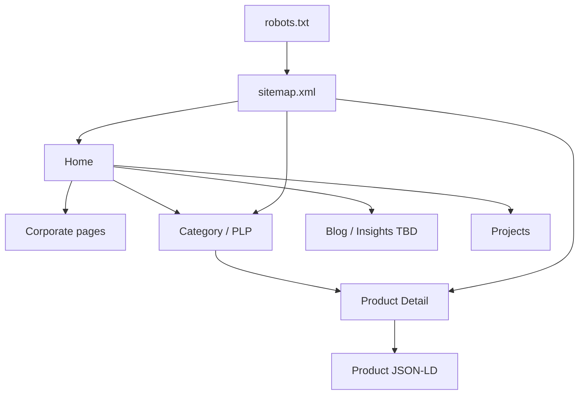

# 100 — SEO Strategy

## Purpose

Define SEO standards for the Neurolinx public site: semantic HTML, metadata, structured data, Open Graph, canonicalization, sitemap, and robots.

## Scope

Public marketing, corporate, and product/e-commerce pages. Admin app is `noindex`. Analytics tooling: [103_ANALYTICS.md](./103_ANALYTICS.md).

## Requirements

1. Every public indexable page has unique title, meta description, and canonical URL.
2. Product pages expose Product structured data where applicable.
3. Sitemap and robots.txt are generated/maintained accurately.
4. Semantic HTML supports both SEO and accessibility ([101_ACCESSIBILITY.md](./101_ACCESSIBILITY.md)).
5. Social previews via Open Graph / Twitter cards.

## Technical Decisions

| Topic | Decision |
|-------|----------|
| Rendering | SPA (React + Vite) — ensure critical metadata is correct per route; SSR/prerender **TBD** if crawl gaps found |
| Canonical | Absolute HTTPS canonical per page |
| URL structure | Readable slugs for products/categories/blog — exact patterns **TBD** with IA docs |
| Structured data | JSON-LD |
| Sitemap | Dynamic XML from published content |
| Robots | Allow public; disallow admin, account, checkout internals as appropriate |

## Information Architecture Signals



## Metadata Standards

| Element | Rule |
|---------|------|
| `<title>` | Brand + page topic; unique; avoid keyword stuffing |
| Meta description | Compelling summary; unique; ~150–160 chars guide |
| Canonical | Self-referencing canonical on indexables |
| hreflang | **TBD** if multi-locale |
| Robots meta | `noindex` for search result pages, cart, checkout, account, admin preview |

## Structured Data

### Product (JSON-LD)

Include when data available:

- `name`, `description`, `sku` / `mpn` (**TBD**), `image`, `brand`, `offers` (price, currency, availability)
- Do not invent ratings; only emit `AggregateRating` if real reviews exist

### Organization / WebSite

- Organization on home/about
- `WebSite` + `SearchAction` if site search is public — **TBD**

### BreadcrumbList

- On PLP/PDP/content hierarchies

Validate with Rich Results testing before launch campaigns.

## Open Graph / Social

| Property | Required |
|----------|----------|
| `og:title` | Yes |
| `og:description` | Yes |
| `og:image` | Yes (absolute URL; product image or page share image) |
| `og:url` | Yes |
| `og:type` | `website` / `product` as applicable |
| Twitter card | `summary_large_image` guide |

Image size guidelines: **TBD** (commonly ≥ 1200 px wide).

## Sitemap & Robots

### robots.txt (logical)

```text
User-agent: *
Allow: /
Disallow: /admin
Disallow: /account
Disallow: /checkout
Disallow: /cart
# TBD exact paths

Sitemap: https://<domain>/sitemap.xml
```

Domain: **TBD**.

### sitemap.xml

- Include: home, corporate, categories, products (`published`), blog posts (`published`)
- Exclude: cart, checkout, account, admin, filtered facet URLs with explosion risk
- `<lastmod>` when available
- Split sitemaps if URL count grows large

## Semantic HTML

- One `<h1>` per page
- Landmark regions: `header`, `nav`, `main`, `footer`
- Meaningful link text; products as articles/sections appropriately
- Image `alt` required for content images
- 3D canvas must not be the only product representation — poster + text specs for crawlers

## SPA / Crawl Considerations

| Risk | Mitigation |
|------|------------|
| Empty shell HTML | Pre-render or SSR critical routes — **TBD**; at minimum ensure meta tags update per route and crawlers tested |
| Infinite param URLs | Canonicalize; robots disallow noisy params |
| Soft 404 | Real HTTP 404 from server/Nginx for unknown product slugs — **TBD** mechanism |

## Functional Requirements

| ID | Requirement |
|----|-------------|
| FR-SEO-01 | Unique title/description/canonical on indexable routes |
| FR-SEO-02 | Product JSON-LD on PDPs with offers when purchasable |
| FR-SEO-03 | sitemap.xml lists published public URLs |
| FR-SEO-04 | robots.txt blocks non-indexable app areas |
| FR-SEO-05 | OG tags present for shareable pages |

## Non-Functional Requirements

| ID | Requirement |
|----|-------------|
| NFR-SEO-01 | Metadata updates on client navigations |
| NFR-SEO-02 | Structured data remains valid when product unpublished (page noindex or removed from sitemap) |

## Dependencies

- Product/content publishing APIs
- Public domain & HTTPS ([120_DEPLOYMENT_ARCHITECTURE.md](./120_DEPLOYMENT_ARCHITECTURE.md))
- Performance for crawl efficiency ([102_PERFORMANCE_STANDARDS.md](./102_PERFORMANCE_STANDARDS.md))

## Constraints

- Do not cloaking: users and bots get equivalent primary content.
- Do not auto-generate fake reviews schema.

## Acceptance Criteria

- [ ] Sample PDP passes Rich Results / schema validation for Product.
- [ ] robots.txt and sitemap deployed and linked.
- [ ] Cart/checkout/account are noindex.
- [ ] Sharing a PDP shows correct OG preview.
- [ ] Crawl strategy (SPA vs prerender) decided or explicitly TBD with owner.

## Open Items (TBD)

- SSR/prerender tool
- Production domain
- Multi-language
- SearchAction
- Exact URL taxonomy

## Related Documents

- [101_ACCESSIBILITY.md](./101_ACCESSIBILITY.md)
- [102_PERFORMANCE_STANDARDS.md](./102_PERFORMANCE_STANDARDS.md)
- [32_PRODUCT_DETAILS.md](./32_PRODUCT_DETAILS.md)
- [84_3D_PERFORMANCE.md](./84_3D_PERFORMANCE.md)
