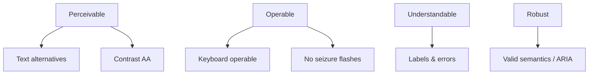

# 101 — Accessibility

## Purpose

Define accessibility requirements for Neurolinx, targeting **WCAG 2.2 Level AA** (aim), including keyboard use, screen readers, reduced motion, and alternatives to 3D content.

## Scope

Public site, customer account, checkout, and admin UI (admin also aims AA where feasible). Related: [100_SEO_STRATEGY.md](./100_SEO_STRATEGY.md), [83_3D_PRODUCT_INTERACTIONS.md](./83_3D_PRODUCT_INTERACTIONS.md), [84_3D_PERFORMANCE.md](./84_3D_PERFORMANCE.md).

## Requirements

1. Aim for WCAG 2.2 AA conformance on primary user journeys.
2. All interactive flows usable via keyboard.
3. Compatible with common screen readers (semantic structure + names/labels).
4. Respect `prefers-reduced-motion`.
5. 3D experiences always have non-3D equivalents for information and tasks.

## Technical Decisions

| Topic | Decision |
|-------|----------|
| Target | WCAG 2.2 AA (aim) |
| Components | Prefer accessible primitives; annotate custom widgets with ARIA only when needed |
| Focus | Visible focus rings; do not remove outline without replacement |
| Motion | GSAP/Framer/Lenis honor reduced motion |
| 3D | Optional enhancement; never sole path to purchase/enquiry info |
| Testing | Automated (axe) + manual keyboard/SR — see [111](./111_FRONTEND_TESTING.md), [113](./113_E2E_TESTING.md) |

## WCAG Focus Areas

| Principle | Neurolinx applications |
|-----------|------------------------|
| Perceivable | Alt text; captions **TBD** for video; contrast; don't rely on color alone |
| Operable | Keyboard; skip link; focus order; target sizes |
| Understandable | Clear labels; error identification; consistent nav |
| Robust | Correct roles/names; works with AT |

## Keyboard

- Tab order follows visual order.
- Modals trap focus and restore on close.
- Esc closes dialogs/menus.
- Dropdowns/menus operable without hover-only.
- Cart, checkout, enquiry, auth fully keyboard-complete.
- 3D: provide button controls (zoom in/out, reset, explode, hotspot list) outside canvas.

## Screen Readers

- Unique page titles.
- Landmarks and heading hierarchy (one h1).
- Form inputs have associated labels.
- Error messages linked via `aria-describedby` / live regions as appropriate.
- Icon-only buttons have accessible names.
- Live updates (cart count) announced judiciously.

## Reduced Motion

When `prefers-reduced-motion: reduce`:

- Disable Lenis smooth scrolling / parallax / auto-rotate.
- Replace long entrance animations with simple fades or none.
- 3D: no autoplay assembly; prefer static poster + stepped controls.
- Do not convey essential information only via motion.

## 3D Alternatives

| 3D feature | Accessible alternative |
|------------|------------------------|
| Orbit model | Product image gallery |
| Hotspots | Structured annotation list / accordion |
| Explode | Diagram images or stepped stills **TBD** |
| Configurator visuals | Variant swatches + text names + price |
| Assembly | Textual steps / video with captions **TBD** |

Ensure product specs, price, CTA remain in DOM independent of WebGL.

## Visual Design Constraints

- Text contrast ≥ AA for normal/large text.
- UI components contrast for non-text controls where required.
- Do not use color as the only state indicator (errors, stock).
- Focus indicators meet visible contrast.

Exact design tokens: design system docs (**cross-ref when present**).

## Admin Accessibility

- Data tables: keyboard sortable where interactive; row actions reachable.
- Do not rely on drag-only without keyboard alternative for critical tasks.

## Functional Requirements

| ID | Requirement |
|----|-------------|
| FR-A11Y-01 | Primary journeys keyboard completable |
| FR-A11Y-02 | Images conveying meaning have alt text |
| FR-A11Y-03 | Reduced motion preferences honored on motion-heavy pages |
| FR-A11Y-04 | 3D pages expose equivalent information in DOM |
| FR-A11Y-05 | Modals manage focus correctly |

## Non-Functional Requirements

| ID | Requirement |
|----|-------------|
| NFR-A11Y-01 | Aim WCAG 2.2 AA on critical flows before public launch |
| NFR-A11Y-02 | Automated a11y checks in CI for key pages — **TBD** scope |
| NFR-A11Y-03 | Known exceptions documented with rationale |

## Dependencies

- Design system components
- 3D viewer shell UI
- E2E and frontend testing docs

## Constraints

- Decorative animation must not block interaction.
- Do not ship inaccessible custom selects without keyboard support.

## Acceptance Criteria

- [ ] Auth, cart, checkout, enquiry completed keyboard-only in QA.
- [ ] axe (or equivalent) critical issues resolved on home + PDP + checkout.
- [ ] Reduced-motion verified on homepage and PDP 3D.
- [ ] Screen reader smoke test on PDP (name, price, CTA, annotations list).

## Open Items (TBD)

- Formal audit vendor / VPAT
- Video captioning pipeline
- Admin AA exceptions list

## Related Documents

- [100_SEO_STRATEGY.md](./100_SEO_STRATEGY.md)
- [83_3D_PRODUCT_INTERACTIONS.md](./83_3D_PRODUCT_INTERACTIONS.md)
- [55_RESPONSIVE_DESIGN.md](./55_RESPONSIVE_DESIGN.md)
- [111_FRONTEND_TESTING.md](./111_FRONTEND_TESTING.md)
