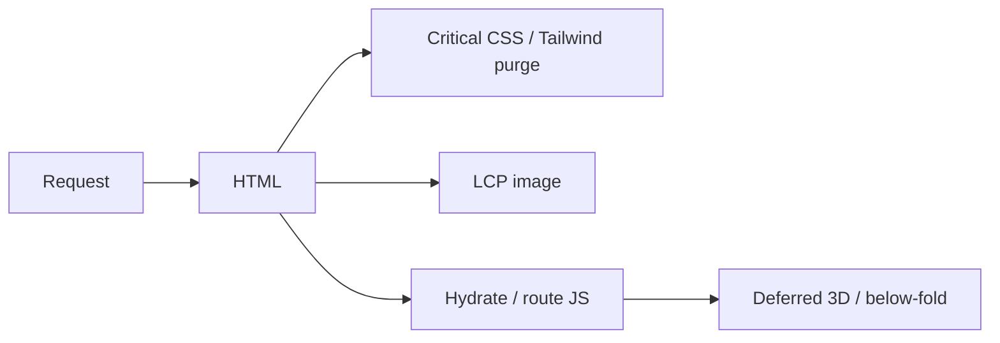

# 102 — Performance Standards

## Purpose

Define performance budgets and optimization standards for Neurolinx, covering Core Web Vitals, images, and 3D-related expectations.

## Scope

Public web performance. Detailed 3D runtime rules: [84_3D_PERFORMANCE.md](./84_3D_PERFORMANCE.md). Frontend techniques: [54_FRONTEND_PERFORMANCE.md](./54_FRONTEND_PERFORMANCE.md).

## Requirements

1. Meet agreed Core Web Vitals targets on key templates (home, PLP, PDP, checkout).
2. Optimize images (modern formats, responsive sizes).
3. Optimize 3D so it does not dominate LCP or block primary CTA interactivity.
4. Measure in CI/staging — tooling **TBD**.

## Technical Decisions

| Topic | Decision |
|-------|----------|
| Framework | Vite code-splitting; route-level lazy loading |
| Images | WebP/AVIF with fallbacks; responsive `srcset` |
| Fonts | Self-host or controlled CDN; subset — avoid layout thrash |
| 3D | Lazy + poster-first |
| Caching | Hashed assets; long cache at Nginx/CDN |
| Monitoring | RUM **TBD** ([103_ANALYTICS.md](./103_ANALYTICS.md), [125](./125_MONITORING_AND_LOGGING.md)) |

## Core Web Vitals Budgets

Targets are **aims** for mobile mid-tier field/lab; adjust after baselines.

| Metric | Aim | Notes |
|--------|-----|-------|
| LCP | ≤ 2.5 s | Likely hero image or PDP poster — not GLB |
| INP | ≤ 200 ms | Keep main thread free from long GSAP/3D spikes on input |
| CLS | ≤ 0.1 | Reserve image/poster space; font strategy |
| TTFB | **TBD** | Edge/app tuning |

Lab budgets (Lighthouse performance score): **TBD** (e.g., ≥ 80 mobile on key pages without 3D loaded).

## Image Optimization Standards

| Rule | Detail |
|------|--------|
| Format | AVIF/WebP preferred; JPEG/PNG fallback |
| Sizing | Exact display sizes; no 4000px images in cards |
| Compression | Visually tuned; automate in media pipeline — **TBD** |
| Lazy load | Below-fold images `loading="lazy"` |
| Priority | LCP image `fetchpriority="high"` |
| Dimensions | Width/height or aspect-ratio to reduce CLS |
| CDN | Cache immutable builds; product media with versioned URLs |

## 3D Optimization Standards (Summary)

- Do not use Canvas as LCP element; use poster.
- Code-split Three/R3F.
- Respect poly/texture budgets ([82_3D_MODEL_GUIDELINES.md](./82_3D_MODEL_GUIDELINES.md)).
- Pause when hidden; degrade quality on low FPS ([84_3D_PERFORMANCE.md](./84_3D_PERFORMANCE.md)).

## JS / CSS Budgets (Guide)

| Asset | Guide |
|-------|-------|
| Initial JS (gzip) for home | **TBD** — measure and cap |
| CSS | Purge unused Tailwind |
| Third parties | Defer analytics; minimize tags ([103](./103_ANALYTICS.md)) |

## Caching

| Asset | Cache |
|-------|-------|
| `/assets/*` hashed | Long-lived `immutable` |
| `index.html` | No long cache / revalidate |
| API JSON | Short/private as appropriate |
| GLB | Long cache with versioned URL |

## Functional Requirements

| ID | Requirement |
|----|-------------|
| FR-PERF-01 | Key routes lazy-load non-critical heavy features |
| FR-PERF-02 | Images follow format/sizing standards |
| FR-PERF-03 | PDP LCP uses poster/image, not 3D parse |
| FR-PERF-04 | Production assets served with correct cache headers |

## Non-Functional Requirements

| ID | Requirement |
|----|-------------|
| NFR-PERF-01 | CWV aims monitored pre-release on home/PLP/PDP/checkout |
| NFR-PERF-02 | Performance regression review for large dependency adds |
| NFR-PERF-03 | 3D optional path never blocks checkout |

## Dependencies

- Nginx caching ([122_NGINX_CONFIGURATION.md](./122_NGINX_CONFIGURATION.md))
- Media pipeline ([68_FILE_STORAGE.md](./68_FILE_STORAGE.md))
- CI performance checks **TBD** ([123_CI_CD.md](./123_CI_CD.md))

## Constraints

- Prefer fewer third-party scripts.
- Do not load 3D on listing grids.

## Acceptance Criteria

- [ ] LCP element identified and optimized on home + PDP.
- [ ] CLS stable with reserved media space.
- [ ] Image pipeline produces WebP/AVIF (or documented interim).
- [ ] 3D chunk not in initial home bundle.
- [ ] Cache headers verified on static assets.

## Open Items (TBD)

- Exact JS byte budgets
- RUM product
- Lighthouse CI thresholds
- CDN provider

## Related Documents

- [84_3D_PERFORMANCE.md](./84_3D_PERFORMANCE.md)
- [54_FRONTEND_PERFORMANCE.md](./54_FRONTEND_PERFORMANCE.md)
- [100_SEO_STRATEGY.md](./100_SEO_STRATEGY.md)
- [123_CI_CD.md](./123_CI_CD.md)
