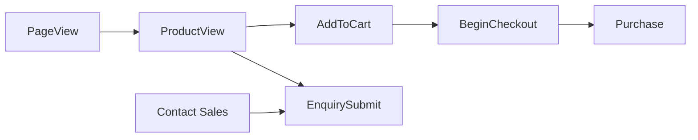

# 103 — Analytics

## Purpose

Define analytics and conversion tracking approach for Neurolinx marketing, product, and e-commerce funnels.

## Scope

Product analytics, traffic analytics, and conversion events. Exact vendor stack is **TBD** if not otherwise specified by stakeholders.

## Requirements

1. Measure acquisition, engagement, and conversion without breaking privacy expectations.
2. Track critical funnels: product view → cart → checkout → purchase; and enquiry/quote.
3. Avoid leaking PII to analytics tools beyond what is approved.
4. Defer/load tags so CWV aims remain attainable ([102_PERFORMANCE_STANDARDS.md](./102_PERFORMANCE_STANDARDS.md)).

## Technical Decisions

| Topic | Decision |
|-------|----------|
| Primary analytics tool | **TBD** (e.g., GA4, Plausible, Matomo, Mixpanel) |
| Error/product analytics split | App errors → monitoring tool ([125](./125_MONITORING_AND_LOGGING.md)); product funnels → analytics |
| Tag loading | Consent-aware if legally required — **TBD** jurisdiction |
| Implementation | Central event helper; no ad-hoc page scripts scattered |
| Admin analytics | Separate internal dashboards ([77_ADMIN_ANALYTICS.md](./77_ADMIN_ANALYTICS.md)) |

## Event Model (Logical)

### Suggested events

| Event | Properties (examples) | Notes |
|-------|----------------------|-------|
| `page_view` | path, title | SPA needs virtual page views |
| `product_view` | productId, slug, category | |
| `view_3d` | productId | When user opens/loads 3D |
| `add_to_cart` | productId, variantId, qty, value | |
| `remove_from_cart` | productId, variantId | |
| `begin_checkout` | value, item_count | |
| `add_shipping_info` | **TBD** | |
| `add_payment_info` | method type only — no PAN | |
| `purchase` | orderId, value, currency | From confirmation; reconcile with backend |
| `enquiry_submit` | productId?, source | B2B path |
| `search` | query (respect privacy) | |
| `sign_up` / `login` | method | Avoid email in event payload |

Exact schema freeze: **TBD**.

## Conversion Tracking

| Conversion | Definition |
|------------|------------|
| Purchase | Successful order confirmation |
| Enquiry | Successful enquiry/quote submit |
| Newsletter | **TBD** if exists |
| Account create | Registration complete |

Prefer server-side or confirmation-page events validated against order id to reduce duplicate purchase counts — **TBD**.

## Privacy & Compliance

- Do not send passwords, tokens, or card data.
- Prefer hashed or omitted emails unless policy allows.
- Cookie/consent banner requirements: **TBD** (legal).
- Document data processing agreements when vendor chosen.

## Performance

- Load analytics after critical content when possible.
- One tag manager max if used; avoid duplicate pixels.
- Review third-party impact in Lighthouse/RUM.

## Functional Requirements

| ID | Requirement |
|----|-------------|
| FR-AN-01 | SPA route changes emit page views |
| FR-AN-02 | Purchase and enquiry conversions tracked |
| FR-AN-03 | Central event API used by features |
| FR-AN-04 | 3D engagement optionally tracked without PII |

## Non-Functional Requirements

| ID | Requirement |
|----|-------------|
| NFR-AN-01 | Analytics failures must not break UX |
| NFR-AN-02 | Staging uses separate property/property filter |
| NFR-AN-03 | Vendor choice and consent mode documented when known |

## Dependencies

- Frontend event bus/helper
- Checkout & enquiry success states
- Possibly backend order webhooks for server-side measurement **TBD**

## Constraints

- Do not invent legal consent copy.
- Do not block release solely on perfect attribution if tool TBD — implement event layer early.

## Acceptance Criteria

- [ ] Event helper exists and is used on PDP cart CTA and enquiry submit.
- [ ] Purchase event fires once per successful order in test gateway mode.
- [ ] Staging data isolated from production property.
- [ ] Vendor selected or explicitly remains TBD with owner.

## Open Items (TBD)

- Analytics vendor
- Consent management platform
- Server-side tracking
- Attribution model / ad pixels

## Related Documents

- [102_PERFORMANCE_STANDARDS.md](./102_PERFORMANCE_STANDARDS.md)
- [42_CHECKOUT.md](./42_CHECKOUT.md)
- [27_CONTACT_AND_ENQUIRY.md](./27_CONTACT_AND_ENQUIRY.md)
- [77_ADMIN_ANALYTICS.md](./77_ADMIN_ANALYTICS.md)
- [125_MONITORING_AND_LOGGING.md](./125_MONITORING_AND_LOGGING.md)
