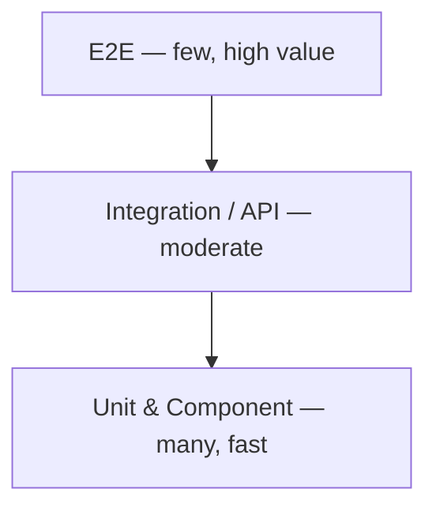

# 110 — Testing Strategy

## Purpose

Define the Neurolinx testing strategy: test pyramid, ownership, environments, and coverage goals (reasonable defaults where exact targets remain TBD).

## Scope

Frontend, backend, E2E, and security testing. Deep dives: [111](./111_FRONTEND_TESTING.md)–[114](./114_SECURITY_TESTING.md).

## Requirements

1. Prefer many fast unit/component tests, fewer integration tests, and a focused E2E suite for critical journeys.
2. CI runs automated tests on pull requests ([123_CI_CD.md](./123_CI_CD.md)).
3. Critical commerce and auth flows are covered by E2E.
4. Security-sensitive areas have explicit test coverage.
5. Coverage goals are pragmatic, not vanity 100%.

## Test Pyramid

| Layer | Focus | Tools (intended) |
|-------|-------|------------------|
| Unit | Domain logic, utils, mappers, validators | JUnit (BE), Vitest (FE) |
| Component | React UI behavior | Vitest + React Testing Library |
| Integration / API | Controllers + security + DB (Testcontainers **TBD**) | Spring MockMvc / WebTestClient |
| E2E | Auth, cart, checkout, enquiry | **Playwright** (locked) |
| Security | Authz, OWASP checks, payment negatives | [114](./114_SECURITY_TESTING.md) |
| Visual | Optional screenshot diffs for design-critical pages | **TBD** |
| Performance | Budgets / Lighthouse CI | **TBD** |

## Coverage Goals (Defaults)

Exact enforcement thresholds **TBD**; recommended starting defaults:

| Area | Default aim |
|------|-------------|
| Backend domain services | ≥ 70% line coverage on critical modules |
| Frontend utils/hooks | ≥ 70% where logic-heavy |
| UI components | Critical interactions tested; not every presentational leaf |
| E2E | 100% of listed critical flows smoke-covered |
| Overall repo % | Do not gate solely on global % |

Critical modules (priority): auth, cart/order pricing, payment webhook handling, RBAC, checkout validation, enquiry create.

## Environments

| Env | Testing use |
|-----|-------------|
| Local | Unit/integration; optional Compose |
| CI | Unit + integration + lint; E2E on PR or main — **TBD** |
| Staging | Full E2E + exploratory + payment test mode |
| Prod | Synthetic checks / smoke — **TBD**; no destructive tests |

## What Must Be Tested Before Release

- [ ] Login/logout/register (as applicable)
- [ ] Add to cart → checkout → order confirmation (test gateway)
- [ ] Enquiry/quote submit
- [ ] Admin login + product publish smoke
- [ ] Authorization negatives on admin APIs
- [ ] File upload reject path for disallowed types

## Functional Requirements

| ID | Requirement |
|----|-------------|
| FR-TEST-01 | PR pipeline runs unit tests for FE and BE |
| FR-TEST-02 | Critical E2E flows defined and automated in staging-capable suite |
| FR-TEST-03 | Flaky tests quarantined/fixed; not ignored silently |

## Non-Functional Requirements

| ID | Requirement |
|----|-------------|
| NFR-TEST-01 | Unit suite completes quickly enough for developer feedback (aim ≤ few minutes) |
| NFR-TEST-02 | Test data isolated; no reliance on production data |
| NFR-TEST-03 | Secrets for test gateways stored securely in CI |

## Dependencies

- Vitest/RTL, Spring test stack, **Playwright**, CI runners
- Docker for integration dependencies where used

## Constraints

- Do not hit production payment gateway with load tests.
- Do not skip security tests for “speed” on authz changes.

## Acceptance Criteria

- [ ] Pyramid documented and reflected in folder layouts.
- [ ] Coverage defaults agreed or explicitly TBD with owners.
- [ ] Critical flow list maps to E2E specs ([113_E2E_TESTING.md](./113_E2E_TESTING.md)).
- [ ] CI job list references this strategy ([123_CI_CD.md](./123_CI_CD.md)).

## Open Items (TBD)

- Exact coverage gates in CI
- E2E on every PR vs nightly
- Visual regression tool
- Testcontainers adoption

## Related Documents

- [111_FRONTEND_TESTING.md](./111_FRONTEND_TESTING.md)
- [112_BACKEND_TESTING.md](./112_BACKEND_TESTING.md)
- [113_E2E_TESTING.md](./113_E2E_TESTING.md)
- [114_SECURITY_TESTING.md](./114_SECURITY_TESTING.md)
- [123_CI_CD.md](./123_CI_CD.md)
