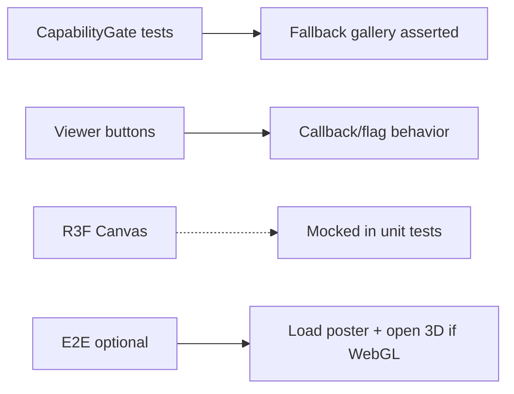

# 111 — Frontend Testing

## Purpose

Define frontend unit/component testing standards for the Neurolinx React application (Vitest + React Testing Library), plus visual testing considerations.

## Scope

React/TypeScript UI and client logic. E2E belongs in [113_E2E_TESTING.md](./113_E2E_TESTING.md). 3D WebGL deep rendering is generally not unit-tested pixel-perfect.

## Requirements

1. Use **Vitest** and **React Testing Library (RTL)** for component tests.
2. Test behavior and accessibility hooks (roles/names), not implementation details.
3. Cover critical UI states: loading, error, empty, success.
4. Mock network via MSW or module mocks — **TBD** preferred approach.
5. Visual regression optional for brand-critical screens — **TBD**.

## Technical Decisions

| Topic | Decision |
|-------|----------|
| Runner | Vitest |
| Component testing | RTL + `user-event` |
| Environment | jsdom |
| Snapshot | Sparingly; prefer assertions on roles/text |
| 3D | Test capability gates, fallbacks, and UI chrome; mock R3F Canvas |
| A11y | axe-core integration in selected tests — **TBD** |

## What to Test

| Priority | Examples |
|----------|----------|
| High | Cart line updates, checkout form validation, auth forms, enquiry form, price display rules |
| High | RBAC-gated admin nav visibility (client-side only as UX; server is source of truth) |
| Medium | Product filters UI, pagination controls, modal focus |
| Low | Pure presentational static chrome |
| Avoid | Asserting Tailwind class strings as primary signal |

## 3D Testing Approach



- Unit-test: flags hide/show explode/hotspot controls; reduced-motion path.
- Do not assert WebGL pixel output in Vitest.

## Visual Considerations

| Approach | Use |
|----------|-----|
| Manual design QA | Required for hero/motion pages |
| Chromatic / Playwright screenshots | **TBD** |
| Cross-browser | Covered primarily in E2E matrix |

Visual tests should stabilize fonts/viewport and avoid flaky motion frames (disable animations in visual env).

## Folder / Naming Conventions (Guide)

```text
*.test.ts / *.test.tsx adjacent or under __tests__/
```

Exact structure: follow [51_FRONTEND_FOLDER_STRUCTURE.md](./51_FRONTEND_FOLDER_STRUCTURE.md).

## Functional Requirements

| ID | Requirement |
|----|-------------|
| FR-FET-01 | Vitest runs in CI for frontend package |
| FR-FET-02 | Critical forms tested for validation and submit happy path (mocked API) |
| FR-FET-03 | 3D fallback UI covered by component tests |

## Non-Functional Requirements

| ID | Requirement |
|----|-------------|
| NFR-FET-01 | Tests deterministic (no real network) |
| NFR-FET-02 | Prefer queries by role/label for a11y alignment |

## Dependencies

- Vitest, RTL, user-event, optional MSW/axe
- [110_TESTING_STRATEGY.md](./110_TESTING_STRATEGY.md), [101_ACCESSIBILITY.md](./101_ACCESSIBILITY.md)

## Constraints

- Do not couple tests to internal state variables of Zustand without necessity.
- Do not screenshot full 3D canvas as primary quality gate.

## Acceptance Criteria

- [ ] Example component test patterns documented in repo README or here followed.
- [ ] Cart and enquiry form tests exist once features land.
- [ ] CI fails on FE unit test failure.
- [ ] Visual tool chosen or TBD recorded.

## Open Items (TBD)

- MSW vs per-test mocks
- axe-in-CI scope
- Visual regression vendor

## Related Documents

- [110_TESTING_STRATEGY.md](./110_TESTING_STRATEGY.md)
- [113_E2E_TESTING.md](./113_E2E_TESTING.md)
- [84_3D_PERFORMANCE.md](./84_3D_PERFORMANCE.md)
