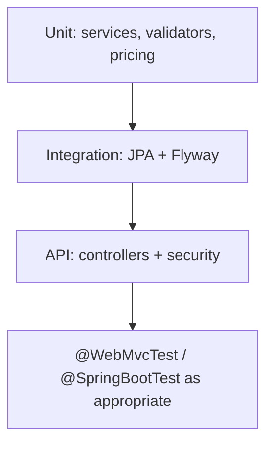

# 112 — Backend Testing

## Purpose

Define unit, integration, and API testing standards for the Neurolinx Spring Boot backend.

## Scope

Java 21+ / Spring Boot services, repositories, security, and REST APIs. E2E across UI: [113](./113_E2E_TESTING.md). Security-focused cases: [114](./114_SECURITY_TESTING.md).

## Requirements

1. Unit-test domain logic and mappers without spinning full HTTP stack where possible.
2. Integration-test persistence and security filter behavior.
3. API tests verify status codes, validation, and authz.
4. Use test profiles; never require production DB.
5. Prefer Testcontainers for PostgreSQL/Redis when feasible — **TBD** if CI resources constrain.

## Technical Decisions

| Topic | Decision |
|-------|----------|
| Unit | JUnit 5 + AssertJ/Mockito |
| API | MockMvc or WebTestClient |
| Security tests | `@WithMockUser` / jwt test helpers — **TBD** |
| DB | H2 only if compatible; else Testcontainers Postgres preferred |
| Migrations | Flyway runs in integration tests |
| Fixtures | Factory methods / SQL seeds under test resources |

## Test Layers

| Layer | Annotations (typical) | Focus |
|-------|----------------------|-------|
| Unit | Plain JUnit | Pure logic |
| Data | `@DataJpaTest` | Repositories |
| Web slice | `@WebMvcTest` | Controllers + validation |
| Full | `@SpringBootTest` | Wiring, security, webhooks |

## Priority Coverage

| Module | Must cover |
|--------|------------|
| Auth | Login, refresh, invalid token, lockout interactions **TBD** |
| RBAC | Forbidden vs allowed admin routes |
| Cart/Orders | Price integrity; ownership checks |
| Payments | Webhook signature failure/success; idempotency |
| Uploads | Reject bad types; accept allowlisted |
| Enquiry | Validation + persistence |
| Products | Publish visibility rules |

## API Test Expectations

- Assert HTTP status + stable error codes.
- Assert no stack traces in body for prod-like profile.
- Assert sensitive fields absent (password hashes, secrets).
- Use dedicated test JWT secrets in config.

## Functional Requirements

| ID | Requirement |
|----|-------------|
| FR-BET-01 | Backend unit tests run in CI |
| FR-BET-02 | Authz negative tests for representative admin endpoints |
| FR-BET-03 | Payment webhook verification tested with invalid signature |
| FR-BET-04 | Validation failures return 400 with structured errors |

## Non-Functional Requirements

| ID | Requirement |
|----|-------------|
| NFR-BET-01 | Tests clean DB state between cases (transaction rollback or truncate strategy) |
| NFR-BET-02 | Parallelization safe or documented as serial |
| NFR-BET-03 | Integration suite skippable locally with clear flag if heavy — but required in CI |

## Dependencies

- JUnit 5, Spring Boot Test, optional Testcontainers
- Flyway, PostgreSQL
- [110_TESTING_STRATEGY.md](./110_TESTING_STRATEGY.md), [91_API_SECURITY.md](./91_API_SECURITY.md)

## Constraints

- Do not use production credentials in tests.
- Do not `@Disabled` failing security tests without issue link.

## Acceptance Criteria

- [ ] Sample `@WebMvcTest` security test pattern established.
- [ ] Order/payment critical service tests exist when modules land.
- [ ] CI fails on backend test failure.
- [ ] Testcontainers decision recorded.

## Open Items (TBD)

- H2 vs Testcontainers
- JWT test utility design
- Contract testing (Spring Cloud Contract / Pact) — optional later

## Related Documents

- [60_SPRING_BOOT_ARCHITECTURE.md](./60_SPRING_BOOT_ARCHITECTURE.md)
- [63_AUTHENTICATION.md](./63_AUTHENTICATION.md)
- [114_SECURITY_TESTING.md](./114_SECURITY_TESTING.md)
- [123_CI_CD.md](./123_CI_CD.md)
