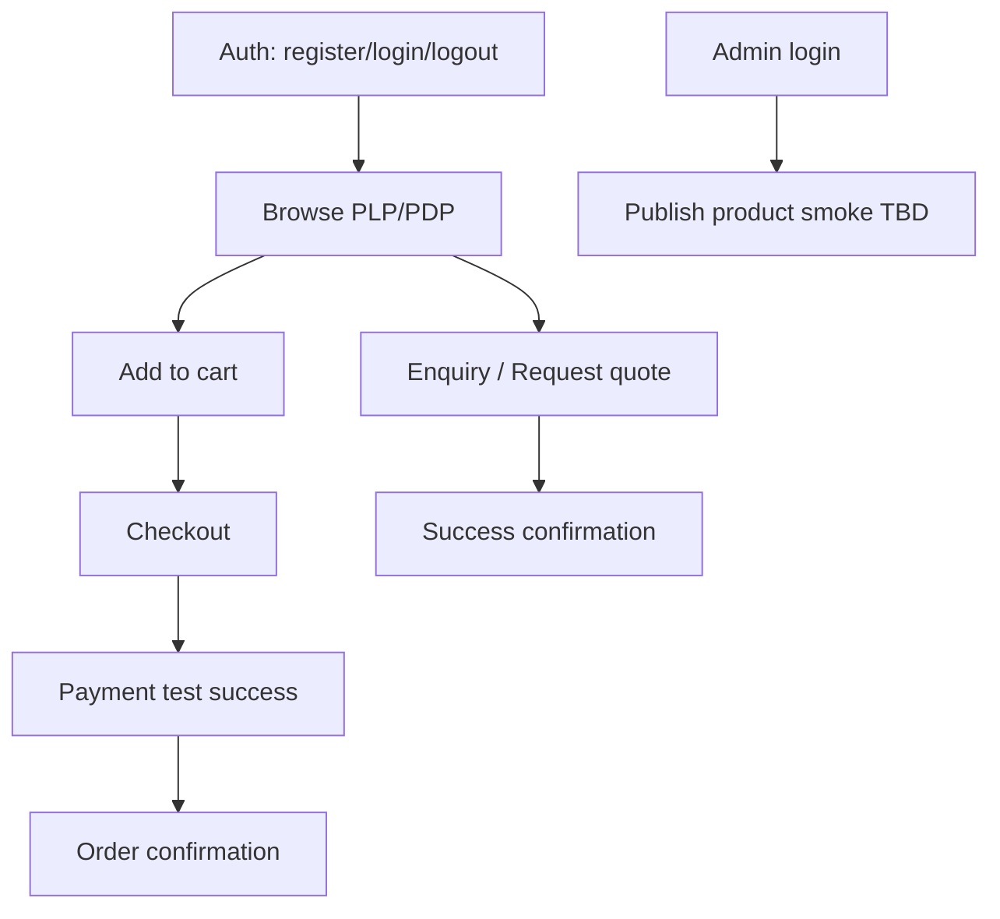

# 113 — E2E Testing

## Purpose

Define end-to-end testing approach for Neurolinx critical user journeys across frontend and backend.

## Scope

Browser-level flows on staging-like environments. **Standard tool: Playwright** ([ADR-001](./ADR/ADR-001-FRONTEND-STACK.md)). Cypress is **not** the project standard.

## Requirements

1. Automate critical flows: **auth, cart, checkout, enquiry**.
2. Run against deployed staging or Compose stack with seeded data.
3. Use payment **test mode** only.
4. Keep suite lean; push edge cases down to unit/API tests.
5. Capture traces/screenshots on failure.

## Technical Decisions

| Topic | Decision |
|-------|----------|
| Primary tool | **Playwright** (locked) |
| Alternative | Not adopted — do not introduce Cypress in parallel |
| Browsers | Chromium required; Firefox/WebKit **TBD** in CI matrix |
| Data | Seeded users/products; create ephemeral where possible |
| Auth | Test accounts in secret store; or API bootstrap login |
| 3D | Smoke only (poster visible; optional WebGL path) |

## Critical Flows

### Flow checklist

| Flow | Happy path | Key negatives |
|------|------------|---------------|
| Auth | Login success | Bad password message; session required for account |
| Cart | Add/update/remove | Persist across refresh if designed |
| Checkout | Complete order in test gateway | Validation blocking incomplete address |
| Enquiry | Submit with required fields | Validation errors |
| Authz (light) | Customer cannot open admin | Redirect/forbidden |

## Environment & Stability

- Base URL via env var.
- Deterministic seed (known product slug).
- Disable animations when flaky (`prefers-reduced-motion` or test flag).
- Retry policy: limited retries for infra flakes only.
- Parallelization: isolate storage state per worker.

## Functional Requirements

| ID | Requirement |
|----|-------------|
| FR-E2E-01 | Auth, cart, checkout, enquiry happy paths automated |
| FR-E2E-02 | Failures produce artifact (trace/screenshot/video) |
| FR-E2E-03 | Suite runnable in CI against staging or ephemeral env — **TBD** |

## Non-Functional Requirements

| ID | Requirement |
|----|-------------|
| NFR-E2E-01 | Median suite duration kept practical (aim under ~15–20 min early) |
| NFR-E2E-02 | No production purchases |
| NFR-E2E-03 | Selectors prefer roles/testids over brittle CSS |

## Dependencies

- Staging/Compose ([121_DOCKER_ARCHITECTURE.md](./121_DOCKER_ARCHITECTURE.md))
- Seed scripts
- Test payment credentials

## Constraints

- Do not E2E every admin screen initially.
- Do not assert full 3D FPS in E2E.

## Acceptance Criteria

- [ ] Playwright locked as E2E standard (no parallel Cypress suite).
- [ ] Four critical happy paths green on staging.
- [ ] CI integration path documented ([123_CI_CD.md](./123_CI_CD.md)).
- [ ] Test data seeding documented.

## Open Items (TBD)

- Cross-browser CI matrix
- Admin E2E depth
- Visual E2E snapshots

## Related Documents

- [110_TESTING_STRATEGY.md](./110_TESTING_STRATEGY.md)
- [42_CHECKOUT.md](./42_CHECKOUT.md)
- [41_CART.md](./41_CART.md)
- [27_CONTACT_AND_ENQUIRY.md](./27_CONTACT_AND_ENQUIRY.md)
- [114_SECURITY_TESTING.md](./114_SECURITY_TESTING.md)
