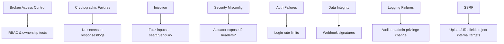

# 114 — Security Testing

## Purpose

Define security testing requirements for Neurolinx covering authentication/authorization, OWASP-aligned checks, uploads, and payment-related negatives.

## Scope

Automated and manual security verification complementary to [90_SECURITY_ARCHITECTURE.md](./90_SECURITY_ARCHITECTURE.md)–[94_PAYMENT_SECURITY.md](./94_PAYMENT_SECURITY.md).

## Requirements

1. AuthN/AuthZ positive and negative tests in API suite.
2. Regression tests for common OWASP risks applicable to this stack.
3. Payment webhook and amount-tampering tests.
4. Upload malicious/disallowed file rejection tests.
5. Periodic dependency vulnerability scanning in CI — **TBD** tooling.

## Technical Decisions

| Topic | Decision |
|-------|----------|
| Primary automation | Backend security tests + selected E2E authz |
| DAST | Optional ZAP/baseline scan in staging — **TBD** |
| SCA | Dependabot/Snyk/OWASP DC — **TBD** |
| Secrets | gitleaks or equivalent — **TBD** |
| Pen test | External test before major launch — **TBD** |

## Auth & Session Tests

| Case | Expected |
|------|----------|
| No token on protected route | 401 |
| Invalid/expired JWT | 401 |
| Valid customer on admin API | 403 |
| Customer A accesses customer B order | 403/404 per design |
| Logout / revoked refresh | Refresh fails |
| Brute force login | Rate limit / lockout behavior |

## OWASP-Aligned Checks (Practical)

| Risk | Test idea |
|------|-----------|
| XSS | Rich text stored XSS attempt rendered safely — **TBD** sanitizer tests |
| SQLi | Metacharacters in search/filter params do not error-leak or alter queries |
| CSRF | If cookie auth: state-changing requests need token/SameSite proof |
| Mass assignment | Role field in profile update ignored |
| IDOR | Horizontal access attempts |
| Path traversal | `../` filenames on upload/download |
| Security headers | Present at edge on staging |

## Payment-Related Tests

| Case | Expected |
|------|----------|
| Webhook invalid signature | Rejected; order not marked paid |
| Webhook replay duplicate event id | Idempotent; no double side effects |
| Client underpays via tampered amount | Server amount wins; charge matches server total |
| Refund without role | 403 |
| Response/logs | No PAN/CVV ever |

See [94_PAYMENT_SECURITY.md](./94_PAYMENT_SECURITY.md).

## Upload Security Tests

- Disallowed extensions rejected.
- MIME/extension mismatch rejected when detectable.
- Oversized body rejected (app + Nginx).
- Stored path not user-controlled ([93_FILE_UPLOAD_SECURITY.md](./93_FILE_UPLOAD_SECURITY.md)).

## Functional Requirements

| ID | Requirement |
|----|-------------|
| FR-SECT-01 | Authz negative suite exists for admin and ownership |
| FR-SECT-02 | Payment webhook signature tests exist |
| FR-SECT-03 | Upload rejection tests exist |
| FR-SECT-04 | Dependency scanning plan documented (even if TBD tool) |

## Non-Functional Requirements

| ID | Requirement |
|----|-------------|
| NFR-SECT-01 | Security tests run in CI for backend changes affecting authz/payments/uploads |
| NFR-SECT-02 | Findings tracked to remediation; critical blockers for release |

## Dependencies

- Spring Security test support
- Staging for DAST if enabled
- [112_BACKEND_TESTING.md](./112_BACKEND_TESTING.md), [113_E2E_TESTING.md](./113_E2E_TESTING.md)

## Constraints

- Do not run aggressive DAST against production.
- Do not store real card numbers in fixtures.

## Acceptance Criteria

- [ ] Authz negatives green in CI.
- [ ] Payment webhook invalid signature test green.
- [ ] Upload traversal/type tests green.
- [ ] SCA/DAST tooling chosen or TBD with owner.
- [ ] Pre-launch pen-test decision recorded.

## Open Items (TBD)

- ZAP in pipeline
- SCA vendor
- Secret scanning
- External penetration test schedule

## Related Documents

- [90_SECURITY_ARCHITECTURE.md](./90_SECURITY_ARCHITECTURE.md)
- [91_API_SECURITY.md](./91_API_SECURITY.md)
- [93_FILE_UPLOAD_SECURITY.md](./93_FILE_UPLOAD_SECURITY.md)
- [94_PAYMENT_SECURITY.md](./94_PAYMENT_SECURITY.md)
- [110_TESTING_STRATEGY.md](./110_TESTING_STRATEGY.md)
