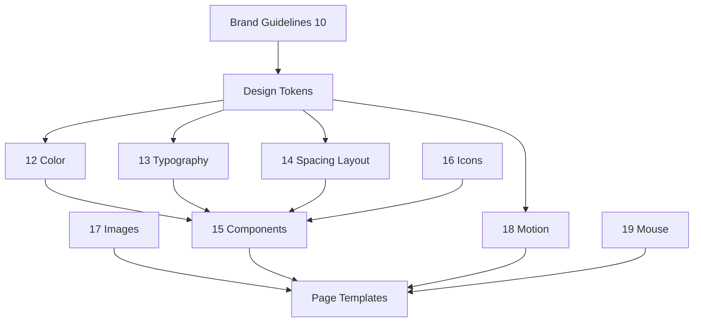

# 11 — Design System Overview

## Purpose

Describe the Neurolinx design system architecture: token philosophy, CSS variable approach, and how color, typography, spacing, components, motion, icons, and images connect.

**Related docs:** [10_BRAND_GUIDELINES.md](./10_BRAND_GUIDELINES.md) · [12_COLOR_SYSTEM.md](./12_COLOR_SYSTEM.md) · [13_TYPOGRAPHY.md](./13_TYPOGRAPHY.md) · [14_SPACING_AND_LAYOUT.md](./14_SPACING_AND_LAYOUT.md) · [15_COMPONENT_LIBRARY.md](./15_COMPONENT_LIBRARY.md) · [16_ICONOGRAPHY.md](./16_ICONOGRAPHY.md) · [17_IMAGE_GUIDELINES.md](./17_IMAGE_GUIDELINES.md) · [18_MOTION_DESIGN.md](./18_MOTION_DESIGN.md) · [19_MOUSE_INTERACTIONS.md](./19_MOUSE_INTERACTIONS.md)

---

## Goals

| Goal | Description |
| --- | --- |
| Consistency | One visual language across Public and Admin (Admin may use denser density tokens) |
| Speed | Engineers compose UI from tokens + components |
| Accessibility | Contrast, focus, reduced motion built into primitives |
| Scalability | New pages/products without one-off CSS |

---

## System map



---

## Token philosophy

1. **Primitives first** — raw palette, font families, spacing scale.
2. **Semantic aliases** — `bg-page`, `text-primary`, `border-subtle`, `action-primary`.
3. **Component tokens** (optional) — only when semantic tokens are insufficient.
4. **No hard-coded hex/rgb in components** — reference CSS variables or Tailwind theme mapped to variables.
5. **Light is primary**; dark is optional theme via data attribute / class.

### Naming convention

```text
--nl-{category}-{name}[-{variant}]
```

Examples:

- `--nl-color-navy-900`
- `--nl-color-bg-page`
- `--nl-font-display`
- `--nl-space-4`
- `--nl-radius-md`
- `--nl-motion-duration-fast`

Prefix `nl` = Neurolinx (avoids collisions).

---

## CSS variables approach

### Delivery

| Layer | Approach |
| --- | --- |
| Source of truth | CSS custom properties on `:root` and `[data-theme="dark"]` |
| Utility framework | Tailwind CSS mapped to CSS variables via theme config |
| React | Prefer token classes / CSS vars; avoid inline magic numbers |
| SSR/static | N/A for Vite SPA; ensure FOUC-safe theme boot **TBD** if dark enabled |

### Example structure

```css
:root {
  /* primitives */
  --nl-color-navy-900: #0b1f33;
  --nl-color-steel-500: #5b6b7c;
  --nl-color-teal-500: #0f8f8a;

  /* semantic */
  --nl-color-bg-page: #f5f7fa;
  --nl-color-text-primary: var(--nl-color-navy-900);
  --nl-color-action-primary: var(--nl-color-teal-600);

  /* space / type / motion */
  --nl-space-4: 1rem;
  --nl-font-body: "Source Serif 4", Georgia, serif; /* example — see 13 */
  --nl-motion-duration-fast: 150ms;
}

[data-theme="dark"] {
  --nl-color-bg-page: #0b121a;
  --nl-color-text-primary: #e8eef5;
}
```

Exact values: [12_COLOR_SYSTEM.md](./12_COLOR_SYSTEM.md), [13_TYPOGRAPHY.md](./13_TYPOGRAPHY.md).

---

## Density modes

| Mode | Use |
| --- | --- |
| Marketing | Comfortable spacing, larger type, generous section rhythm |
| Product / Shop | Balanced density for scanning specs and cards (interaction cards only) |
| Admin | Compact spacing scale variant (`--nl-space-*-admin` **TBD** if needed) |

---

## Component principles

From brand + frontend design rules:

- Prefer layout and typography over boxed chrome.
- **Cards only when needed for interaction** (product select, form grouping, admin tables may use surfaces differently).
- Shared primitives: Button, Input, Link, Nav, Dialog, Toast, etc.—see [15_COMPONENT_LIBRARY.md](./15_COMPONENT_LIBRARY.md).
- States: default, hover, focus-visible, active, disabled, loading, error.

---

## Public vs Admin

| Aspect | Public | Admin |
| --- | --- | --- |
| Brand expression | Full marketing system | Restrained; same tokens, denser UI |
| Motion | Hero/scroll (budgeted) | Minimal functional transitions |
| Custom cursor | Allowed per `19` | Generally off / default OS cursor |

---

## Functional requirements

| ID | Requirement |
| --- | --- |
| DS-F-01 | Token files exist and are imported globally in frontend apps. |
| DS-F-02 | New UI uses semantic tokens before inventing locals. |
| DS-F-03 | Components documented in `15` with variants/states. |

## Non-functional requirements

| ID | Requirement |
| --- | --- |
| DS-N-01 | Theme switch must not break contrast requirements. |
| DS-N-02 | Token changes cascade without hunting hex values in components. |
| DS-N-03 | Bundle impact of fonts/icons controlled (subsetting, tree-shaking). |

## Dependencies

- Tailwind + Vite React setup ([50_REACT_ARCHITECTURE.md](./50_REACT_ARCHITECTURE.md)).
- Brand approval for final palette/fonts where marked TBD.

## Constraints

- Do not introduce a second parallel design language for Shop vs Corporate.
- Do not use Inter/Roboto/Arial/system as primary marketing fonts ([13_TYPOGRAPHY.md](./13_TYPOGRAPHY.md)).

## Acceptance criteria

- [ ] `:root` token sheet covers color, type, space, radius, elevation, motion.
- [ ] At least Button, Input, Nav, Product interaction surface implemented on tokens.
- [ ] Dark theme (if shipped) remaps semantics without duplicate component code.

---

## Document index (design subsystem)

| Doc | Responsibility |
| --- | --- |
| [12_COLOR_SYSTEM.md](./12_COLOR_SYSTEM.md) | Palette & semantics |
| [13_TYPOGRAPHY.md](./13_TYPOGRAPHY.md) | Fonts & type scale |
| [14_SPACING_AND_LAYOUT.md](./14_SPACING_AND_LAYOUT.md) | Space, grid, breakpoints |
| [15_COMPONENT_LIBRARY.md](./15_COMPONENT_LIBRARY.md) | Components |
| [16_ICONOGRAPHY.md](./16_ICONOGRAPHY.md) | Lucide rules |
| [17_IMAGE_GUIDELINES.md](./17_IMAGE_GUIDELINES.md) | Imagery |
| [18_MOTION_DESIGN.md](./18_MOTION_DESIGN.md) | Motion |
| [19_MOUSE_INTERACTIONS.md](./19_MOUSE_INTERACTIONS.md) | Cursor |

---

## Summary

The Neurolinx design system is **token-driven**, CSS-variable-backed, light-primary, and shared across surfaces. Brand rules feed tokens; tokens feed components; components compose pages without one-off styling.
