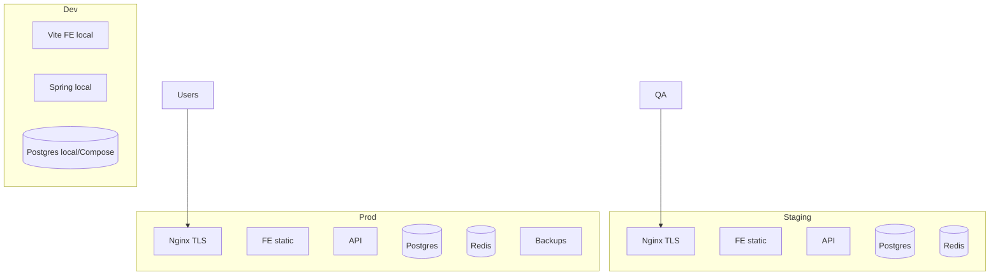
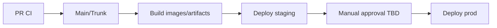

# 120 — Deployment Architecture

## Purpose

Define Neurolinx deployment topology across development, staging, and production, including VPS deployment, HTTPS, and domain architecture (**TBD** where unknown).

## Scope

Runtime environments and traffic flow. Container internals: [121_DOCKER_ARCHITECTURE.md](./121_DOCKER_ARCHITECTURE.md). Edge: [122_NGINX_CONFIGURATION.md](./122_NGINX_CONFIGURATION.md). Pipeline: [123_CI_CD.md](./123_CI_CD.md).

## Requirements

1. Support isolated **dev**, **staging**, and **prod** environments.
2. Production deployable on a **VPS** using Docker Compose (initial architecture).
3. HTTPS for staging/prod.
4. Clear separation of public web, API, and admin entrypoints (path or subdomain — **TBD**).
5. Health checks and backups integrated into ops practice.

## Technical Decisions

| Topic | Decision |
|-------|----------|
| Initial hosting | VPS + Docker Compose |
| Reverse proxy | Nginx |
| TLS | Let's Encrypt or provider certs — **TBD** |
| Domains | **TBD** |
| Admin hosting | Same SPA with route guard and/or `admin.` subdomain — **TBD** |
| Scaling | Single-node Compose first; horizontal scale later |

## Environment Overview



| Env | Purpose | Data | Payments |
|-----|---------|------|----------|
| Dev | Feature development | Disposable / seed | Mock or gateway test keys |
| Staging | QA, E2E, UAT | Near-prod seed; no real PII if possible | Gateway test mode |
| Prod | Live customers | Real | Live gateway keys |

## VPS Deployment (Logical)

```text
Internet
   │
   ▼
Nginx (443/80)
   ├── /            → frontend static (SPA)
   ├── /api/        → Spring Boot upstream
   └── /assets/     → cached static / media TBD
Docker network
   ├── frontend (or static files on host/volume)
   ├── backend
   ├── postgres
   └── redis
```

Optional: separate media volume or S3-compatible storage ([68_FILE_STORAGE.md](./68_FILE_STORAGE.md)).

## Domain Architecture (TBD)

| Host pattern | Possible use |
|--------------|--------------|
| `www.example.com` / apex | Public site |
| `api.example.com` | API only — **TBD** vs path `/api` |
| `admin.example.com` | Admin SPA — **TBD** |
| `staging.example.com` | Staging |

Exact domain names, DNS provider, and email DNS: **TBD**.

## HTTPS

- Terminate TLS at Nginx.
- HTTP → HTTPS redirect in staging/prod.
- HSTS in production once stable.
- Automate cert renewal.

## Promotion Flow



Details: [123_CI_CD.md](./123_CI_CD.md).

## Functional Requirements

| ID | Requirement |
|----|-------------|
| FR-DEP-01 | Staging and prod runnable via documented Compose/deploy process |
| FR-DEP-02 | HTTPS enabled on staging/prod |
| FR-DEP-03 | Environment-specific configs/secrets (no prod secrets in git) |
| FR-DEP-04 | Health endpoints checked by deploy verification |

## Non-Functional Requirements

| ID | Requirement |
|----|-------------|
| NFR-DEP-01 | Deployments reversible via previous image/artifact — **TBD** rollback runbook |
| NFR-DEP-02 | Staging mirrors prod topology closely enough for E2E confidence |
| NFR-DEP-03 | Resource limits set on containers — **TBD** values |

## Dependencies

- Docker, Docker Compose, Nginx, DNS, TLS certs
- [124_BACKUP_AND_RECOVERY.md](./124_BACKUP_AND_RECOVERY.md), [125_MONITORING_AND_LOGGING.md](./125_MONITORING_AND_LOGGING.md)

## Constraints

- Do not expose Postgres/Redis ports publicly in prod.
- Do not share prod DB with staging.

## Acceptance Criteria

- [ ] Dev/staging/prod differences documented.
- [ ] VPS Compose topology agreed and diagrammed.
- [ ] TLS working on staging.
- [ ] Domain plan filled or explicitly TBD with owner.
- [ ] Rollback approach documented.

## Open Items (TBD)

- Domain names & admin/API host strategy
- Cert automation tool (Certbot, Caddy sibling, etc.)
- Single VPS sizing
- Blue/green vs rolling restart
- CDN in front of Nginx

## Related Documents

- [121_DOCKER_ARCHITECTURE.md](./121_DOCKER_ARCHITECTURE.md)
- [122_NGINX_CONFIGURATION.md](./122_NGINX_CONFIGURATION.md)
- [123_CI_CD.md](./123_CI_CD.md)
- [90_SECURITY_ARCHITECTURE.md](./90_SECURITY_ARCHITECTURE.md)
