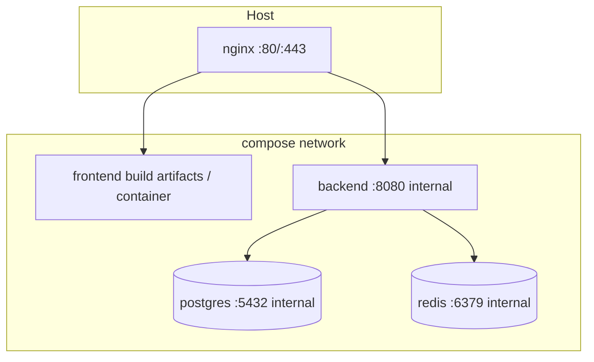

# 121 — Docker Architecture

## Purpose

Define Docker and Docker Compose services for Neurolinx: frontend, backend, PostgreSQL, Redis, and Nginx.

## Scope

Container boundaries, networking, volumes, and compose profiles. Nginx behavior detail: [122_NGINX_CONFIGURATION.md](./122_NGINX_CONFIGURATION.md).

## Requirements

1. Local and server environments use Compose for parity.
2. Services: **frontend**, **backend**, **postgres**, **redis**, **nginx**.
3. Backend connects to Postgres and Redis via Docker DNS names.
4. Only Nginx (and maybe SSH) exposed on host in prod-like setups.
5. Images build reproducibly from Dockerfiles.

## Technical Decisions

| Topic | Decision |
|-------|----------|
| Orchestration (initial) | Docker Compose |
| FE prod artifact | Multi-stage Vite build → static files served by Nginx |
| FE dev | Vite dev server optional compose service or host |
| BE | Spring Boot JAR in JRE image (Temurin 21+) |
| DB | Official PostgreSQL image |
| Cache | Official Redis image |
| Networks | Single bridge network `neurolinx` (or split front/back — **TBD**) |

## Compose Service Map



| Service | Role | Publishes ports (prod-like) |
|---------|------|-------------------------------|
| `nginx` | TLS, reverse proxy, static SPA | 80, 443 |
| `frontend` | Build-only or nginx volume source | None publicly |
| `backend` | Spring Boot API | None publicly (nginx → 8080) |
| `postgres` | Primary data store | None publicly |
| `redis` | Cache / rate limit / sessions TBD | None publicly |

## Suggested Compose Layout

```text
docker-compose.yml          # base
docker-compose.override.yml # local dev conveniences (gitignored or non-prod)
docker-compose.staging.yml  # staging overlays
docker-compose.prod.yml     # prod overlays
```

Exact file naming: **TBD** with repo conventions.

## Images & Build

### Frontend

- Stage 1: Node build (`pnpm` workspaces — locked; see [ADR-001](./ADR/ADR-001-FRONTEND-STACK.md)).
- Stage 2: Static assets copied to Nginx image or shared volume.

### Backend

- Stage 1: Gradle/Maven build.
- Stage 2: Runtime image with JAR only.
- Run as non-root user.

### Postgres / Redis

- Pin versions.
- Redis require password in non-local.
- Postgres credentials via secrets/env.

## Volumes

| Volume | Purpose |
|--------|---------|
| `pgdata` | Database durability |
| `redisdata` | Optional AOF/RDB — **TBD** |
| `uploads` / object storage mount | Media & 3D — **TBD** |
| `certs` | TLS material if not using host certbot paths |

## Environment & Secrets

- `.env` for local only; never commit prod secrets.
- Compose `secrets` or host-mounted files for prod — **TBD**.
- Distinct credentials per environment.

## Healthchecks

| Service | Check |
|---------|-------|
| backend | HTTP `/actuator/health` or `/api/health` — **TBD** path |
| postgres | `pg_isready` |
| redis | `redis-cli ping` |
| nginx | `wget`/`curl` localhost health page |

## Functional Requirements

| ID | Requirement |
|----|-------------|
| FR-DOC-01 | `docker compose up` brings API + DB + Redis + proxy for staging-like use |
| FR-DOC-02 | Backend reaches postgres/redis by service name |
| FR-DOC-03 | Database port not published in prod compose overlay |
| FR-DOC-04 | Frontend production assets served via Nginx |

## Non-Functional Requirements

| ID | Requirement |
|----|-------------|
| NFR-DOC-01 | Images run non-root where feasible |
| NFR-DOC-02 | Resource limits defined for prod — **TBD** |
| NFR-DOC-03 | Logs to stdout for container collection |

## Dependencies

- Docker Engine, Compose v2
- [120_DEPLOYMENT_ARCHITECTURE.md](./120_DEPLOYMENT_ARCHITECTURE.md)
- [65_DATABASE_ARCHITECTURE.md](./65_DATABASE_ARCHITECTURE.md), [67_REDIS_ARCHITECTURE.md](./67_REDIS_ARCHITECTURE.md)

## Constraints

- Do not bind-mount production code for live edit.
- Do not use `latest` tags unmarked in prod without digest pin — prefer pinned versions.

## Acceptance Criteria

- [ ] Compose files document all five services.
- [ ] Staging-like stack boots cleanly from docs instructions.
- [ ] Internal-only DB/Redis verified.
- [ ] Healthchecks pass.

## Open Items (TBD)

- Package manager for FE Docker build
- Upload volume vs S3
- Compose secret mechanism
- Separate frontend container vs pure Nginx static

## Related Documents

- [122_NGINX_CONFIGURATION.md](./122_NGINX_CONFIGURATION.md)
- [123_CI_CD.md](./123_CI_CD.md)
- [68_FILE_STORAGE.md](./68_FILE_STORAGE.md)
