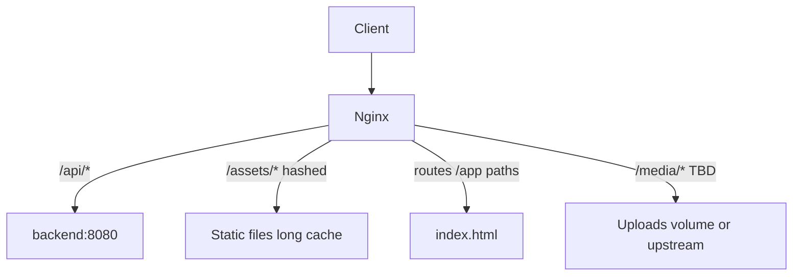

# 122 — Nginx Configuration

## Purpose

Define Nginx configuration standards for Neurolinx as reverse proxy, TLS terminator, static asset server, and SPA router.

## Scope

Edge Nginx in Docker/VPS deployments. App security headers coordination with [91_API_SECURITY.md](./91_API_SECURITY.md).

## Requirements

1. Terminate TLS and redirect HTTP → HTTPS in staging/prod.
2. Serve frontend SPA with correct fallback routing.
3. Reverse-proxy API to Spring Boot.
4. Cache hashed static assets aggressively.
5. Enforce upload/body size limits aligned with [93_FILE_UPLOAD_SECURITY.md](./93_FILE_UPLOAD_SECURITY.md).

## Technical Decisions

| Topic | Decision |
|-------|----------|
| Role | Single edge Nginx |
| SPA | `try_files` → `index.html` |
| API prefix | `/api/` → `backend:8080` (path rewrite **TBD**) |
| Compression | `gzip` on; `brotli` **TBD** module |
| HTTP/2 | Enabled with TLS |
| Rate limit | Optional zones at edge for `/api/auth` — **TBD** |

## Request Routing



## SPA Routing

- For client routes (`/products/...`, `/cart`, etc.): serve `index.html` when file not found.
- Do not SPA-fallback real missing asset files (return 404 for `/assets/*` misses).
- Ensure API paths never fall through to `index.html`.

## TLS

```text
listen 443 ssl http2;
ssl_certificate     ...;
ssl_certificate_key ...;
# protocols/ciphers: modern Mozilla intermediate guide — TBD exact snippet ownership
```

- ACME/Certbot renewal automation — **TBD**.
- HSTS: enable in prod after HTTPS stability (`max-age` **TBD**).

## Static Assets

| Path | Cache-Control |
|------|---------------|
| Hashed `/assets/*` | `public, max-age=31536000, immutable` |
| `index.html` | `no-cache` or short revalidate |
| Images/media versioned | Long cache |
| GLB versioned | Long cache; consider `Content-Type` correctly |

## Reverse Proxy Headers

Pass through / set:

- `Host`
- `X-Forwarded-For`
- `X-Forwarded-Proto`
- `X-Forwarded-Host`

Backend must trust forwarded proto for redirects/cookies if applicable.

## Security & Limits

| Control | Guidance |
|---------|----------|
| `client_max_body_size` | Match max upload (3D/docs) |
| `server_tokens` | Off |
| Security headers | `X-Content-Type-Options nosniff`, `Referrer-Policy`, `Frame-Options`/`CSP` **TBD** |
| Hide upstream errors | Custom error pages optional |
| Rate limit | Auth endpoints preferred |

## Example Location Logic (Illustrative)

```nginx
# illustrative only — not production-final
location /api/ {
  proxy_pass http://backend:8080/api/;
  proxy_set_header Host $host;
  proxy_set_header X-Forwarded-For $proxy_add_x_forwarded_for;
  proxy_set_header X-Forwarded-Proto $scheme;
}

location /assets/ {
  try_files $uri =404;
  add_header Cache-Control "public, max-age=31536000, immutable";
}

location / {
  try_files $uri $uri/ /index.html;
}
```

## Functional Requirements

| ID | Requirement |
|----|-------------|
| FR-NGX-01 | HTTPS redirect works in staging/prod |
| FR-NGX-02 | SPA deep links load on refresh |
| FR-NGX-03 | `/api` proxied to Spring Boot |
| FR-NGX-04 | Hashed assets cached long-term |
| FR-NGX-05 | Body size limit configured |

## Non-Functional Requirements

| ID | Requirement |
|----|-------------|
| NFR-NGX-01 | Nginx config versioned in repo |
| NFR-NGX-02 | Config tested in staging before prod |
| NFR-NGX-03 | Access/error logs available to monitoring |

## Dependencies

- Certs, frontend build output, backend upstream health
- [121_DOCKER_ARCHITECTURE.md](./121_DOCKER_ARCHITECTURE.md)

## Constraints

- Do not proxy Postgres.
- Do not enable directory listing.
- Do not commit private keys to git.

## Acceptance Criteria

- [ ] Refresh on `/products/<slug>` returns app, not Nginx 404.
- [ ] API calls succeed through `/api`.
- [ ] TLS grade acceptable on staging.
- [ ] Large upload limit aligned with backend.
- [ ] Cache headers verified for hashed assets.

## Open Items (TBD)

- Brotli module
- Final CSP header
- Media URL strategy
- Exact cert automation
- Admin subdomain server block vs path

## Related Documents

- [120_DEPLOYMENT_ARCHITECTURE.md](./120_DEPLOYMENT_ARCHITECTURE.md)
- [102_PERFORMANCE_STANDARDS.md](./102_PERFORMANCE_STANDARDS.md)
- [91_API_SECURITY.md](./91_API_SECURITY.md)
- [93_FILE_UPLOAD_SECURITY.md](./93_FILE_UPLOAD_SECURITY.md)
