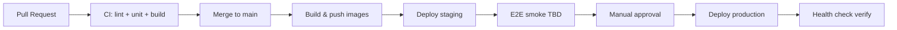

# 123 — CI / CD

## Purpose

Outline the Neurolinx continuous integration and continuous delivery pipeline: build, test, and deploy.

## Scope

Automation from pull request to staging/production. Test strategy: [110_TESTING_STRATEGY.md](./110_TESTING_STRATEGY.md). Deploy topology: [120_DEPLOYMENT_ARCHITECTURE.md](./120_DEPLOYMENT_ARCHITECTURE.md).

## Requirements

1. Every PR runs lint/typecheck/unit tests for affected areas.
2. Main branch produces deployable artifacts/images.
3. Staging deploys automatically or on merge — **TBD**.
4. Production deploys require protection (manual approval recommended).
5. Secrets stored in CI secret store, not in repo.

## Technical Decisions

| Topic | Decision |
|-------|----------|
| CI platform | **TBD** (GitHub Actions preferred default if repo on GitHub) |
| Artifacts | Docker images and/or FE static + BE JAR |
| Registry | **TBD** (GHCR/Docker Hub/private) |
| Deploy mechanism | SSH + Compose pull/up on VPS — **TBD** |
| Node/Java versions | Pin versions matching project |

## Pipeline Outline

### CI jobs (logical)

| Job | Purpose |
|-----|---------|
| `frontend-lint` | ESLint/typecheck |
| `frontend-test` | Vitest |
| `frontend-build` | Vite production build |
| `backend-test` | JUnit + integration |
| `backend-build` | Package JAR / image |
| `security-sca` | Dependency scan — **TBD** |
| `e2e` | Playwright against staging/ephemeral — **TBD** cadence |

### CD steps (logical)

1. Pull approved images on VPS.
2. `docker compose` up with prod overlay.
3. Run DB migrations (Flyway on boot or explicit job).
4. Hit health endpoint.
5. Announce deploy status.

## Branching & Releases

| Strategy | Notes |
|----------|-------|
| Trunk-based / main + short PRs | Preferred default |
| Release tags | Optional semver tags — **TBD** |
| Hotfix | Branch from tag/main with accelerated approval |

## Secrets & Environments

- Separate staging/prod secrets.
- Gateway test vs live keys isolated.
- Rotation runbook — **TBD**.

## Functional Requirements

| ID | Requirement |
|----|-------------|
| FR-CICD-01 | PR pipeline blocks merge on unit test failure |
| FR-CICD-02 | Main builds publish versioned artifacts |
| FR-CICD-03 | Staging deploy path documented and workable |
| FR-CICD-04 | Prod deploy gated by approval or protected environment |

## Non-Functional Requirements

| ID | Requirement |
|----|-------------|
| NFR-CICD-01 | CI feedback aim ≤ 15–20 minutes early on |
| NFR-CICD-02 | Pipelines idempotent; reruns safe |
| NFR-CICD-03 | Failed deploy does not silently leave mixed versions without detection |

## Dependencies

- Container registry, VPS SSH access, test suites
- [121_DOCKER_ARCHITECTURE.md](./121_DOCKER_ARCHITECTURE.md), [112](./112_BACKEND_TESTING.md), [113](./113_E2E_TESTING.md)

## Constraints

- Do not deploy to prod from feature branches.
- Do not print secrets in logs.

## Acceptance Criteria

- [ ] CI platform chosen or TBD with interim manual steps documented.
- [ ] PR checks include FE + BE tests.
- [ ] Staging deploy runbook exists.
- [ ] Prod approval gate defined.
- [ ] Post-deploy health verification step exists.

## Open Items (TBD)

- GitHub Actions vs other CI
- Image registry
- Auto vs manual staging
- E2E in PR vs post-deploy
- Migration downtime strategy

## Related Documents

- [110_TESTING_STRATEGY.md](./110_TESTING_STRATEGY.md)
- [120_DEPLOYMENT_ARCHITECTURE.md](./120_DEPLOYMENT_ARCHITECTURE.md)
- [114_SECURITY_TESTING.md](./114_SECURITY_TESTING.md)
- [125_MONITORING_AND_LOGGING.md](./125_MONITORING_AND_LOGGING.md)
