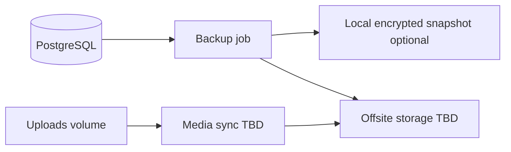

# 124 — Backup and Recovery

## Purpose

Define database backup, media backup considerations, and disaster recovery posture for Neurolinx. RPO/RTO targets are **TBD** until business owners set them.

## Scope

PostgreSQL backups, restore drills, and linkage to data security ([92_DATA_SECURITY.md](./92_DATA_SECURITY.md)). Application code is in git; this doc focuses on stateful data.

## Requirements

1. Automated PostgreSQL backups for production.
2. Backups stored off the primary VPS when possible.
3. Backups encrypted and access-restricted.
4. Documented restore procedure tested periodically.
5. Explicit RPO/RTO once approved (until then marked TBD).

## Technical Decisions

| Topic | Decision |
|-------|----------|
| DB backup | `pg_dump` and/or continuous WAL archiving — **TBD** sophistication |
| Schedule | At least daily full dump — **TBD** exact cron |
| Media/3D files | Volume sync or object storage versioning — **TBD** |
| Redis | Treat as ephemeral cache unless session-critical; rebuild OK if designed so |
| Encryption | Encrypt at rest for offsite copies |
| Retention | **TBD** (e.g., 7–30 daily; monthly longer) |

## RPO / RTO

| Metric | Target |
|--------|--------|
| RPO (max data loss) | **TBD** |
| RTO (max downtime) | **TBD** |

Interim ops assumption (non-binding): daily backups ⇒ up to ~24h RPO unless WAL archiving added.

## Backup Architecture

## What to Back Up

| Data | Priority | Method guide |
|------|----------|--------------|
| PostgreSQL | Critical | Automated dump / PITR **TBD** |
| Uploaded media & 3D | High | Object versioning or rsync |
| Nginx certs | Medium | Reissuable via ACME often |
| Env secrets | Critical | Secret manager / sealed ops store — not only disk |
| Redis | Low | Usually skip |

## Restore Procedure (Logical)

1. Stop API writers / put maintenance page (**TBD**).
2. Provision Postgres; restore dump (or PITR).
3. Restore media to expected paths/bucket.
4. Start backend; run Flyway (should be no-op if backup includes schema).
5. Verify health, admin login, sample product, sample order read.
6. Record incident timeline.

## Disaster Scenarios

| Scenario | Response guide |
|----------|----------------|
| Accidental data delete | Restore dump to new DB; selective export if needed |
| VPS loss | New VPS + Compose + restore DB/media + DNS |
| Ransomware / compromise | Isolate; restore from offline/offsite; rotate secrets |
| Corrupt volume | Replace volume; restore |

## Functional Requirements

| ID | Requirement |
|----|-------------|
| FR-BK-01 | Scheduled prod DB backups enabled |
| FR-BK-02 | Offsite or equivalent failure-isolated copy exists |
| FR-BK-03 | Restore runbook documented |
| FR-BK-04 | Backup encryption + restricted access |

## Non-Functional Requirements

| ID | Requirement |
|----|-------------|
| NFR-BK-01 | Backup job monitored for failure ([125](./125_MONITORING_AND_LOGGING.md)) |
| NFR-BK-02 | Periodic restore drill — frequency **TBD** (suggest quarterly) |
| NFR-BK-03 | Retention complies with business/legal **TBD** |

## Dependencies

- VPS storage, offsite provider **TBD**, alerting
- [120_DEPLOYMENT_ARCHITECTURE.md](./120_DEPLOYMENT_ARCHITECTURE.md), [92_DATA_SECURITY.md](./92_DATA_SECURITY.md)

## Constraints

- Do not store only backups on the same disk as Postgres without offsite copy.
- Do not use unencrypted public buckets for DB dumps.
- Do not restore prod backups into shared dev without anonymization.

## Acceptance Criteria

- [ ] Daily backup job documented and running in prod.
- [ ] Offsite copy verified.
- [ ] At least one successful restore drill recorded (or scheduled with date).
- [ ] RPO/RTO formally set or explicitly TBD with named owner.

## Open Items (TBD)

- RPO/RTO numbers
- WAL/PITR vs dump-only
- Offsite vendor
- Media backup tooling
- Retention policy
- Drill cadence

## Related Documents

- [92_DATA_SECURITY.md](./92_DATA_SECURITY.md)
- [65_DATABASE_ARCHITECTURE.md](./65_DATABASE_ARCHITECTURE.md)
- [68_FILE_STORAGE.md](./68_FILE_STORAGE.md)
- [125_MONITORING_AND_LOGGING.md](./125_MONITORING_AND_LOGGING.md)
