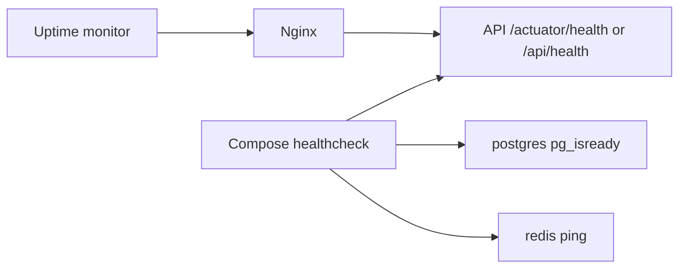

# 125 — Monitoring and Logging

## Purpose

Define health checks, logging, error tracking, and alerting for Neurolinx production operations.

## Scope

Application and infrastructure observability for Compose/VPS deployments. Product analytics are separate ([103_ANALYTICS.md](./103_ANALYTICS.md)).

## Requirements

1. Backend exposes health endpoints for orchestration and uptime checks.
2. Structured application logs to stdout (container-friendly).
3. Error tracking for frontend and backend — tool **TBD**.
4. Alerts on downtime, elevated 5xx, backup failures, and disk pressure — **TBD** channels.
5. Do not log secrets or card data ([92](./92_DATA_SECURITY.md), [94](./94_PAYMENT_SECURITY.md)).

## Technical Decisions

| Topic | Decision |
|-------|----------|
| Health | Spring Actuator health (lock down sensitive endpoints) |
| Metrics | Actuator/Prometheus **TBD** |
| FE errors | Browser error tracker **TBD** (Sentry, etc.) |
| BE errors | Same family or logs + tracker **TBD** |
| Log shipping | Docker logging driver / host collector **TBD** |
| Uptime | External HTTP check on `/` and `/api/health` **TBD** |

## Health Checks

| Check | Use |
|-------|-----|
| Liveness | Process up |
| Readiness | DB (and Redis if required) reachable |
| Dependency detail | Restricted to internal/admin |

Public exposure of detailed Actuator info: **disabled** or authenticated.

## Logging Standards

| Rule | Detail |
|------|--------|
| Format | Structured JSON preferred in prod — **TBD** |
| Correlation | Request ID / trace ID propagated FE→BE — **TBD** |
| Levels | INFO default; DEBUG not in prod |
| Security | Redact Authorization, cookies, passwords, PAN |
| Audit | Separate audit stream/table for admin actions ([90](./90_SECURITY_ARCHITECTURE.md)) |
| Retention | **TBD** |

### What to log

- Request summary (method, path, status, latency)
- Auth failures (without passwords)
- Payment status transitions (ids only)
- Upload failures
- Unhandled exceptions (stack in tracker, not necessarily user response)

## Error Tracking

| Layer | Events |
|-------|--------|
| Frontend | Uncaught exceptions, failed critical API calls |
| Backend | 5xx, webhook processing failures |
| 3D | Context loss / load failures (sampled) |

PII scrubbing rules required before enabling session replay — **TBD**.

## Alerting

| Alert | Severity guide |
|-------|----------------|
| Site/API down | Critical |
| Elevated 5xx rate | High |
| DB disk > threshold | High |
| Backup job failed | High |
| Cert expiry approaching | Medium |
| Redis down | Medium/High depending on critical path |

Notification channel (email/Slack/Pager): **TBD**.

## Dashboards (Guide)

- Request rate, error rate, latency p95
- JVM memory / container CPU — **TBD**
- Order/payment success rates (ops, not marketing)
- Queue/worker lag if media processor added

## Functional Requirements

| ID | Requirement |
|----|-------------|
| FR-MON-01 | Health endpoint used by Compose/uptime checks |
| FR-MON-02 | App logs available without SSH-only tribal knowledge — path **TBD** |
| FR-MON-03 | Error tracker receives BE 5xx in staging/prod once tool chosen |
| FR-MON-04 | Backup failure generates alert |

## Non-Functional Requirements

| ID | Requirement |
|----|-------------|
| NFR-MON-01 | Monitoring must not store PAN/secrets |
| NFR-MON-02 | Actuator sensitive endpoints not public |
| NFR-MON-03 | Alert noise tuned to avoid ignore fatigue |

## Dependencies

- Spring Actuator, Nginx access logs, CI/CD health verify step
- [121_DOCKER_ARCHITECTURE.md](./121_DOCKER_ARCHITECTURE.md), [123_CI_CD.md](./123_CI_CD.md), [124_BACKUP_AND_RECOVERY.md](./124_BACKUP_AND_RECOVERY.md)

## Constraints

- Do not expose heap dumps publicly.
- Do not rely solely on SSH `docker logs` without retention plan for prod.

## Acceptance Criteria

- [ ] Health checks green in Compose.
- [ ] Uptime check configured for staging/prod or TBD with owner.
- [ ] Error tracking vendor selected or TBD.
- [ ] Log redaction verified with sample auth request.
- [ ] Backup failure alert path documented.

## Open Items (TBD)

- Sentry (or alternative) selection
- Prometheus/Grafana vs simpler VPS monitors
- Log retention & shipping
- On-call / alert routing
- Trace ID standard

## Related Documents

- [90_SECURITY_ARCHITECTURE.md](./90_SECURITY_ARCHITECTURE.md)
- [103_ANALYTICS.md](./103_ANALYTICS.md)
- [120_DEPLOYMENT_ARCHITECTURE.md](./120_DEPLOYMENT_ARCHITECTURE.md)
- [124_BACKUP_AND_RECOVERY.md](./124_BACKUP_AND_RECOVERY.md)
