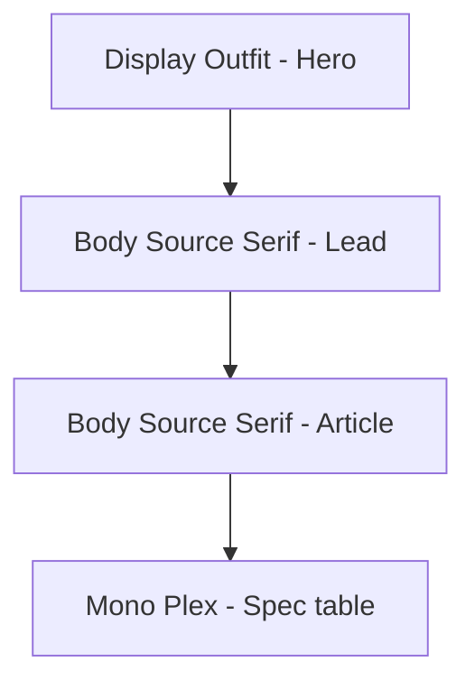

# 13 — Typography

## Purpose

Define Neurolinx type stacks, scale, weights, and usage rules. Typography must feel expressive and purposeful for a premium industrial-tech brand—**not** Inter, Roboto, Arial, or system UI fonts as primary marketing faces.

**Related docs:** [10_BRAND_GUIDELINES.md](./10_BRAND_GUIDELINES.md) · [11_DESIGN_SYSTEM.md](./11_DESIGN_SYSTEM.md) · [14_SPACING_AND_LAYOUT.md](./14_SPACING_AND_LAYOUT.md)

---

## Type roles

| Role | Purpose |
| --- | --- |
| Display | Hero and section titles; brand presence |
| Body | Long-form reading, UI copy, product descriptions |
| Mono | SKUs, specs, code-like technical values, datasheet figures |

---

## Recommended font stacks (provisional)

Licensing and final selection **TBD** with brand/marketing. Recommendations below are implementable and distinctive.

### Display — `Outfit` (geometric sans, engineering clarity)

```css
--nl-font-display: "Outfit", "Avenir Next", "Segoe UI", sans-serif;
```

**Why:** Modern, industrial, strong for headlines without sci-fi theatrics.  
**Fallback note:** System fallbacks are last-resort only; primary webfont must load for brand pages.

### Body — `Source Serif 4` (readable, premium editorial technical)

```css
--nl-font-body: "Source Serif 4", "Iowan Old Style", "Palatino Linotype", serif;
```

**Why:** Differentiates from generic SaaS sans-only sites; excellent for corporate storytelling and long specs intros.  
**UI exception:** Dense admin tables may use a secondary sans for compactness:

```css
--nl-font-ui: "IBM Plex Sans", "Helvetica Neue", sans-serif;
```

### Mono — `IBM Plex Mono`

```css
--nl-font-mono: "IBM Plex Mono", "Consolas", "Menlo", monospace;
```

**Why:** Technical credibility for SKUs, dimensions, protocol names.

### Banned as primary

| Font | Reason |
| --- | --- |
| Inter | Overused AI/SaaS default |
| Roboto | Generic Material default |
| Arial / Helvetica as primary brand | Undifferentiated |
| System UI stack as primary | Weak brand signal |

---

## CSS variables

```css
:root {
  --nl-font-display: "Outfit", "Avenir Next", "Segoe UI", sans-serif;
  --nl-font-body: "Source Serif 4", "Iowan Old Style", "Palatino Linotype", serif;
  --nl-font-ui: "IBM Plex Sans", "Helvetica Neue", sans-serif;
  --nl-font-mono: "IBM Plex Mono", "Consolas", "Menlo", monospace;

  --nl-font-weight-regular: 400;
  --nl-font-weight-medium: 500;
  --nl-font-weight-semibold: 600;
  --nl-font-weight-bold: 700;
}
```

Loading strategy: self-host or approved CDN; `font-display: swap`; subset weights actually used. Exact hosting **TBD**.

---

## Type scale

Base: `1rem = 16px`. Modular scale ~1.25.

| Token | Size | Line height | Typical use |
| --- | --- | --- | --- |
| `--nl-text-xs` | 0.75rem (12px) | 1.4 | Captions, legal footnotes |
| `--nl-text-sm` | 0.875rem (14px) | 1.45 | Meta, table secondary |
| `--nl-text-md` | 1rem (16px) | 1.6 | Body |
| `--nl-text-lg` | 1.125rem (18px) | 1.55 | Lead paragraphs |
| `--nl-text-xl` | 1.25rem (20px) | 1.4 | Small titles |
| `--nl-text-2xl` | 1.5rem (24px) | 1.3 | Section titles (mobile) |
| `--nl-text-3xl` | 1.875rem (30px) | 1.25 | Section titles |
| `--nl-text-4xl` | 2.25rem (36px) | 1.2 | Page titles |
| `--nl-text-5xl` | 3rem (48px) | 1.1 | Hero (desktop) |
| `--nl-text-6xl` | 3.75rem (60px) | 1.05 | Large hero (optional) |

Fluid type for heroes recommended via `clamp()`:

```css
--nl-text-hero: clamp(2.25rem, 1.5rem + 3vw, 3.75rem);
```

---

## Weight & tracking rules

| Element | Family | Weight | Tracking |
| --- | --- | --- | --- |
| Hero title | Display | 600–700 | Slightly tight (`-0.02em`) |
| Section title | Display | 600 | `-0.01em` |
| Body | Body | 400 | `0` |
| Lead | Body | 400–500 | `0` |
| UI labels | UI | 500 | `0.01em` optional |
| Buttons | UI or Display | 600 | `0.01em` |
| Spec keys/values | Mono / UI | 400–500 | `0` |
| Overlines / eyebrows | UI | 600 | `0.08em` uppercase sparingly |

Avoid all-caps for long phrases. Prefer sentence case for CTAs.

---

## Usage rules

1. **Brand test:** On marketing pages, display type should help the brand feel unique even without logo color.
2. **One display + one body** on a page; do not mix multiple display faces.
3. **Hierarchy:** No more than three distinct sizes competing in one section.
4. **Specs:** Use mono for SKUs, voltages, dimensions; keep units consistent.
5. **Admin:** Prefer `--nl-font-ui` for dense controls; body serif optional for long help text only.
6. **Measure:** Ideal body line length ~60–75 characters on desktop reading layouts.

---

## Pairing examples



| Context | Stack |
| --- | --- |
| Homepage hero | Display 5xl + Body lg lead |
| PDP title | Display 3xl/4xl |
| PDP specs | UI sm labels + Mono md values |
| Checkout | UI throughout for clarity |
| Blog | Display title + Body article |

---

## Functional requirements

| ID | Requirement |
| --- | --- |
| TYPE-F-01 | Font CSS variables defined and applied via utility classes. |
| TYPE-F-02 | Critical fonts preloaded on key marketing routes. |

## Non-functional requirements

| ID | Requirement |
| --- | --- |
| TYPE-N-01 | CLS avoided via metric-friendly fallbacks / size adjust **TBD**. |
| TYPE-N-02 | Only licensed weights shipped. |

## Dependencies

- Font license confirmation (**TBD**).
- Tailwind `fontFamily` theme mapping.

## Constraints

- Do not default marketing UI to Inter/Roboto/Arial.
- Do not use novelty/display fonts that reduce legibility.

## Acceptance criteria

- [ ] Display/body/mono loaded on public app.
- [ ] Type scale utilities match tokens.
- [ ] Hero typography passes brand test from [10_BRAND_GUIDELINES.md](./10_BRAND_GUIDELINES.md).

---

## Summary

Neurolinx typography pairs **Outfit** (display), **Source Serif 4** (body), and **IBM Plex Mono** (technical), with **IBM Plex Sans** for dense UI—expressive, industrial, and deliberately unlike generic SaaS stacks. Final licensing confirmation is TBD.
