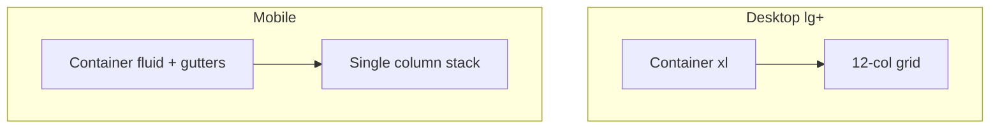

# 14 — Spacing and Layout

## Purpose

Define the Neurolinx spacing scale, grid, breakpoints, container widths, and section rhythm for consistent layout across marketing, product, and admin surfaces.

**Related docs:** [11_DESIGN_SYSTEM.md](./11_DESIGN_SYSTEM.md) · [13_TYPOGRAPHY.md](./13_TYPOGRAPHY.md) · [15_COMPONENT_LIBRARY.md](./15_COMPONENT_LIBRARY.md) · [55_RESPONSIVE_DESIGN.md](./55_RESPONSIVE_DESIGN.md)

---

## Principles

1. **4/8-based scale** — all spacing resolves to multiples of 4px.
2. **Rhythm over decoration** — whitespace creates hierarchy.
3. **One composition** — marketing first viewport is not a multi-widget dashboard.
4. **Consistent containers** — shared max-widths for readable content.
5. **Admin density** — optional compact multipliers without breaking the base scale.

---

## Spacing scale

| Token | Rem | Px | Common use |
| --- | --- | --- | --- |
| `--nl-space-0` | 0 | 0 | Reset |
| `--nl-space-1` | 0.25rem | 4 | Icon gaps, tight chips |
| `--nl-space-2` | 0.5rem | 8 | Label → input, inline gaps |
| `--nl-space-3` | 0.75rem | 12 | Compact stacking |
| `--nl-space-4` | 1rem | 16 | Default component padding |
| `--nl-space-5` | 1.25rem | 20 | Comfortable padding |
| `--nl-space-6` | 1.5rem | 24 | Card/internal sections* |
| `--nl-space-8` | 2rem | 32 | Group separation |
| `--nl-space-10` | 2.5rem | 40 | Small section gaps |
| `--nl-space-12` | 3rem | 48 | Medium section gaps |
| `--nl-space-16` | 4rem | 64 | Large section gaps |
| `--nl-space-20` | 5rem | 80 | Page section rhythm |
| `--nl-space-24` | 6rem | 96 | Hero/section breathing |
| `--nl-space-32` | 8rem | 128 | Rare major breaks |

\*Cards only when interaction requires a surface—see [15_COMPONENT_LIBRARY.md](./15_COMPONENT_LIBRARY.md).

```css
:root {
  --nl-space-1: 0.25rem;
  --nl-space-2: 0.5rem;
  --nl-space-3: 0.75rem;
  --nl-space-4: 1rem;
  --nl-space-5: 1.25rem;
  --nl-space-6: 1.5rem;
  --nl-space-8: 2rem;
  --nl-space-10: 2.5rem;
  --nl-space-12: 3rem;
  --nl-space-16: 4rem;
  --nl-space-20: 5rem;
  --nl-space-24: 6rem;
  --nl-space-32: 8rem;
}
```

### Admin density (optional)

```css
[data-density="compact"] {
  --nl-space-scale: 0.85;
}
```

Exact compact mapping **TBD** during admin implementation.

---

## Breakpoints

Mobile-first.

| Name | Min width | Token | Intent |
| --- | --- | --- | --- |
| `xs` | 0 | — | Base mobile |
| `sm` | 640px | `--nl-bp-sm` | Large phones |
| `md` | 768px | `--nl-bp-md` | Tablets |
| `lg` | 1024px | `--nl-bp-lg` | Small desktops |
| `xl` | 1280px | `--nl-bp-xl` | Desktops |
| `2xl` | 1536px | `--nl-bp-2xl` | Wide monitors |

Align Tailwind screens to these values.

---

## Containers

| Token | Max width | Use |
| --- | --- | --- |
| `--nl-container-sm` | 40rem (640px) | Narrow forms, auth |
| `--nl-container-md` | 48rem (768px) | Articles |
| `--nl-container-lg` | 72rem (1152px) | Standard marketing/content |
| `--nl-container-xl` | 80rem (1280px) | Catalog grids |
| `--nl-container-2xl` | 90rem (1440px) | Wide product/admin shells |

Gutters:

| Viewport | Horizontal padding |
| --- | --- |
| < md | `--nl-space-4` (16px) |
| md–lg | `--nl-space-6` (24px) |
| ≥ xl | `--nl-space-8` (32px) |

Full-bleed heroes ignore container max-width for media; text overlays still respect readable measure inside a container.

---

## Grid

### Marketing / content

- Default 12-column CSS grid at `lg+`.
- Common patterns: 12 (full), 7+5 (text + media), 6+6, 4+4+4.
- Mobile: single column stack; media may precede or follow text per page docs.

### Product listing

- Mobile: 1–2 columns.
- `md`: 2–3 columns.
- `xl`: 3–4 columns.
- Gap: `--nl-space-6` to `--nl-space-8`.

### Admin

- App shell: fixed/ sticky nav + fluid main.
- Content grids denser; tables preferred over card grids for data.



---

## Section rhythm

| Section type | Vertical padding (desktop) | Mobile |
| --- | --- | --- |
| Hero | Full viewport target (`min-h-[100svh]` guidance) | Allow content to stack without clipping CTAs |
| Standard band | `--nl-space-20`–`--nl-space-24` | `--nl-space-12`–`--nl-space-16` |
| Tight feature | `--nl-space-16` | `--nl-space-10` |
| Footer | `--nl-space-16` | `--nl-space-12` |

**Hero budget:** brand, one headline, one supporting sentence, one CTA group, one dominant visual—no stat strips or secondary promos in first viewport ([10_BRAND_GUIDELINES.md](./10_BRAND_GUIDELINES.md)).

Section title → body gap: typically `--nl-space-4` to `--nl-space-6`.  
Body → CTA gap: `--nl-space-6` to `--nl-space-8`.

---

## Z-index scale

| Token | Value | Use |
| --- | --- | --- |
| `--nl-z-base` | 0 | Content |
| `--nl-z-sticky` | 100 | Sticky header |
| `--nl-z-dropdown` | 200 | Menus |
| `--nl-z-overlay` | 300 | Backdrops |
| `--nl-z-modal` | 400 | Dialogs |
| `--nl-z-toast` | 500 | Toasts |
| `--nl-z-cursor` | 600 | Custom cursor |

---

## Radius & elevation (layout-adjacent)

| Token | Value | Use |
| --- | --- | --- |
| `--nl-radius-sm` | 4px | Inputs, small controls |
| `--nl-radius-md` | 8px | Buttons, interaction surfaces |
| `--nl-radius-lg` | 12px | Rare large surfaces |
| `--nl-radius-full` | 9999px | Avoid for marketing pills; use sparingly |

Elevation: prefer borders + subtle shadow sparingly; no multi-layer soft glow stacks.

---

## Functional requirements

| ID | Requirement |
| --- | --- |
| LAY-F-01 | Spacing utilities map to `--nl-space-*` tokens. |
| LAY-F-02 | Containers and breakpoints shared by Public app. |
| LAY-F-03 | Layouts remain usable at 320px width minimum. |

## Non-functional requirements

| ID | Requirement |
| --- | --- |
| LAY-N-01 | No horizontal scroll on standard breakpoints for core pages. |
| LAY-N-02 | Sticky header must not obscure focus targets. |

## Dependencies

- Tailwind theme screens/spacing.
- Page-level IA ([20_WEBSITE_INFORMATION_ARCHITECTURE.md](./20_WEBSITE_INFORMATION_ARCHITECTURE.md)).

## Constraints

- Do not invent ad-hoc spacing (e.g., 13px, 22px).
- Do not put dashboard-style multi-cards in marketing heroes.

## Acceptance criteria

- [ ] Token scale documented in CSS and Tailwind config.
- [ ] Homepage and PDP comply with container/gutter rules.
- [ ] Section rhythm reviewed against brand composition rules.

---

## Summary

Neurolinx layout uses a **4/8 spacing scale**, mobile-first breakpoints, shared containers, a 12-column desktop grid, and deliberate section rhythm—supporting premium marketing compositions and denser admin/product views without chaotic spacing.
