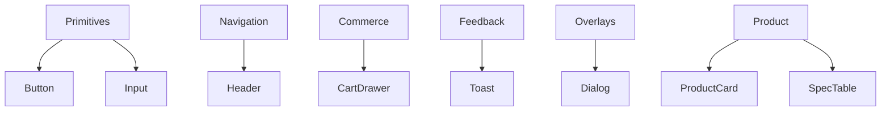

# 15 — Component Library

## Purpose

Inventory core UI components for Neurolinx Public and Admin apps: variants, states, and usage rules. Cards are **not** a default decoration—use them only when a surface improves interaction or understanding.

**Related docs:** [11_DESIGN_SYSTEM.md](./11_DESIGN_SYSTEM.md) · [12_COLOR_SYSTEM.md](./12_COLOR_SYSTEM.md) · [13_TYPOGRAPHY.md](./13_TYPOGRAPHY.md) · [14_SPACING_AND_LAYOUT.md](./14_SPACING_AND_LAYOUT.md) · [16_ICONOGRAPHY.md](./16_ICONOGRAPHY.md) · [18_MOTION_DESIGN.md](./18_MOTION_DESIGN.md) · [19_MOUSE_INTERACTIONS.md](./19_MOUSE_INTERACTIONS.md)

---

## Principles

| Principle | Rule |
| --- | --- |
| Token-driven | Colors/type/space from CSS variables |
| Interaction-first cards | If removing border/shadow/radius doesn't hurt UX, don't use a card |
| Accessibility | Focus-visible, keyboard, labels, ARIA as needed |
| Motion-aware | Respect reduced motion; cursor states via `19` |
| Consistency | Shared primitives across marketing and shop; admin may add dense variants |

---

## Inventory overview

---

## Primitives

### Button

| Item | Spec |
| --- | --- |
| Variants | `primary`, `secondary`, `tertiary`/`ghost`, `danger` |
| Sizes | `sm`, `md`, `lg` |
| States | default, hover, focus-visible, active, disabled, loading |
| Rules | One primary CTA per section cluster; loading shows spinner + disables re-submit |
| Cursor | `BUTTON` state ([19_MOUSE_INTERACTIONS.md](./19_MOUSE_INTERACTIONS.md)) |

### Link

| Item | Spec |
| --- | --- |
| Variants | inline, standalone, nav |
| States | default, hover, focus-visible, visited (optional policy **TBD**) |
| Cursor | `LINK` |

### Input / Textarea / Select

| Item | Spec |
| --- | --- |
| States | default, hover, focus, error, disabled, read-only |
| Required | Visible label (not placeholder-only); helper + error text |
| Admin | Compact size variant |

### Checkbox / Radio / Switch

| Item | Spec |
| --- | --- |
| Rules | Hit target ≥ 24px; associate labels; group legends for radios |

### Badge / StatusPill

| Item | Spec |
| --- | --- |
| Use | Stock status, order status—not hero stickers |
| Avoid | Floating promo badges on heroes |

---

## Navigation

### Header / NavBar

- Logo (brand-level), primary links, utility (search, account, cart).
- Mobile: disclosure menu; focus trap when open.
- Sticky behavior per [14_SPACING_AND_LAYOUT.md](./14_SPACING_AND_LAYOUT.md).

### Footer

- Sitemap clusters, legal links, contact; no competing primary marketing CTA overload.

### Breadcrumbs

- Catalog and content hierarchies; last item non-link.

### Tabs

- PDP sections or admin detail panes; keyboard arrow support.

---

## Product & commerce components

### ProductCard *(interaction surface)*

Allowed because users select/browse products.

| Item | Spec |
| --- | --- |
| Content | Image, name, key meta, price (**visibility TBD**), CTA |
| States | default, hover, focus, out-of-stock |
| Rules | Prefer minimal chrome; image is the anchor |
| Cursor | `VIEW` or `LINK` |

### ProductGallery

- Primary image + thumbnails; zoom affordance → cursor `ZOOM` / `IMAGE`.
- Keyboard-accessible thumbs.

### SpecTable

- Two-column key/value; mono for values where appropriate.
- Responsive: stacked rows on mobile.

### Price

- Formatting locale **TBD**; show/hide per BR-PROD-06.

### AddToCartButton / EnquireButton

- Driven by product commercial flags ([03_PRODUCT_REQUIREMENTS.md](./03_PRODUCT_REQUIREMENTS.md)).

### CartLineItem / CartSummary

- Quantity stepper, remove, subtotal; errors for stock issues (**rules TBD**).

### Checkout steps

- Progress indicator + form sections; avoid decorative cards—use clear field groups.

---

## Feedback & overlays

| Component | Notes |
| --- | --- |
| Toast | Transient success/error; do not replace form validation |
| Alert / InlineBanner | Page or section level notices |
| Dialog / Modal | Confirmations, compact forms; focus trap + ESC |
| Drawer | Cart/filters on mobile |
| Skeleton | Loading placeholders matching layout |
| EmptyState | Clear next action; no cartoon clutter |

---

## Media & 3D wrappers

| Component | Notes |
| --- | --- |
| ResponsiveImage | Uses [17_IMAGE_GUIDELINES.md](./17_IMAGE_GUIDELINES.md) |
| VideoEmbed | Lazy; captions **TBD** |
| ModelViewerShell | Hosts R3F canvas; fallback image; cursor `3D` / `ROTATE` / `DRAG` |

---

## Admin-oriented components

| Component | Notes |
| --- | --- |
| DataTable | Sort/filter/pagination; dense |
| PageHeader | Title + primary actions |
| FormSection | Group related fields without heavy card chrome unless needed |
| FileUploader | Secure upload UX per `93` |
| StatWidget | Dashboard only—never on public heroes |

---

## State matrix (shared)

| State | Visual | Interaction |
| --- | --- | --- |
| Default | Semantic tokens | — |
| Hover | Darken/lighten action or border | Cursor update |
| Focus-visible | Focus ring token | Keyboard only highlight |
| Active | Pressed teal/navy | — |
| Disabled | Reduced opacity + `aria-disabled` | No pointer events |
| Loading | Spinner / aria-busy | Block duplicate submits |
| Error | Error color + message | Announce via aria-live when needed |

---

## Motion hooks

Components may use Framer Motion / CSS for:

- Button press micro-feedback
- Drawer/modal enter-exit
- List reorder (admin)

Do not animate layout shift that harms CLS. Details: [18_MOTION_DESIGN.md](./18_MOTION_DESIGN.md).

---

## Functional requirements

| ID | Requirement |
| --- | --- |
| CMP-F-01 | Core primitives implemented before page assembly. |
| CMP-F-02 | Components expose accessible names and keyboard behavior. |
| CMP-F-03 | ProductCard used for product interaction lists; not for static marketing blurb grids by default. |

## Non-functional requirements

| ID | Requirement |
| --- | --- |
| CMP-N-01 | Tree-shakeable; avoid mega UI kits that fight tokens. |
| CMP-N-02 | Visual regression coverage for primary/secondary buttons and inputs. |

## Dependencies

- Design tokens `12`–`14`
- Lucide ([16_ICONOGRAPHY.md](./16_ICONOGRAPHY.md))
- Cursor system ([19_MOUSE_INTERACTIONS.md](./19_MOUSE_INTERACTIONS.md))

## Constraints

- No hero card grids or floating badge components on heroes.
- No purple component themes.

## Acceptance criteria

- [ ] Storybook or equivalent docs **TBD** tooling—at minimum markdown + examples in repo.
- [ ] Button/Input/Nav/ProductCard meet a11y checks.
- [ ] Cursor states wired for Link/Button/Product/3D where custom cursor enabled.

---

## Summary

The component library prioritizes **accessible primitives**, restrained surfaces, and **interaction-justified** product cards—integrated with motion and mouse guidelines for a premium industrial-tech UI.
