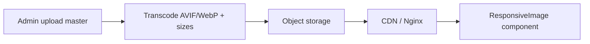

# 17 — Image Guidelines

## Purpose

Define how Neurolinx sources, formats, delivers, and presents imagery across corporate, product, and marketing surfaces—prioritizing authentic assets and performance.

**Related docs:** [10_BRAND_GUIDELINES.md](./10_BRAND_GUIDELINES.md) · [11_DESIGN_SYSTEM.md](./11_DESIGN_SYSTEM.md) · [32_PRODUCT_DETAILS.md](./32_PRODUCT_DETAILS.md) · [36_PRODUCT_MEDIA.md](./36_PRODUCT_MEDIA.md) · [68_FILE_STORAGE.md](./68_FILE_STORAGE.md) · [102_PERFORMANCE_STANDARDS.md](./102_PERFORMANCE_STANDARDS.md)

---

## Principles

1. **Prefer original Neurolinx photography** and professionally produced product imagery.
2. **No generic stock** when authentic assets are available.
3. **Real visual anchors** — product, place, engineering context—not abstract gradients as the main idea.
4. **Performance-aware** — modern formats, responsive sizes, lazy-loading.
5. **Accessible** — meaningful alt text; decorative images handled correctly.

---

## Approved subject matter

| Category | Examples |
| --- | --- |
| Products | Packshots, detail crops, in-situ installs |
| Engineering | PCB, assembly, testing benches |
| Manufacturing | Lines, QA, tooling (approved access only) |
| R&D | Labs, prototyping (non-confidential) |
| Automation / IoT | Gateways, sensors, deployments |
| Industrial systems | Panels, enclosures, field context |
| Team / company | Approved people photography |
| Projects | Case-study sites with client permission **TBD** |

**Confidentiality:** Never publish unreleased IP, customer-secret installations, or unmarked prototypes. Approval workflow **TBD**.

---

## Formats & delivery

| Topic | Standard |
| --- | --- |
| Preferred formats | **AVIF** and/or **WebP** with JPEG/PNG fallback as needed |
| Masters | Keep high-quality masters in DAM/storage; do not serve RAW to web |
| Responsive | `srcset` / `sizes` or framework image helper |
| Lazy loading | Native `loading="lazy"` below fold; LCP image eager + priority |
| CDN | **TBD** provider; still apply format/size rules locally |

### Suggested width set (product/marketing)

| Name | Width (px) |
| --- | --- |
| `xs` | 320 |
| `sm` | 640 |
| `md` | 960 |
| `lg` | 1280 |
| `xl` | 1920 |
| `hero` | 2400 (cap; weigh quality vs weight) |

Exact generation pipeline in admin/media docs (`76`, `68`).

---

## Product imagery rules

| Rule | Detail |
| --- | --- |
| Primary image | Clean product on neutral or approved backdrop; consistent lighting set |
| Gallery | Detail, scale, ports/interfaces, lifestyle/in-situ if authentic |
| Consistency | Similar crop/angle within a category for listing grids |
| 3D companion | Still provide 2D fallback for every 3D product |
| Watermarks | Avoid heavy watermarks on catalog images |
| Text overlays | Prefer HTML text over burned-in marketing copy |

---

## Corporate / hero imagery

- Full-bleed heroes by default on promotional pages ([10_BRAND_GUIDELINES.md](./10_BRAND_GUIDELINES.md)).
- No inset rounded media cards as the default hero treatment.
- No floating badges/chips on hero media.
- Ensure contrast for any text placed on image (scrim if needed—keep subtle).

---

## Stock imagery policy

| Situation | Action |
| --- | --- |
| Authentic Neurolinx asset exists | Use it |
| Temporary placeholder during build | Mark as placeholder; replace before launch |
| No authentic asset | Commission or generate **approved** product imagery; avoid random stock |
| Abstract tech stock (neon server rooms) | Discouraged; fails brand authenticity |

---

## Alt text & SEO

| Type | Alt guidance |
| --- | --- |
| Product primary | Include product name + distinguishing trait |
| Decorative | Empty alt (`alt=""`) |
| Complex diagram | Short alt + longer description nearby if needed |
| Team | Name + role when relevant |

File naming: descriptive kebab-case (`neurolinx-gateway-x200-front.webp`), not `IMG_1234`.

---

## Technical constraints

| Constraint | Value |
| --- | --- |
| Max upload size | **TBD** (see `93`) |
| Allowed MIME | jpeg, png, webp, avif, (+ svg carefully) |
| SVG | Sanitize; prefer Lucide for UI icons |
| Aspect ratios | Listing common ratio **TBD** (e.g., 4:3 or 1:1)—lock before bulk shoot |

---

## Functional requirements

| ID | Requirement |
| --- | --- |
| IMG-F-01 | Public components consume optimized derivatives, not masters. |
| IMG-F-02 | PDP and listing images provide responsive sources. |
| IMG-F-03 | Admin media library stores metadata (alt, title, product links). |

## Non-functional requirements

| ID | Requirement |
| --- | --- |
| IMG-N-01 | LCP image optimized; avoid huge heroes without compression. |
| IMG-N-02 | CLS controlled via width/height or aspect-ratio boxes. |

## Dependencies

- [76_ADMIN_MEDIA_MANAGEMENT.md](./76_ADMIN_MEDIA_MANAGEMENT.md)
- [68_FILE_STORAGE.md](./68_FILE_STORAGE.md)
- [93_FILE_UPLOAD_SECURITY.md](./93_FILE_UPLOAD_SECURITY.md)

## Constraints

- Do not hotlink unlicensed third-party images.
- Do not invent customer project photos.

## Acceptance criteria

- [ ] Image pipeline produces WebP/AVIF derivatives.
- [ ] Core templates use ResponsiveImage patterns.
- [ ] Placeholder stock purged before production launch.
- [ ] Alt text present on product primaries.

---

## Summary

Neurolinx imagery prioritizes **authentic product and engineering photography**, modern **WebP/AVIF** delivery, responsive sizing, and accessibility—rejecting generic stock when real assets can tell the brand story.
