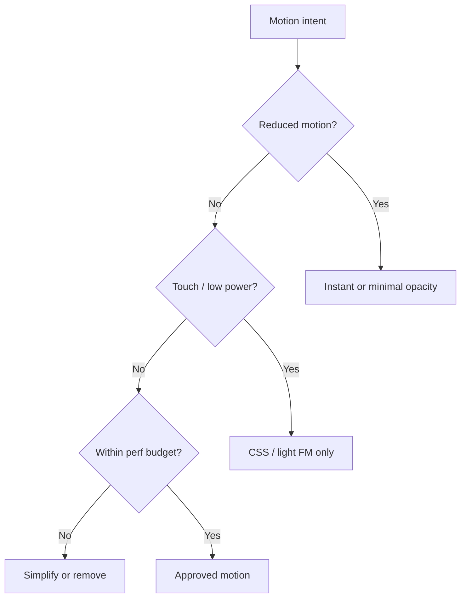

# 18 — Motion Design

## Purpose

Define motion standards for Neurolinx using **GSAP**, **Framer Motion**, and **Lenis**: allowed experiences, performance/accessibility constraints, and `prefers-reduced-motion` behavior.

**Related docs:** [10_BRAND_GUIDELINES.md](./10_BRAND_GUIDELINES.md) · [11_DESIGN_SYSTEM.md](./11_DESIGN_SYSTEM.md) · [15_COMPONENT_LIBRARY.md](./15_COMPONENT_LIBRARY.md) · [19_MOUSE_INTERACTIONS.md](./19_MOUSE_INTERACTIONS.md) · [101_ACCESSIBILITY.md](./101_ACCESSIBILITY.md) · [102_PERFORMANCE_STANDARDS.md](./102_PERFORMANCE_STANDARDS.md)

---

## Motion philosophy

Motion creates **presence and hierarchy**, not noise.

| Do | Don't |
| --- | --- |
| Short, purposeful transitions | Endless loops that distract |
| Reveal content as user scrolls thoughtfully | Parallax that harms readability |
| Coordinate with brand calm confidence | Neon particle spectacle by default |
| Respect device and a11y constraints | Force heavy animation on low-end mobile |

---

## Technology roles

| Tool | Role |
| --- | --- |
| **Framer Motion** | React component enter/exit, layout transitions, micro-interactions |
| **GSAP** | Complex timelines, scroll-triggered sequences, hero orchestration |
| **Lenis** | Smooth scrolling where enabled and appropriate |
| CSS | Simple hovers, focus, opacity/transform micro-feedback |
| R3F / Three.js | 3D-specific motion (see `80`–`84`)—not a substitute for UI motion system |

Do not use all three libraries on every page. Prefer the lightest tool that meets the need.

---

## Motion tokens

```css
:root {
  --nl-motion-duration-fast: 150ms;
  --nl-motion-duration-base: 250ms;
  --nl-motion-duration-slow: 400ms;
  --nl-motion-ease-standard: cubic-bezier(0.2, 0.8, 0.2, 1);
  --nl-motion-ease-emphasized: cubic-bezier(0.2, 0.0, 0, 1);
}
```

Longer cinematic timelines only for approved hero moments; still interruptible and skippable under reduced motion.

---

## Allowed experiences

| Experience | Allowed | Guidance |
| --- | --- | --- |
| Hero entrance | Yes | Brand + headline + CTA + media; 2–3 intentional motions max in first viewport |
| Scroll section reveals | Yes | Subtle fade/translate; once per section |
| Page transitions | Yes (sparingly) | Must not block navigation or hurt LCP/INP |
| Product hover | Yes | Image/title emphasis; no bouncing |
| Magnetic buttons | Optional | Desktop only; disable on touch/reduced motion |
| Custom cursor coupling | Yes | Per [19_MOUSE_INTERACTIONS.md](./19_MOUSE_INTERACTIONS.md) |
| Parallax | Limited | Small range; never hide critical text |
| Particle effects | Rare | Only if brand-approved and perf-budgeted; default off |
| 3D rotate/auto-spin | Controlled | User-initiated preferred; auto-spin off under reduced motion |
| Lenis smooth scroll | Optional | Disable on reduced motion / when it breaks a11y expectations |

---

## Non-negotiable constraints

Animations must **never** compromise:

1. **Performance** — respect Core Web Vitals budgets (`102`).
2. **Accessibility** — keyboard users, AT users, vestibular sensitivity.
3. **Readability** — text must remain stable enough to read.
4. **Navigation** — menus and links remain immediately usable.
5. **Mobile usability** — reduce or replace heavy effects on small/low-power devices.



---

## `prefers-reduced-motion`

When `prefers-reduced-motion: reduce`:

| Behavior | Requirement |
| --- | --- |
| Lenis | Disabled; native scroll |
| GSAP/FM entrance | Skip to final state or use ≤150ms opacity only |
| Auto-playing decorative loops | Off |
| Page transitions | Instant or crossfade ≤150ms |
| 3D auto-rotate | Off |
| Custom cursor animations | Off / simplified per `19` |
| Scroll scrubbing animations | Disabled; show static layouts |

Implement a shared `useMotionPreference()` (name TBD) consumed by motion wrappers.

---

## Performance guidelines

| Guideline | Detail |
| --- | --- |
| Prefer transform/opacity | Avoid animating width/top/left that trigger layout |
| Contain effects | `will-change` sparingly and temporarily |
| Lazy init | Create GSAP scrolls only when sections near viewport |
| Mobile | Default to reduced choreography; no multi-timeline heroes |
| Bundle | Code-split heavy GSAP plugins; load on routes that need them |
| Compete with 3D | Do not run heavy scroll timelines atop active WebGL without profiling |

---

## Implementation patterns

### Framer Motion (UI)

- `initial` / `animate` / `exit` for drawers/modals.
- Variants shared from `motionVariants.ts`.
- `MotionConfig reducedMotion="user"`.

### GSAP (orchestration)

- Central registry to kill tweens on unmount.
- ScrollTrigger cleanup mandatory.
- Avoid animating React-managed layout without reconciliation strategy.

### Lenis

- Single app-level instance when enabled.
- Sync with ScrollTrigger if both used (documented integration pattern).
- Provide toggle or auto-disable for reduced motion.

---

## Functional requirements

| ID | Requirement |
| --- | --- |
| MOT-F-01 | Shared motion tokens and preference hook exist. |
| MOT-F-02 | Homepage ships at least 2–3 intentional motions when motion allowed. |
| MOT-F-03 | All motion paths have reduced-motion equivalents. |

## Non-functional requirements

| ID | Requirement |
| --- | --- |
| MOT-N-01 | Motion must not cause persistent jank on target mid-tier mobile **TBD** device list. |
| MOT-N-02 | No animation blocks first input on LCP critical path. |

## Dependencies

- Frontend architecture (`50`–`54`)
- Accessibility (`101`)
- 3D performance (`84`) when combined with WebGL

## Constraints

- Do not add particle/glow spectacles as default theme.
- Do not require motion to convey essential information.

## Acceptance criteria

- [ ] Reduced-motion mode verified on Home, PDP, Cart drawer.
- [ ] Lenis disabled under reduced motion.
- [ ] Performance budget checks include motion-heavy routes.
- [ ] Mobile QA shows usable experience without desktop-only effects.

---

## Summary

Neurolinx motion uses **GSAP + Framer Motion + optional Lenis** for purposeful premium presence. Performance, accessibility, readability, navigation, and mobile usability always win over spectacle; `prefers-reduced-motion` is mandatory.
