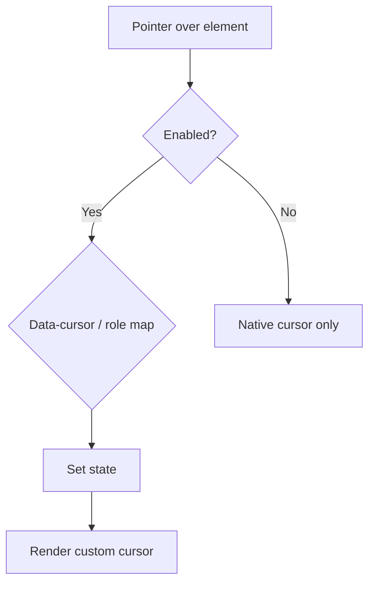

# 19 — Mouse Interactions

## Purpose

Specify the Neurolinx custom cursor system: states, behaviors, enablement rules, and accessibility constraints. Custom cursors are a premium desktop enhancement—not required for task completion.

**Related docs:** [15_COMPONENT_LIBRARY.md](./15_COMPONENT_LIBRARY.md) · [18_MOTION_DESIGN.md](./18_MOTION_DESIGN.md) · [83_3D_PRODUCT_INTERACTIONS.md](./83_3D_PRODUCT_INTERACTIONS.md) · [101_ACCESSIBILITY.md](./101_ACCESSIBILITY.md)

---

## Goals

| Goal | Detail |
| --- | --- |
| Clarity | Cursor state communicates affordance (view, drag, rotate) |
| Restraint | Small, precise, industrial—not oversized novelty cursors |
| Safety | Auto-disable on touch, mobile, a11y, and reduced motion |
| Performance | rAF-throttled; no layout thrash |

---

## Cursor states

| State | Typical target | Visual intent | Label / hint |
| --- | --- | --- | --- |
| `DEFAULT` | Page background | Small precise dot/ring | — |
| `LINK` | Text/nav links | Emphasize clickable | — |
| `BUTTON` | Buttons / primary controls | Interactive affordance | — |
| `VIEW` | Product cards / view more | Suggest exploration | Optional “View” |
| `DRAG` | Draggable UI / sliders | Grab affordance | “Drag” |
| `ROTATE` | 3D orbit controls | Rotation affordance | “Rotate” |
| `ZOOM` | Zoomable images / 3D zoom | Zoom affordance | “Zoom” |
| `IMAGE` | Image galleries / lightbox entry | Media focus | “View” |
| `3D` | 3D canvas hotspot (generic) | Entering 3D context | Optional “3D” |
| `TEXT` | Selectable text / inputs | I-beam or text-friendly | — |

```text
Default → small cursor
Button → interactive cursor
3D model → "Rotate"
Image → "View"
Draggable area → "Drag"
```

Exact SVG/CSS artwork **TBD** with design; behavior contract above is normative.

---

## State resolution



### Suggested attribute API

```html
<a data-cursor="link">...</a>
<button data-cursor="button">...</button>
<div data-cursor="rotate"> <!-- R3F canvas shell -->
```

Priority: deepest element with explicit `data-cursor` wins; otherwise infer from semantics (`a`, `button`, `input`, `[role="button"]`).

---

## Enablement & disable rules

Custom cursor **must disable or simplify** when any of the following is true:

| Condition | Behavior |
| --- | --- |
| Touch / coarse pointer (`pointer: coarse`) | Off — native cursors/N/A |
| Mobile / small viewports (e.g. `< lg`) | Off |
| `prefers-reduced-motion: reduce` | Off or static minimal |
| User a11y setting / OS force | Off (**expose site toggle TBD**) |
| Prefers reduced data / low power **TBD** | Prefer off |
| Admin app | Default off (productivity) |
| Typing in inputs | `TEXT` or native I-beam; do not obscure caret |

When disabled: restore `cursor` CSS to browser defaults; unmount custom cursor layer.

---

## Interaction details

| Topic | Rule |
| --- | --- |
| Native cursor | Hide (`cursor: none`) only while custom cursor active and enabled |
| Hit testing | Custom cursor is visual only; does not capture events |
| Mixing with 3D | Canvas may set `ROTATE`/`DRAG`/`ZOOM` via pointer mode from R3F controls |
| Scroll | Cursor may soften during scroll; avoid heavy trail FX |
| Magnetic pull | Optional for buttons; desktop + motion-ok only |
| Labels | Short (≤12 chars); not full sentences |
| Contrast | Visible on light and dark sections (dual-tone ring **TBD**) |

---

## Performance

| Requirement | Detail |
| --- | --- |
| Position updates | `requestAnimationFrame`; transform-only |
| DOM | Single cursor element (dot + optional label) |
| No layout reads | Avoid `getBoundingClientRect` per move unless necessary for magnets |
| Cleanup | Remove listeners on disable/unmount |

---

## Accessibility

| Requirement | Detail |
| --- | --- |
| Non-essential | All affordances also available without custom cursor |
| Focus | Keyboard focus rings remain visible; cursor system does not replace focus |
| Screen readers | Cursor labels are visual only; not announced |
| Vestibular | No large trailing smears or rapid oscillation |

---

## Functional requirements

| ID | Requirement |
| --- | --- |
| CUR-F-01 | Implement state enum covering all listed states. |
| CUR-F-02 | Provide enablement gate used app-wide. |
| CUR-F-03 | Wire ProductCard, links, buttons, images, 3D shell to states. |

## Non-functional requirements

| ID | Requirement |
| --- | --- |
| CUR-N-01 | Zero custom cursor cost on touch devices (code-split ok). |
| CUR-N-02 | Must not raise INP unreasonably on dense pages. |

## Dependencies

- [18_MOTION_DESIGN.md](./18_MOTION_DESIGN.md)
- [15_COMPONENT_LIBRARY.md](./15_COMPONENT_LIBRARY.md)
- 3D interaction modes in [83_3D_PRODUCT_INTERACTIONS.md](./83_3D_PRODUCT_INTERACTIONS.md)

## Constraints

- Do not implement custom cursor as the only indicator of interactivity.
- Do not use playful cartoon cursors misaligned with industrial brand.

## Acceptance criteria

- [ ] Desktop fine-pointer: states change correctly on Home, PDP, 3D viewer.
- [ ] Touch device / reduced motion: custom cursor absent; native UX intact.
- [ ] Inputs show text-friendly cursor behavior.
- [ ] Admin defaults to native cursor.

---

## Summary

Neurolinx custom cursors expose clear affordances (`DEFAULT` through `TEXT`) for premium desktop exploration of links, products, images, and 3D—automatically disabling on touch, mobile, accessibility configurations, and reduced motion so core usability never depends on the effect.
