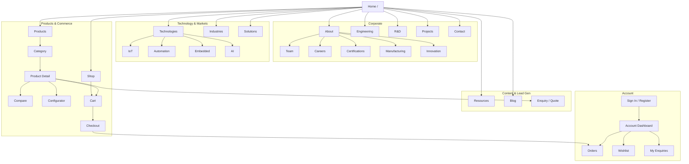

# 20 — Website Information Architecture

## Purpose

Define the complete public information architecture (IA) for the Neurolinx platform: primary sections, page hierarchy, shop/account flows, and how corporate, technology, and e-commerce experiences connect.

This document is the structural source of truth for routing, navigation, SEO URL design, and page inventory.

## Related Documents

- [21_PAGE_INVENTORY.md](./21_PAGE_INVENTORY.md) — page-level purpose, CTAs, SEO, auth
- [22_NAVIGATION.md](./22_NAVIGATION.md) — primary, secondary, footer, mobile, mega-menus
- [23_HOMEPAGE_DESIGN.md](./23_HOMEPAGE_DESIGN.md) — homepage composition rules
- [24_COMPANY_PAGES.md](./24_COMPANY_PAGES.md) — About and corporate pages
- [25_TECHNOLOGY_PAGES.md](./25_TECHNOLOGY_PAGES.md) — technology capability pages
- [26_INDUSTRY_PAGES.md](./26_INDUSTRY_PAGES.md) — industry landing pattern
- [27_CONTACT_AND_ENQUIRY.md](./27_CONTACT_AND_ENQUIRY.md) — contact and B2B enquiry
- [30_PRODUCT_ARCHITECTURE.md](./30_PRODUCT_ARCHITECTURE.md) — product domain model
- [40_ECOMMERCE_ARCHITECTURE.md](./40_ECOMMERCE_ARCHITECTURE.md) — shop flows (when present)
- [100_SEO_STRATEGY.md](./100_SEO_STRATEGY.md) — URL and sitemap strategy (when present)

## Requirements

1. Support a premium **corporate technology** experience and a **B2B/B2C e-commerce** experience in one coherent site.
2. Make Products, Technologies, Industries, Engineering, R&D, and Shop discoverable without competing for primary hierarchy.
3. Support account, cart, checkout, and B2B enquiry as first-class flows.
4. Use stable, SEO-friendly URL patterns that map cleanly to React Router routes.
5. Mark unknown business specifics (exact industry list, legal entities, office addresses) as **TBD**.

## Technical Decisions

| Decision | Choice | Rationale |
|---|---|---|
| Primary IA model | Hybrid corporate + commerce | Master spec requires both enterprise credibility and shop capability |
| URL style | Lowercase kebab-case paths | Predictable SEO and routing |
| Product URLs | `/products/:categorySlug/:productSlug` | Category context retained for SEO and breadcrumbs |
| Shop entry | `/shop` aliases product catalog discovery | Clear commerce intent without duplicating catalog logic |
| Content CMS pages | Slug-driven under `/resources`, `/blog` | Admin-managed without hardcoding every article |
| Locale | Single-locale initially (**TBD** for i18n) | Avoid premature localization complexity |
| Stack alignment | React Router on Vite SPA + Spring Boot API | Public routes are frontend; data/auth via REST |

## Full IA Tree

```text
/
├── Home                                    /
├── About                                   /about
│   ├── Company Overview                    /about
│   ├── Team                                /about/team
│   ├── Careers                             /careers
│   ├── Certifications                      /about/certifications
│   ├── Manufacturing                       /about/manufacturing
│   └── Innovation                          /about/innovation
├── Products                                /products
│   ├── Category listing                    /products/:categorySlug
│   ├── Product detail (PDP)                /products/:categorySlug/:productSlug
│   ├── Compare                             /products/compare
│   └── Configurator (if enabled)           /products/.../:productSlug/configure
├── Solutions                               /solutions
│   └── Solution detail                     /solutions/:slug
├── Technologies                            /technologies
│   ├── IoT                                 /technologies/iot
│   ├── Automation                          /technologies/automation
│   ├── Embedded Systems                    /technologies/embedded
│   └── AI                                  /technologies/ai
├── Industries                              /industries
│   └── Industry landing                    /industries/:slug
├── Engineering                             /engineering
├── R&D                                     /rd
├── Projects                                /projects
│   └── Project detail                      /projects/:slug
├── Resources                               /resources
│   ├── Resource hub                        /resources
│   ├── Datasheets / docs index             /resources/documents
│   └── Resource detail                     /resources/:slug
├── Blog                                    /blog
│   ├── Article                             /blog/:slug
│   └── Category/tag filter                 /blog?tag=:tag  (or /blog/tag/:slug — TBD)
├── Contact                                 /contact
├── Enquiry                                 /enquiry
│   └── Quote request (product-linked)      /enquiry/quote?product=:id
├── Shop                                    /shop
│   ├── Catalog (filters/search)            /shop
│   ├── Category                            /shop/:categorySlug
│   └── Product detail (commerce view)      /shop/:categorySlug/:productSlug
│       (may deep-link to Products PDP — TBD single vs dual URL strategy)
├── Account                                 /account
│   ├── Sign in                             /account/sign-in
│   ├── Register                            /account/register
│   ├── Dashboard                           /account
│   ├── Orders                              /account/orders
│   ├── Order detail                        /account/orders/:orderId
│   ├── Addresses                           /account/addresses
│   ├── Wishlist                            /account/wishlist
│   ├── Quotations / enquiries              /account/enquiries
│   └── Profile / settings                  /account/settings
├── Cart                                    /cart
├── Checkout                                /checkout
│   ├── Shipping                            /checkout/shipping
│   ├── Payment                             /checkout/payment
│   └── Confirmation                        /checkout/confirmation
└── Legal (required shell; content TBD)
    ├── Privacy                             /legal/privacy
    ├── Terms                               /legal/terms
    └── Cookies                             /legal/cookies
```

### Notes on Products vs Shop

- **Products** emphasizes engineering showcase, specs, 3D, datasheets, and B2B CTAs.
- **Shop** emphasizes commerce discovery, pricing visibility, cart, and checkout.
- Preferred implementation: **one product domain model**, two presentation intents (corporate PDP vs commerce PDP), with canonical URL strategy **TBD** (single canonical vs intentional dual entry).

## Mermaid Sitemap



## Functional Requirements (FR)

| ID | Requirement |
|---|---|
| FR-IA-01 | Every public section in the master IA tree must have a defined route and breadcrumb path. |
| FR-IA-02 | Product detail pages must be reachable from Products, Shop, search, and related-product links. |
| FR-IA-03 | Enquiry/quote entry points must accept optional product context via query or path. |
| FR-IA-04 | Account, cart, and checkout routes must be present even if some commerce features ship later behind feature flags. |
| FR-IA-05 | Legal pages must exist as routes; legal copy is TBD. |
| FR-IA-06 | 404 and maintenance routes must be defined at implementation time. |

## Non-Functional Requirements (NFR)

| ID | Requirement |
|---|---|
| NFR-IA-01 | URL structure must remain stable after launch; breaking changes require redirect mapping. |
| NFR-IA-02 | IA depth should generally stay within 3 levels for primary journeys. |
| NFR-IA-03 | Sitemap generation must cover all indexable public routes. |
| NFR-IA-04 | Auth-gated routes must not leak private content to crawlers. |

## Dependencies

- Brand and design system docs (`10`–`19`) for page composition consistency
- Product architecture (`30`–`36`) for product/category URL entities
- Auth and account docs (`45`, `63`, `64`) for account route behavior
- SEO strategy (`100`) for canonicalization and sitemap

## Constraints

- Do not invent specific industry, product category, or office location lists beyond generic placeholders marked TBD.
- Do not assume multi-brand or multi-region sites unless approved later.
- Admin platform routes are out of scope for public IA (see admin docs `70`+).

## Acceptance Criteria

- [ ] Full IA tree is documented with paths for Home, About subtree, Products, Solutions, Technologies, Industries, Engineering, R&D, Projects, Resources, Blog, Contact, Enquiry, Shop, Account, Cart, Checkout, Legal.
- [ ] Mermaid sitemap reflects primary relationships.
- [ ] Products vs Shop relationship is explicitly decided or marked TBD with options.
- [ ] Cross-links exist to navigation, page inventory, and contact/enquiry docs.
- [ ] Unknown business facts are marked TBD.
