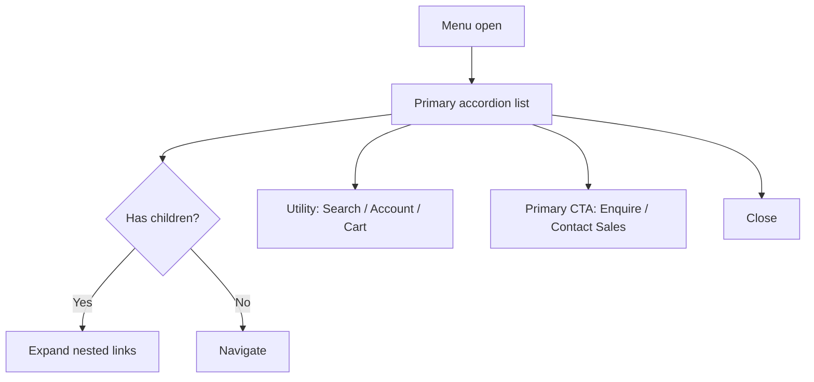

# 22 — Navigation

## Purpose

Define primary, secondary, footer, and mobile navigation for Neurolinx, including mega-menu considerations for Products and Technologies. Navigation must support premium corporate credibility and efficient commerce discovery.

## Related Documents

- [20_WEBSITE_INFORMATION_ARCHITECTURE.md](./20_WEBSITE_INFORMATION_ARCHITECTURE.md)
- [21_PAGE_INVENTORY.md](./21_PAGE_INVENTORY.md)
- [15_COMPONENT_LIBRARY.md](./15_COMPONENT_LIBRARY.md)
- [18_MOTION_DESIGN.md](./18_MOTION_DESIGN.md)
- [19_MOUSE_INTERACTIONS.md](./19_MOUSE_INTERACTIONS.md)
- [55_RESPONSIVE_DESIGN.md](./55_RESPONSIVE_DESIGN.md)
- [101_ACCESSIBILITY.md](./101_ACCESSIBILITY.md)

## Requirements

1. Persistent global header with brand-dominant logo lockup.
2. Clear paths to Products, Shop, Technologies, and Contact/Sales.
3. Mega-menus for dense product/technology hierarchies without trapping focus.
4. Mobile navigation that is usable one-handed and keyboard accessible.
5. Footer must cover company, product, support, legal, and contact essentials.

## Technical Decisions

| Decision | Choice | Rationale |
|---|---|---|
| Header pattern | Sticky/compact on scroll | Keeps brand + CTA available without dominating hero |
| Products nav | Mega-menu (categories + featured) | Supports deep catalog without endless dropdowns |
| Technologies nav | Mega-menu or structured dropdown | Capability areas are few but benefit from descriptions |
| Shop entry | Header utility + primary nav item | Dual corporate/commerce intent |
| Cart/account | Header utility cluster (right) | Standard commerce pattern |
| Mobile | Full-screen or drawer with accordion sections | Avoid mega-menu on small screens |
| Active state | Path-prefix match | Clear orientation |

## Primary Navigation (Desktop)

Proposed order (left → right after logo):

| Item | Target | Behavior |
|---|---|---|
| Products | `/products` | Mega-menu |
| Solutions | `/solutions` | Dropdown or simple link (**TBD** if solution count is low) |
| Technologies | `/technologies` | Mega-menu |
| Industries | `/industries` | Dropdown of industry landings |
| Engineering | `/engineering` | Direct link |
| R&D | `/rd` | Direct link |
| Projects | `/projects` | Direct link |
| Resources | `/resources` | Dropdown (Documents, Blog entry optional) |
| Shop | `/shop` | Direct link (commerce emphasis) |
| About | `/about` | Dropdown (Team, Certifications, Manufacturing, Innovation, Careers) |
| Contact | `/contact` | Direct link |

### Header Utility Cluster (Right)

| Control | Target | Notes |
|---|---|---|
| Search | Overlay or `/search` | Product + content search |
| Wishlist | `/account/wishlist` | Auth may prompt |
| Cart | `/cart` | Badge with count |
| Account | `/account` or sign-in | Avatar/menu when authenticated |
| Contact Sales / Enquire | `/enquiry` or `/contact` | High-intent B2B CTA — exact label **TBD** |

## Secondary Navigation

Used within section hubs (not global):

| Context | Secondary items |
|---|---|
| About | Overview, Team, Certifications, Manufacturing, Innovation, Careers |
| Technologies | Overview, IoT, Automation, Embedded, AI |
| Products / Shop | Categories, Filters (page chrome), Compare tray |
| Account | Dashboard, Orders, Addresses, Wishlist, Enquiries, Settings |
| Checkout | Progress steps: Cart → Shipping → Payment → Confirmation |

## Footer Navigation

```text
Company                 Products / Shop          Support                 Legal
- About                 - All Products           - Contact               - Privacy
- Careers               - Categories (dynamic)   - Enquiry / Quote       - Terms
- Certifications        - Shop                   - Resources / Docs      - Cookies
- Manufacturing         - Compare                - Blog
- Innovation                                     - FAQs (TBD)
- Engineering
- R&D
- Projects
- Industries
- Technologies
```

Footer also includes:

- Brand lockup + short positioning line (**TBD** approved tagline)
- Contact details (**TBD** address, phones, emails)
- Social links (**TBD** channels)
- Newsletter signup (**TBD** whether included at launch)
- Copyright

## Mega-Menu: Products

### Goals

- Surface categories quickly
- Highlight featured or new products without overcrowding
- Provide shortcuts to Shop, Compare, and Request Quote

### Layout (Desktop)

```text
┌────────────────────────────────────────────────────────────────┐
│ Categories (col 1-2)     Featured (col 3)     Shortcuts (col 4) │
│ - Category A             [Product card/media] - All Products    │
│ - Category B             Title + short line   - Shop            │
│ - Category C             View product CTA     - Request Quote   │
│ - View all categories                         - Compare         │
└────────────────────────────────────────────────────────────────┘
```

### Rules

- Prefer text + optional thumbnail; avoid dense card grids in the menu.
- Featured block is optional and CMS-driven.
- Exact category list is **TBD** from product catalog.
- Mega-menu must be hover **and** click accessible; keyboard operable; Escape closes.

## Mega-Menu: Technologies

```text
┌──────────────────────────────────────────────────────────┐
│ IoT            Automation       Embedded         AI      │
│ Short blurb    Short blurb      Short blurb      Blurb   │
│ Explore →      Explore →        Explore →        Explore │
│ Related products / industries links (optional)           │
└──────────────────────────────────────────────────────────┘
```

Keep copy short; deep content lives on technology pages ([25_TECHNOLOGY_PAGES.md](./25_TECHNOLOGY_PAGES.md)).

## Mobile Navigation



### Mobile Rules

- No hover mega-menus.
- Accordion for Products, Technologies, About, Resources.
- Cart and Account remain reachable from header even when menu closed.
- Lock body scroll when open.
- Honor `prefers-reduced-motion` for open/close animation.
- Touch targets ≥ 44×44 px.

## Navigation Interaction Model

| Interaction | Behavior |
|---|---|
| Logo click | Home |
| Mega-menu open | Focus trapped in panel while open (or standard disclosure pattern — choose one and document in a11y) |
| Outside click / Escape | Close menus |
| Route change | Close menus |
| Scroll | Optional header density change; do not hide critical CTA on mobile without alternative |

## Functional Requirements

| ID | Requirement |
|---|---|
| FR-NAV-01 | Primary nav items match IA top-level sections. |
| FR-NAV-02 | Products and Technologies support mega-menu (desktop) and accordion (mobile). |
| FR-NAV-03 | Cart count reflects current cart state. |
| FR-NAV-04 | Authenticated users see account menu; guests see Sign in. |
| FR-NAV-05 | Footer includes legal links and contact essentials. |
| FR-NAV-06 | Skip-to-content link present. |

## Non-Functional Requirements

| ID | Requirement |
|---|---|
| NFR-NAV-01 | Navigation usable via keyboard and screen readers (WCAG 2.2 AA target — see accessibility doc). |
| NFR-NAV-02 | Mega-menu open latency must feel instant (<100 ms UI response). |
| NFR-NAV-03 | Nav must not obscure hero brand composition on first paint beyond intentional sticky header. |

## Dependencies

- Category and technology taxonomies from CMS/product admin
- Cart and auth state from frontend stores/API
- Design system header/footer components

## Constraints

- Do not invent category names or industry list beyond placeholders.
- Avoid marketing sticker/badge clutter on nav items.
- Custom cursor states for nav links must disable on touch (see `19_MOUSE_INTERACTIONS.md`).

## Acceptance Criteria

- [ ] Primary, utility, secondary, footer, and mobile patterns documented.
- [ ] Products/Technologies mega-menu wireframes described.
- [ ] Accessibility and mobile constraints stated.
- [ ] Cross-links to IA and page inventory present.
