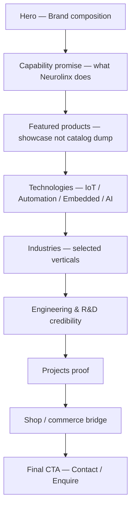

# 23 — Homepage Design

## Purpose

Define the Neurolinx homepage composition, hero budget rules, and post-hero section model so the first viewport reads as one premium brand composition—not a dashboard—while subsequent sections each have a single job.

## Related Documents

- [10_BRAND_GUIDELINES.md](./10_BRAND_GUIDELINES.md)
- [11_DESIGN_SYSTEM.md](./11_DESIGN_SYSTEM.md)
- [18_MOTION_DESIGN.md](./18_MOTION_DESIGN.md)
- [20_WEBSITE_INFORMATION_ARCHITECTURE.md](./20_WEBSITE_INFORMATION_ARCHITECTURE.md)
- [21_PAGE_INVENTORY.md](./21_PAGE_INVENTORY.md)
- [22_NAVIGATION.md](./22_NAVIGATION.md)
- [30_PRODUCT_ARCHITECTURE.md](./30_PRODUCT_ARCHITECTURE.md)
- [80_3D_ARCHITECTURE.md](./80_3D_ARCHITECTURE.md)

## Requirements

1. Communicate technology leadership, engineering credibility, and e-commerce readiness.
2. Brand must be hero-level—not merely nav text.
3. First viewport must remain uncluttered and conversion-focused.
4. Support premium motion (GSAP / Framer Motion / optional R3F) without harming performance or accessibility.
5. Work on desktop and mobile with full-bleed visual treatment.

## Technical Decisions

| Decision | Choice | Rationale |
|---|---|---|
| Hero visual | Full-bleed edge-to-edge plane (image, cinematic video, or lightweight 3D) | Master design rules; premium tech brand presence |
| Hero content budget | Brand + 1 headline + 1 supporting sentence + 1 CTA group | Prevents first-viewport clutter |
| Cards in hero | Forbidden | Keeps composition singular |
| Stats / schedules / promos in first viewport | Forbidden | Avoids dashboard feel |
| Stack | React + TS + Vite; motion via Framer Motion/GSAP; optional Three.js/R3F | Aligns with platform stack |
| Content source | Mostly static/CMS-configurable blocks | Marketing can iterate without redeploy for copy (**TBD** CMS fields) |

## Hero Budget Rules (Mandatory)

The **first viewport** may contain only:

1. **Brand** — Neurolinx wordmark/logo as a dominant brand signal (beyond the sticky nav logo alone when possible; nav alone is insufficient for the brand test).
2. **One headline** — single primary message.
3. **One supporting sentence** — short clarifying line.
4. **One CTA group** — typically primary + optional secondary (e.g. Explore Products + Contact Sales). Exact labels **TBD**.
5. **One dominant full-bleed visual** — product atmosphere, engineering context, or interactive 3D hero experience.

### Explicitly excluded from first viewport

- Cards of any kind
- Stat strips, KPI counters, awards rows
- Schedules, event listings, “this week” callouts
- Address blocks, metadata rows
- Secondary marketing modules, promo stickers, floating badges, info chips overlaid on hero media
- Multi-column content dashboards

### Brand test

If the first viewport could belong to another brand after removing the nav, branding is too weak. Strengthen brand presence before adding more content.

### Visual rules

- Full-bleed hero only; no inset hero image cards, side-panel heroes, rounded media cards, tiled collages, or floating image blocks in the hero.
- Background atmosphere may use gradients/patterns in addition to the dominant visual, but gradients alone are not the main visual idea.
- No detached labels or callout boxes overlaid on hero media.

## Suggested Hero Content Model (Copy TBD)

| Element | Guidance | Status |
|---|---|---|
| Brand | Neurolinx lockup / wordmark treatment | Required |
| Headline | One line on technology + engineering leadership | Copy **TBD** |
| Supporting sentence | One sentence on products / IoT / automation / premium quality | Copy **TBD** |
| Primary CTA | Products or Shop | Label **TBD** |
| Secondary CTA | Contact Sales / Enquire | Label **TBD** |
| Visual | Full-bleed product/engineering film still, or optimized R3F scene | Asset **TBD** |

## Post-Hero Sections (One Job Each)

Sections below the fold. Order is a **recommended default**; final sequence **TBD** after content approval. Each section: one purpose, one headline, one short supporting sentence, then focused content.

| Section | One job | Notes |
|---|---|---|
| Capability promise | State positioning | Not a feature grid dump; keep sparse |
| Featured products | Entice exploration | Prefer immersive product visuals; cards only if interaction requires container |
| Technologies | Route into tech IA | Link to `/technologies/*` |
| Industries | Route into industry landings | Exact industries **TBD** |
| Engineering & R&D | Credibility | Link `/engineering`, `/rd` |
| Projects | Proof | Link `/projects` |
| Shop bridge | Commerce intent | Link `/shop` |
| Final CTA | Convert | Contact / Enquiry |

### Section composition rules

- One headline + one supporting sentence per section.
- Prefer real product/place/engineering imagery over abstract decoration as the main visual idea.
- Motion: ship 2–3 intentional homepage motions (e.g. hero reveal, product hover/scroll reveal, CTA emphasis)—not noise.
- Cards: default no cards; allowed only when they are the container for a user interaction.

## Motion Guidance (Homepage)

| Moment | Intent | Constraint |
|---|---|---|
| Hero entrance | Presence and hierarchy | Respect `prefers-reduced-motion` |
| Scroll section reveal | Continuity | Avoid layout shift |
| Product visual interaction | Desire to explore PDP/3D | Performance budget; see `102_PERFORMANCE_STANDARDS.md` |

Optional lightweight Three.js/R3F hero is allowed if it meets performance and mobile fallback rules ([80_3D_ARCHITECTURE.md](./80_3D_ARCHITECTURE.md), [84_3D_PERFORMANCE.md](./84_3D_PERFORMANCE.md)).

## Functional Requirements

| ID | Requirement |
|---|---|
| FR-HP-01 | Homepage implements the hero budget rules without exceptions. |
| FR-HP-02 | CTAs navigate to documented routes. |
| FR-HP-03 | Featured products are CMS/admin selectable when catalog exists. |
| FR-HP-04 | Homepage remains usable with JS motion reduced/disabled. |

## Non-Functional Requirements

| ID | Requirement |
|---|---|
| NFR-HP-01 | LCP target aligned with Core Web Vitals standards doc. |
| NFR-HP-02 | Hero media must be responsive and optimized (WebP/AVIF where applicable). |
| NFR-HP-03 | 3D hero must degrade gracefully on low-power/mobile devices. |
| NFR-HP-04 | Visual direction must avoid generic AI design clichés called out in project design rules (e.g. default purple gradients, cream+terracotta brochure looks). Exact brand palette is defined in color system docs. |

## Dependencies

- Brand guidelines, design system, motion design
- Product and media APIs for featured products
- Optional 3D asset pipeline

## Constraints

- Do not invent final marketing copy, taglines, or product feature lists.
- Do not place commerce widgets (cart mini-drawers, coupon banners) in the hero.
- Do not turn the first viewport into a multi-module marketing dashboard.

## Acceptance Criteria

- [ ] Hero budget documented and enforceable in design review.
- [ ] Exclusions for first viewport explicitly listed.
- [ ] Post-hero sections each have one job.
- [ ] Motion and 3D constraints referenced.
- [ ] TBD items clearly marked for copy and assets.
