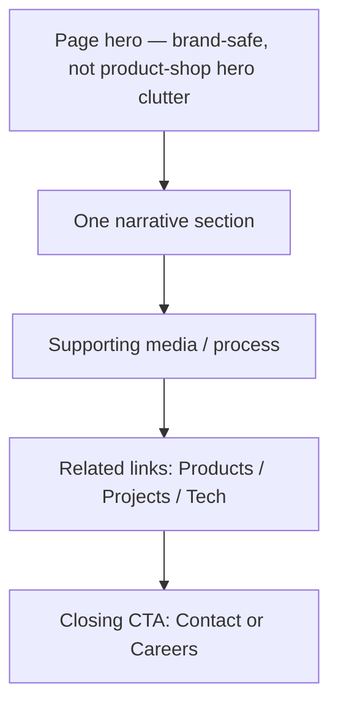

# 24 — Company Pages

## Purpose

Specify corporate pages that establish Neurolinx as a serious engineering and technology company: About, Team, Careers, Certifications, Manufacturing, and Innovation. Credibility over spectacle.

## Related Documents

- [20_WEBSITE_INFORMATION_ARCHITECTURE.md](./20_WEBSITE_INFORMATION_ARCHITECTURE.md)
- [21_PAGE_INVENTORY.md](./21_PAGE_INVENTORY.md)
- [22_NAVIGATION.md](./22_NAVIGATION.md)
- [23_HOMEPAGE_DESIGN.md](./23_HOMEPAGE_DESIGN.md)
- [25_TECHNOLOGY_PAGES.md](./25_TECHNOLOGY_PAGES.md)
- [10_BRAND_GUIDELINES.md](./10_BRAND_GUIDELINES.md)
- [75_ADMIN_CONTENT_MANAGEMENT.md](./75_ADMIN_CONTENT_MANAGEMENT.md)

## Requirements

1. Communicate professional corporate identity, engineering capability, and reliability.
2. Provide structured pages that can be CMS-managed where content changes frequently.
3. Cross-link to Technologies, Projects, Products, Careers, and Contact.
4. Mark unknown factual content (history dates, headcount, cert names, plant locations) as **TBD**.

## Technical Decisions

| Decision | Choice | Rationale |
|---|---|---|
| Page type | Mostly long-form marketing pages with shared layout primitives | Consistency with design system |
| Content ownership | CMS/admin for body copy, media, team entries, job posts | Avoid code deploys for content |
| Visual tone | Premium photography / authentic engineering imagery | Master image strategy |
| Careers data | Job list CMS or external ATS embed — **TBD** | Unknown hiring process |

## Page Specifications

### About — `/about`

| Field | Detail |
|---|---|
| Purpose | Company overview and positioning |
| Primary CTA | Contact / Explore Products |
| Sections (pattern) | Intro, mission/vision (**TBD** approved copy), capability summary, credibility strip (certs/projects — not first viewport stats dump), links to subpages |
| SEO | About Neurolinx / company entity |
| Unknowns | Founding year, HQ location, legal entity name, mission statement — **TBD** |

### Team — `/about/team`

| Field | Detail |
|---|---|
| Purpose | Humanize engineering leadership and expertise |
| Primary CTA | Careers / Contact |
| Content model | Person: name, role, bio short, photo, optional links — **TBD** roster |
| Rules | No social-proof fake titles; omit page from nav if roster not ready |
| Unknowns | Team members, org structure — **TBD** |

### Careers — `/careers`

| Field | Detail |
|---|---|
| Purpose | Employer brand + open roles |
| Primary CTA | Apply |
| Sections | Culture/engineering narrative (**TBD**), open roles list, application method |
| Application flow | **TBD** — internal form vs email vs external ATS |
| Unknowns | Benefits, locations, role taxonomy — **TBD** |

### Certifications — `/about/certifications`

| Field | Detail |
|---|---|
| Purpose | Trust and compliance communication |
| Primary CTA | Contact / Download certificate pack (**TBD** if available) |
| Content model | Certification name, issuer, scope, validity, document asset |
| Unknowns | Exact certifications held — **TBD** (do not invent ISO numbers) |

### Manufacturing — `/about/manufacturing`

| Field | Detail |
|---|---|
| Purpose | Explain manufacturing/quality capability |
| Primary CTA | Contact Sales / View Projects |
| Sections | Facilities narrative, process overview, quality approach, media gallery |
| Unknowns | Plant locations, capacity metrics, process details — **TBD** |
| Visuals | Prefer authentic manufacturing imagery per image guidelines |

### Innovation — `/about/innovation`

| Field | Detail |
|---|---|
| Purpose | Bridge company story to R&D and future technology |
| Primary CTA | R&D / Technologies / Enquire |
| Sections | Innovation principles, example themes (IoT, automation, embedded, AI as capability areas—not unsubstantiated claims), link to `/rd` |
| Unknowns | Named innovation programs, patents — **TBD** |

## Shared Company Page Pattern

### Composition rules

- One job per section; one headline + short supporting sentence.
- Avoid card-heavy “about us” dashboards.
- Do not place stats in the first viewport unless explicitly approved later; prefer narrative credibility.
- Authentic imagery over generic stock when Neurolinx assets exist.

## Functional Requirements

| ID | Requirement |
|---|---|
| FR-CO-01 | About subtree pages exist per IA with secondary nav. |
| FR-CO-02 | Team and Careers support empty states when no published entries. |
| FR-CO-03 | Certification documents download through secure media URLs when assets exist. |
| FR-CO-04 | All company pages link to Contact or Enquiry where conversion is relevant. |

## Non-Functional Requirements

| ID | Requirement |
|---|---|
| NFR-CO-01 | Pages must be editable without frontend redeploy once CMS is live. |
| NFR-CO-02 | Meet accessibility standards for text, media alternatives, and focus order. |

## Dependencies

- CMS/content admin (`75`)
- Media storage (`68`, `76`)
- Brand and image guidelines

## Constraints

- Do not invent certifications, awards, client names, or metrics.
- Do not claim capabilities not supported by Technology/R&D docs.

## Acceptance Criteria

- [ ] About, Team, Careers, Certifications, Manufacturing, Innovation specified.
- [ ] Content models and TBD fields listed.
- [ ] Shared page pattern and CTAs defined.
- [ ] Cross-links to IA and technology pages present.
