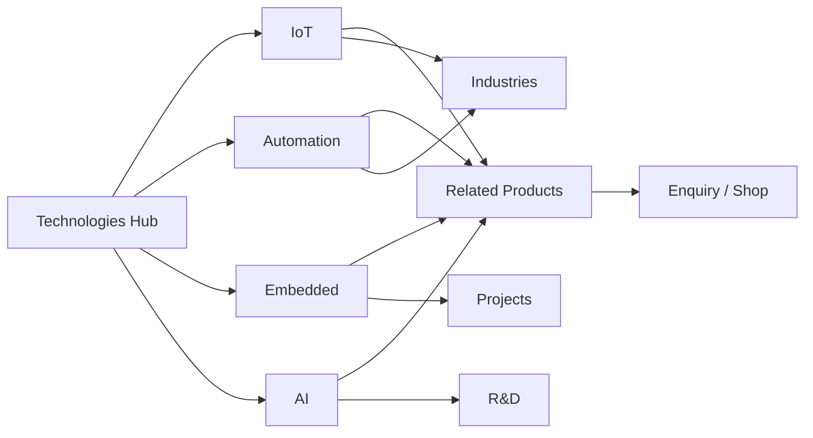

# 25 — Technology Pages

## Purpose

Define the Technologies hub and capability area pages (IoT, Automation, Embedded, AI) that communicate Neurolinx technology leadership. Content must reflect documented capabilities only; unverified specifics remain **TBD**.

## Related Documents

- [20_WEBSITE_INFORMATION_ARCHITECTURE.md](./20_WEBSITE_INFORMATION_ARCHITECTURE.md)
- [21_PAGE_INVENTORY.md](./21_PAGE_INVENTORY.md)
- [22_NAVIGATION.md](./22_NAVIGATION.md)
- [26_INDUSTRY_PAGES.md](./26_INDUSTRY_PAGES.md)
- [30_PRODUCT_ARCHITECTURE.md](./30_PRODUCT_ARCHITECTURE.md)
- [24_COMPANY_PAGES.md](./24_COMPANY_PAGES.md)
- [80_3D_ARCHITECTURE.md](./80_3D_ARCHITECTURE.md)

## Requirements

1. Present technology areas as a coherent capability system, not isolated marketing microsites.
2. Link technologies to relevant products, industries, projects, and enquiry CTAs.
3. Support optional interactive diagrams or lightweight 3D/animated explainers where they aid understanding.
4. Avoid overclaiming (especially AI); mark depth and offerings as **TBD** until approved.

## Technical Decisions

| Decision | Choice | Rationale |
|---|---|---|
| Taxonomy | Fixed primary areas from master spec: IoT, Automation, Embedded, AI | Known capability themes |
| Additional areas | Extensible via CMS later | Future expansion without IA rewrite |
| Page template | Shared Technology Landing template | Consistency and faster delivery |
| Product linking | Tagged products/categories related to technology slug | Keeps commerce/engineering connected |

## Information Structure

```text
/technologies                 Hub overview
/technologies/iot             IoT
/technologies/automation      Automation
/technologies/embedded        Embedded systems
/technologies/ai              AI
/technologies/:slug           Future areas (optional)
```

## Hub — `/technologies`

| Element | Guidance |
|---|---|
| Purpose | Orient visitors to capability map |
| Primary CTA | Explore an area / Contact |
| Content | Short positioning + links to four areas |
| Visual | Atmospheric engineering/tech visual; optional animated diagram |
| Unknowns | Exact positioning copy — **TBD** |

## Capability Area Template

Each area page uses the same structure:

| Section | Job |
|---|---|
| Hero | Area name + one headline + one sentence + CTA group (Explore products / Enquire) |
| Capability narrative | What Neurolinx does in this area (approved copy only) |
| Applications | Generic application themes (not fake case metrics) |
| Related products | Filtered product modules |
| Related industries / projects | Cross-links when content exists |
| Closing CTA | Contact Sales / Request Quote |



## Area Definitions (Documented Themes)

### IoT — `/technologies/iot`

| Field | Content |
|---|---|
| Documented theme | IoT expertise as a platform pillar |
| Typical topics to cover when approved | Devices, connectivity, data paths, cloud integration readiness |
| Future expansion hooks | Device management, MQTT, cloud platforms (architecture must not hard-couple) |
| Specifics | Protocols supported, platforms, reference architectures — **TBD** |

### Automation — `/technologies/automation`

| Field | Content |
|---|---|
| Documented theme | Automation expertise |
| Typical topics | Control, industrial/smart automation narratives, system integration framing |
| Specifics | PLC brands, protocols, certified partner status — **TBD** |

### Embedded Systems — `/technologies/embedded`

| Field | Content |
|---|---|
| Documented theme | Embedded systems expertise |
| Typical topics | Firmware/hardware co-design narrative, product electronics framing |
| Specifics | MCU families, RTOS, toolchains — **TBD** |

### AI — `/technologies/ai`

| Field | Content |
|---|---|
| Documented theme | AI as a documented capability area |
| Guidance | Keep claims conservative; distinguish research interest vs shipped product features |
| Specifics | Models, on-device vs cloud inference, productized AI features — **TBD** |

## Functional Requirements

| ID | Requirement |
|---|---|
| FR-TECH-01 | Hub and four area routes exist and are linked from navigation mega-menu. |
| FR-TECH-02 | Each area can reference related published products by tag/category. |
| FR-TECH-03 | Enquiry CTA can pass technology context (e.g. `?topic=iot`). |
| FR-TECH-04 | Empty related-product modules hide gracefully. |

## Non-Functional Requirements

| ID | Requirement |
|---|---|
| NFR-TECH-01 | Pages must remain informative with motion disabled. |
| NFR-TECH-02 | Any WebGL diagram must meet 3D performance budgets or fall back to static SVG/image. |

## Dependencies

- Product tagging/taxonomy
- CMS for narrative blocks
- Industry and project content for cross-links
- Design system section primitives

## Constraints

- Do not invent partner logos, protocol certifications, or AI product claims.
- Do not tightly couple page templates to a single future IoT/cloud vendor.

## Acceptance Criteria

- [ ] Hub + IoT + Automation + Embedded + AI pages specified.
- [ ] Shared template and cross-link model defined.
- [ ] TBD specifics explicitly listed.
- [ ] Links to IA, industries, and product docs present.
