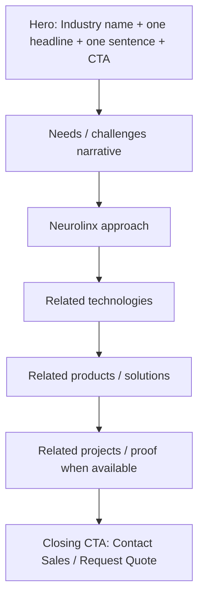

# 26 — Industry Pages

## Purpose

Define the industry landing page pattern for Neurolinx market verticals. Exact industry list is largely **TBD**; where the master specification implies domains (industrial systems, smart home, electronics/engineering contexts), they may be listed as generic candidates only—not as confirmed go-to-market verticals until approved.

## Related Documents

- [20_WEBSITE_INFORMATION_ARCHITECTURE.md](./20_WEBSITE_INFORMATION_ARCHITECTURE.md)
- [21_PAGE_INVENTORY.md](./21_PAGE_INVENTORY.md)
- [22_NAVIGATION.md](./22_NAVIGATION.md)
- [25_TECHNOLOGY_PAGES.md](./25_TECHNOLOGY_PAGES.md)
- [27_CONTACT_AND_ENQUIRY.md](./27_CONTACT_AND_ENQUIRY.md)
- [30_PRODUCT_ARCHITECTURE.md](./30_PRODUCT_ARCHITECTURE.md)
- [02_BUSINESS_REQUIREMENTS.md](./02_BUSINESS_REQUIREMENTS.md)

## Requirements

1. Provide a repeatable industry landing pattern for SEO and sales enablement.
2. Connect industries to relevant technologies, solutions, products, and projects.
3. Support B2B conversion via Contact Sales / Request Quote.
4. Avoid fabricating vertical expertise, customer logos, or case metrics.

## Technical Decisions

| Decision | Choice | Rationale |
|---|---|---|
| URL pattern | `/industries/:slug` | Clean SEO |
| Template | Shared Industry Landing template | Scalability |
| Hub | `/industries` index of published verticals | Discovery |
| Taxonomy source | CMS/admin controlled | Business can revise without code changes |

## Candidate Industry Themes (Generic / Unconfirmed)

Derived only as generic themes appearing in the master specification imagery/context language. **Not approved business fact:**

| Candidate slug | Theme | Status |
|---|---|---|
| `industrial` | Industrial systems | Candidate — **TBD** approval |
| `smart-home` | Smart home | Candidate — **TBD** approval |
| `electronics` | Electronics / engineering products context | Candidate — **TBD** approval |
| `automation-systems` | Automation-oriented markets | Candidate — **TBD** / may merge with industrial |
| Additional verticals | — | **TBD** |

Do not publish candidate pages until marketing/business confirms the industry list.

## Industry Hub — `/industries`

| Element | Detail |
|---|---|
| Purpose | Orient visitors to served markets |
| Primary CTA | Select industry / Contact Sales |
| Content | Grid or list of published industries with short descriptors |
| Empty state | Message + Contact CTA if none published |

## Industry Landing Pattern — `/industries/:slug`

### Section rules

| Section | One job | Constraints |
|---|---|---|
| Hero | Name the vertical and promise | Hero budget: no card grids, no stat strips in first viewport |
| Needs | Reflect buyer problems | No invented statistics |
| Approach | How Neurolinx helps | Align with documented tech capabilities only |
| Technologies | Route to `/technologies/*` | Only relevant links |
| Products / solutions | Commerce + engineering discovery | Published items only |
| Projects | Proof | Hide if none |
| CTA | Convert B2B | Prefill enquiry with industry context |

### Content model (CMS)

| Field | Type | Notes |
|---|---|---|
| name | string | Required |
| slug | string | Required, unique |
| headline | string | Required |
| summary | string | One supporting sentence |
| body sections | rich text / blocks | Optional structured blocks |
| hero media | image/video | Required for premium feel |
| relatedTechnologySlugs | string[] | Optional |
| relatedCategoryIds | refs | Optional |
| relatedProductIds | refs | Optional |
| relatedProjectIds | refs | Optional |
| seoTitle / seoDescription | string | Optional overrides |
| published | boolean | Index only when true |

## Functional Requirements

| ID | Requirement |
|---|---|
| FR-IND-01 | Hub lists only published industries. |
| FR-IND-02 | Landing pages follow the shared pattern. |
| FR-IND-03 | Enquiry CTAs can pass `industry` context. |
| FR-IND-04 | Unpublished slugs return 404. |

## Non-Functional Requirements

| ID | Requirement |
|---|---|
| NFR-IND-01 | Industry pages must be SEO-indexable when published. |
| NFR-IND-02 | Template performance comparable to other marketing pages (no heavy 3D by default). |

## Dependencies

- CMS industry entities
- Product/technology/project relations
- Enquiry system context parameters

## Constraints

- Exact industries, logos, and case studies are **TBD**.
- Do not imply regulatory specialization (medical, aerospace, etc.) unless approved.

## Acceptance Criteria

- [ ] Hub + landing pattern documented with Mermaid.
- [ ] Candidate industries marked as unconfirmed.
- [ ] CMS content model listed.
- [ ] Cross-links to technologies, products, enquiry present.
