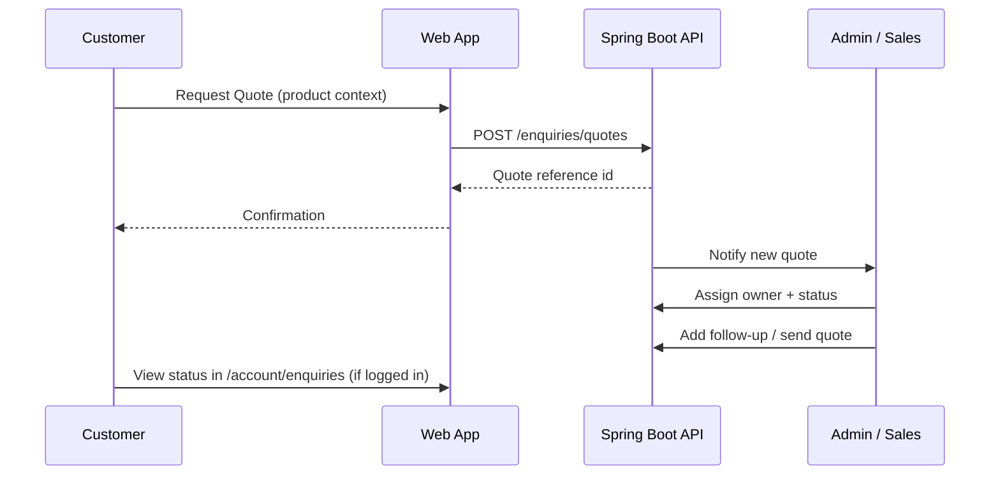

# 27 — Contact and Enquiry

## Purpose

Define Contact and B2B Enquiry experiences, including product-level CTAs (Buy Now, Add to Cart, Request Quote, Contact Sales, Download Datasheet) and the quotation workflow fields required for sales follow-up.

## Related Documents

- [20_WEBSITE_INFORMATION_ARCHITECTURE.md](./20_WEBSITE_INFORMATION_ARCHITECTURE.md)
- [21_PAGE_INVENTORY.md](./21_PAGE_INVENTORY.md)
- [22_NAVIGATION.md](./22_NAVIGATION.md)
- [32_PRODUCT_DETAILS.md](./32_PRODUCT_DETAILS.md)
- [30_PRODUCT_ARCHITECTURE.md](./30_PRODUCT_ARCHITECTURE.md)
- [40_ECOMMERCE_ARCHITECTURE.md](./40_ECOMMERCE_ARCHITECTURE.md)
- [45_CUSTOMER_ACCOUNT.md](./45_CUSTOMER_ACCOUNT.md)
- [70_ADMIN_ARCHITECTURE.md](./70_ADMIN_ARCHITECTURE.md)
- [93_FILE_UPLOAD_SECURITY.md](./93_FILE_UPLOAD_SECURITY.md)

## Requirements

1. Support general contact and structured B2B enquiry/quotation in one platform.
2. Products may expose commerce and sales CTAs based on product configuration.
3. Quotations must capture customer, company, quantity, product, requirements, attachments, notes, and support sales status, admin assignment, and follow-up.
4. Integrate with customer accounts when the user is authenticated, without blocking guest enquiry (**TBD** if guest allowed—default assume yes).

## Technical Decisions

| Decision | Choice | Rationale |
|---|---|---|
| Contact vs Enquiry | Separate routes: `/contact`, `/enquiry`, `/enquiry/quote` | Different intents |
| Product CTAs | Configurable per product/variant | Mixed B2B/B2C catalog |
| Persistence | Spring Boot enquiry module + PostgreSQL | Enterprise workflow |
| Attachments | Secure upload via file storage service | Virus scanning / type limits per security docs |
| Notifications | Email to sales distribution + optional admin inbox | **TBD** CRM integration later |
| Spam protection | Rate limit + CAPTCHA/Turnstile — **TBD** vendor | Required before public launch |

## Contact — `/contact`

| Element | Detail |
|---|---|
| Purpose | General inbound communication |
| Channels | Form + displayed email/phone/address (**TBD** real values) |
| Form fields (minimum) | Name, email, phone (optional), subject, message |
| Primary CTA | Send message |
| Success | Confirmation state; ticket/reference id **TBD** format |

### Contact FR

| ID | Requirement |
|---|---|
| FR-CT-01 | Submit creates a contact record via API. |
| FR-CT-02 | Validation errors are field-level and accessible. |
| FR-CT-03 | Success does not re-submit on refresh (PRG or client disable). |

## Enquiry Hub — `/enquiry`

| Element | Detail |
|---|---|
| Purpose | B2B sales entry without requiring a product |
| Fields | Customer name, email, phone, company, interest area (technology/industry/product — optional), requirements, attachments, notes |
| Primary CTA | Submit enquiry |
| Routing | May deep-link from Technologies/Industries with query context |

## Request Quote — `/enquiry/quote`

Product-linked quotation flow (also embeddable as PDP modal/drawer).

### Product CTA Matrix

| CTA | Typical use | Destination / behavior |
|---|---|---|
| Buy Now | B2C immediate purchase | Checkout with product/variant |
| Add to Cart | B2C browse-then-buy | Cart line item |
| Request Quote | B2B pricing/volume | Quote form with product context |
| Contact Sales | Complex/custom needs | Enquiry with sales intent |
| Download Datasheet | Technical evaluation | Secure file download / gated download **TBD** |

CTA availability is product (and possibly variant) configuration—see [30_PRODUCT_ARCHITECTURE.md](./30_PRODUCT_ARCHITECTURE.md) and [32_PRODUCT_DETAILS.md](./32_PRODUCT_DETAILS.md).

### Quotation Fields

| Field | Required | Description |
|---|---|---|
| Customer name | Yes | Requestor name |
| Customer email | Yes | Contact email |
| Customer phone | Optional | **TBD** if required for certain regions |
| Company | Yes for B2B quote | Organization name |
| Quantity | Yes | Requested units (validate > 0) |
| Product | Yes | Product id/slug; variant id if applicable |
| Requirements | Yes | Free-text technical/commercial requirements |
| Attachments | Optional | Specs, drawings, RFQs; type/size limits per security docs |
| Notes | Optional | Additional context from customer |
| Sales status | System/Admin | Workflow state (not customer-editable) |
| Admin assignment | Admin | Owner user for follow-up |
| Follow-up | Admin | Next action date/notes history |

### Sales status (initial set — adjustable)

Suggested states (final enum **TBD** with sales ops):

```text
NEW → IN_REVIEW → QUOTED → NEGOTIATING → WON → LOST → CLOSED
```

Optional: `NEEDS_INFO`, `ON_HOLD`.

### Quote lifecycle



## Data Considerations

| Concern | Guidance |
|---|---|
| PII | Store minimally; protect per data security docs |
| Guest vs account | Link enquiry to userId when authenticated |
| Product snapshot | Store product name/sku snapshot at request time |
| Audit | Admin status/assignment changes audited |

## Functional Requirements

| ID | Requirement |
|---|---|
| FR-ENQ-01 | Contact, Enquiry, and Quote endpoints persist submissions. |
| FR-ENQ-02 | Quote requires customer, company, quantity, product, requirements. |
| FR-ENQ-03 | Attachments scanned/validated before storage. |
| FR-ENQ-04 | Admin can set sales status, assignment, and follow-up. |
| FR-ENQ-05 | Authenticated customers can list their enquiries. |
| FR-ENQ-06 | Product PDP renders only enabled CTAs for that product. |
| FR-ENQ-07 | Datasheet download respects published/media permissions. |

## Non-Functional Requirements

| ID | Requirement |
|---|---|
| NFR-ENQ-01 | Form APIs rate-limited. |
| NFR-ENQ-02 | Attachment max size and MIME allowlist enforced server-side. |
| NFR-ENQ-03 | Confirmation email delivery target **TBD** (transactional provider). |
| NFR-ENQ-04 | WCAG-compliant forms (labels, errors, focus). |

## Dependencies

- Auth/RBAC for admin assignment
- File storage + upload security
- Product catalog for product/variant context
- Notification service
- Future CRM/ERP integration (loosely coupled)

## Constraints

- Do not invent SLA response times or pricing rules for quotes.
- Payment is not part of quote acceptance unless explicitly added later.
- Exact sales email routing and business hours — **TBD**.

## Acceptance Criteria

- [ ] Contact and enquiry routes/fields documented.
- [ ] Product CTA matrix defined.
- [ ] Quotation fields include customer, company, quantity, product, requirements, attachments, notes, sales status, admin assignment, follow-up.
- [ ] Lifecycle Mermaid present.
- [ ] Security and admin dependencies linked.
