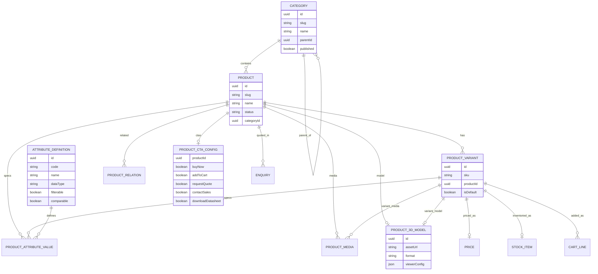

# 30 — Product Architecture

## Purpose

Define the product domain model for Neurolinx: categories, variants, specifications, media, 3D assets, pricing, stock, enquiry affordances, cart integration, related products, and comparison. This is the shared backbone for Products showcase and Shop commerce.

## Related Documents

- [31_PRODUCT_LISTING.md](./31_PRODUCT_LISTING.md)
- [32_PRODUCT_DETAILS.md](./32_PRODUCT_DETAILS.md)
- [33_PRODUCT_3D_VIEWER.md](./33_PRODUCT_3D_VIEWER.md)
- [34_PRODUCT_CONFIGURATOR.md](./34_PRODUCT_CONFIGURATOR.md)
- [35_PRODUCT_COMPARISON.md](./35_PRODUCT_COMPARISON.md)
- [36_PRODUCT_MEDIA.md](./36_PRODUCT_MEDIA.md)
- [27_CONTACT_AND_ENQUIRY.md](./27_CONTACT_AND_ENQUIRY.md)
- [40_ECOMMERCE_ARCHITECTURE.md](./40_ECOMMERCE_ARCHITECTURE.md)
- [41_CART.md](./41_CART.md)
- [66_DATABASE_SCHEMA.md](./66_DATABASE_SCHEMA.md)
- [72_ADMIN_PRODUCTS.md](./72_ADMIN_PRODUCTS.md)

## Requirements

1. Support engineering-rich products (specs, docs, 3D) and commerce (price, stock, cart).
2. Support B2B enquiry CTAs alongside B2C purchase CTAs.
3. Allow admin-managed catalog growth without code changes.
4. Enable related products and attribute comparison.
5. Keep future IoT/device linkages loosely coupled.

## Technical Decisions

| Decision | Choice | Rationale |
|---|---|---|
| Entity style | Product + Variants | Standard commerce flexibility |
| Categories | Hierarchical tree | SEO + navigation mega-menu |
| Specs | Attribute definitions + values (EAV-like or typed JSON with schema) | Comparison and filtering | Exact storage shape finalized in DB schema docs |
| Media | Polymorphic media assets linked to product/variant | Shared media library |
| 3D | GLB/GLTF asset references + viewer config | See 3D docs 80–84 |
| Pricing | Variant-level price; product-level display fallback | Accurate cart pricing |
| Stock | Variant-level inventory | Prevent oversell |
| Enquiry flags | Per product (and optionally variant) CTA enablement | Mixed catalog |
| IDs | UUID internally; human SKU + slugs externally | Stability + SEO |

## Core Entities

| Entity | Responsibility |
|---|---|
| Category | Hierarchy, SEO, listing context |
| Product | Sellable/showcased parent; shared narrative |
| ProductVariant | SKU, price, stock, option values |
| AttributeDefinition | Spec/filter/compare field metadata |
| ProductAttributeValue | Spec values on product/variant |
| ProductMedia | Images, video, docs, drawings |
| Product3DModel | GLB/GLTF + viewer metadata |
| ProductRelation | Related/accessory/upsell links |
| ProductCTAConfig | Which CTAs are enabled |
| Price | Amount, currency, visibility rules (**TBD** B2B price lists) |
| StockItem | Quantity, reservation policy (**TBD**) |

## Entity Relationship (Mermaid)



## Capability Mapping

| Capability | Model support |
|---|---|
| Categories | `Category` tree |
| Variants | `ProductVariant` + option attributes |
| Specifications | `AttributeDefinition` + values |
| Images / video / docs | `ProductMedia` (see [36](./36_PRODUCT_MEDIA.md)) |
| 3D models | `Product3DModel` (see [33](./33_PRODUCT_3D_VIEWER.md)) |
| Pricing | Variant `Price` |
| Stock | Variant `StockItem` |
| Enquiry | CTA config + enquiry FK |
| Add to cart / buy now | CTA config + cart lines |
| Related products | `ProductRelation` |
| Comparison | Comparable attributes (see [35](./35_PRODUCT_COMPARISON.md)) |
| Configurator | Variant/option selection (see [34](./34_PRODUCT_CONFIGURATOR.md)) |

## Product Status

Suggested lifecycle (**TBD** final enum):

```text
DRAFT → REVIEW → PUBLISHED → ARCHIVED
```

Unpublished products are not indexable and return 404 on public PDP (or redirect — **TBD**).

## Pricing & Stock Notes

| Topic | Decision / TBD |
|---|---|
| Currency | **TBD** (single currency at launch likely) |
| Tax display | **TBD** inclusive/exclusive |
| B2B price lists | Future — do not hardcode assumptions |
| Out of stock UX | Allow quote CTA even if purchase disabled — **recommended**, confirm **TBD** |
| Backorders | **TBD** |

## Functional Requirements

| ID | Requirement |
|---|---|
| FR-PA-01 | Admin can create categories, products, variants, specs, media, 3D, CTAs. |
| FR-PA-02 | Public APIs return only published catalog data. |
| FR-PA-03 | Cart operations reference variant IDs. |
| FR-PA-04 | Quote/enquiry can reference product and optional variant. |
| FR-PA-05 | Related products resolve only to published targets. |
| FR-PA-06 | Comparable attributes are explicitly flagged. |

## Non-Functional Requirements

| ID | Requirement |
|---|---|
| NFR-PA-01 | Catalog read APIs cacheable via Redis where safe. |
| NFR-PA-02 | Slug uniqueness enforced per product (and category). |
| NFR-PA-03 | Media/3D URLs delivered via CDN-friendly storage paths. |

## Dependencies

- PostgreSQL schema (`65`/`66`)
- File storage (`68`)
- Admin products (`72`)
- Cart/checkout (`41`/`42`)
- Enquiry (`27`)

## Constraints

- Do not invent concrete category trees or SKUs.
- Do not assume ERP sync exists at launch.
- 3D is optional per product; absence must not break PDP.

## Acceptance Criteria

- [ ] Entities cover categories, variants, specs, media, 3D, pricing, stock, enquiry, cart, related, comparison.
- [ ] ER Mermaid diagram included.
- [ ] CTA configuration modeled.
- [ ] Cross-links to listing, PDP, 3D, media, enquiry docs present.
