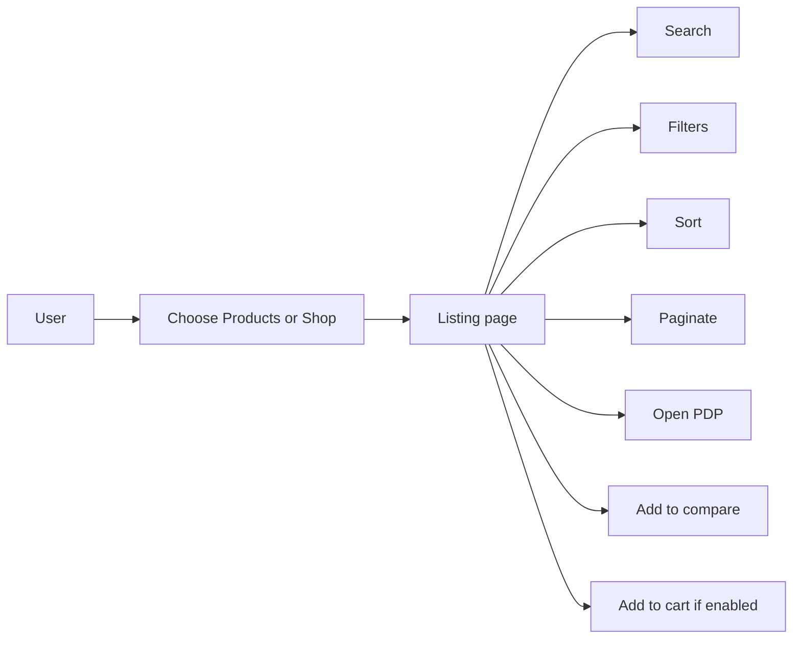

# 31 — Product Listing

## Purpose

Specify product discovery experiences: search, filters, sorting, pagination, and category pages for both Products (`/products`) and Shop (`/shop`) entry points.

## Related Documents

- [30_PRODUCT_ARCHITECTURE.md](./30_PRODUCT_ARCHITECTURE.md)
- [32_PRODUCT_DETAILS.md](./32_PRODUCT_DETAILS.md)
- [35_PRODUCT_COMPARISON.md](./35_PRODUCT_COMPARISON.md)
- [20_WEBSITE_INFORMATION_ARCHITECTURE.md](./20_WEBSITE_INFORMATION_ARCHITECTURE.md)
- [22_NAVIGATION.md](./22_NAVIGATION.md)
- [54_FRONTEND_PERFORMANCE.md](./54_FRONTEND_PERFORMANCE.md)
- [100_SEO_STRATEGY.md](./100_SEO_STRATEGY.md)

## Requirements

1. Enable fast discovery across an engineering/commerce catalog.
2. Support category browsing and faceted filtering on filterable attributes.
3. Provide search with relevant ranking for product name, SKU, and key specs (**TBD** search engine: DB full-text vs dedicated search).
4. Support pagination (and optional infinite scroll — **TBD**; default pagination for SEO).
5. Allow multi-select for comparison from listing results.

## Technical Decisions

| Decision | Choice | Rationale |
|---|---|---|
| Dual entry | `/products` and `/shop` share listing components with intent-specific defaults | One domain model |
| Filtering | Query-param driven facets | Shareable/SEO-friendly category URLs |
| Pagination | Page + pageSize | Predictable SEO and accessibility |
| Sort options | Featured, newest, name, price asc/desc | Price sorts only when price visible |
| Empty states | Guided reset filters + contact/enquire | Avoid dead ends |
| Data | TanStack Query against Spring Boot catalog APIs | Stack standard |

## Listing Surfaces

| Surface | Route | Intent |
|---|---|---|
| Products hub | `/products` | Engineering showcase discovery |
| Product category | `/products/:categorySlug` | Category SEO + filters |
| Shop hub | `/shop` | Commerce discovery |
| Shop category | `/shop/:categorySlug` | Commerce category |
| Search results | `/search` or listing `?q=` — **TBD** | Cross-catalog search |

## Discovery UX

## Filters

| Filter type | Source | Notes |
|---|---|---|
| Category / subcategory | Category tree | Hierarchical |
| Price range | Variant prices | Hidden if prices not shown for B2B-only items — **TBD** rules |
| Availability | Stock | In stock / all |
| Attribute facets | `filterable` attribute definitions | Numeric ranges, enums, boolean |
| Technology tags | Product tags | Optional bridge to tech pages |
| Has 3D model | Derived flag | Showcase filter |
| CTA type | CTA config | e.g. quotable products — optional |

### Filter UX rules

- Show result count.
- Allow clear-all.
- Reflect selected filters as removable chips (interaction containers OK).
- Mobile: filters in drawer.

## Sorting

| Key | Label | Availability |
|---|---|---|
| `featured` | Featured | Default for hubs — featured score **TBD** |
| `newest` | Newest | Based on publish date |
| `name_asc` | Name A–Z | Always |
| `price_asc` / `price_desc` | Price | Only when price display permitted |
| `best_selling` | Best selling | **TBD** if analytics exist |

## Pagination

| Param | Default | Max | Notes |
|---|---|---|---|
| `page` | 1 | — | 1-based |
| `pageSize` | 12 or 24 — **TBD** | Hard cap server-side | |

Requirements:

- Preserve filters/sort in URL.
- Provide rel next/prev for SEO when using pagination.
- Announce result updates to screen readers.

## Search

| Concern | Guidance |
|---|---|
| Fields | Name, slug, SKU, short description, key attribute values |
| Behavior | Debounced suggestions optional; full results on submit |
| Ranking | **TBD** |
| No results | Suggestions + contact CTA |

## Listing Card / Row Content

Prefer non-card visual language where possible; if a result tile is required for interaction, keep minimal:

- Primary image
- Name
- Short descriptor / key spec
- Price or “Request quote” label based on CTA config
- Optional badges (New, 3D) — use sparingly; no sticker clutter
- Quick actions: View, Add to cart (if enabled), Compare

## Functional Requirements

| ID | Requirement |
|---|---|
| FR-PL-01 | Category pages list only published products in that subtree. |
| FR-PL-02 | Filters and sort are encoded in the URL. |
| FR-PL-03 | Pagination works with filters applied. |
| FR-PL-04 | Search returns published products only. |
| FR-PL-05 | Compare selection persists for the session (see comparison doc). |
| FR-PL-06 | Add to cart from listing respects stock and CTA flags. |

## Non-Functional Requirements

| ID | Requirement |
|---|---|
| NFR-PL-01 | Listing API p95 latency target defined in performance docs (**TBD** numeric SLO). |
| NFR-PL-02 | Images use responsive/optimized formats. |
| NFR-PL-03 | Filter changes should not full-reload the app shell. |

## Dependencies

- Catalog API + attribute metadata
- Inventory service for availability facets
- SEO templates for category pages
- Design system listing primitives

## Constraints

- Exact facet set depends on attribute definitions — not invented here.
- Do not implement infinite scroll as default without SEO plan.

## Acceptance Criteria

- [ ] Discovery, search, filters, sorting, pagination, category pages documented.
- [ ] Products vs Shop listing intents clarified.
- [ ] URL-driven facet behavior specified.
- [ ] Cross-links to architecture, PDP, comparison present.
