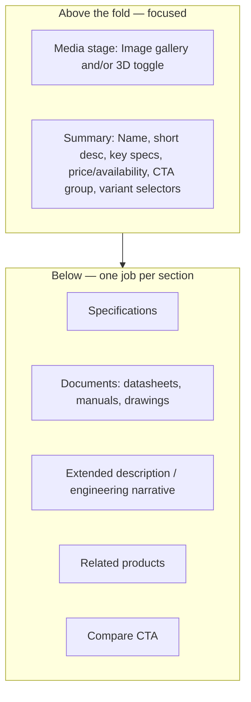
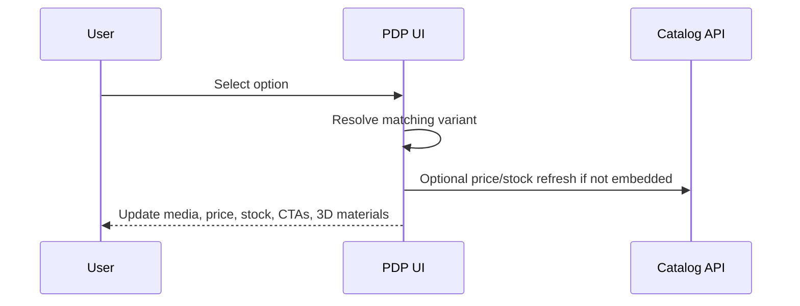

# 32 — Product Details (PDP)

## Purpose

Define the Product Detail Page structure for Neurolinx: gallery, specifications, documents, CTAs (buy/cart/quote/sales/datasheet), related products, and integration points for 3D viewer and configurator.

## Related Documents

- [30_PRODUCT_ARCHITECTURE.md](./30_PRODUCT_ARCHITECTURE.md)
- [31_PRODUCT_LISTING.md](./31_PRODUCT_LISTING.md)
- [33_PRODUCT_3D_VIEWER.md](./33_PRODUCT_3D_VIEWER.md)
- [34_PRODUCT_CONFIGURATOR.md](./34_PRODUCT_CONFIGURATOR.md)
- [35_PRODUCT_COMPARISON.md](./35_PRODUCT_COMPARISON.md)
- [36_PRODUCT_MEDIA.md](./36_PRODUCT_MEDIA.md)
- [27_CONTACT_AND_ENQUIRY.md](./27_CONTACT_AND_ENQUIRY.md)
- [41_CART.md](./41_CART.md)
- [23_HOMEPAGE_DESIGN.md](./23_HOMEPAGE_DESIGN.md)

## Requirements

1. Serve both engineering evaluation and purchase/enquiry conversion.
2. Present media (images, video, 3D) without first-viewport clutter rules being violated by promo stickers.
3. Expose specifications and downloadable technical documents.
4. Show only enabled CTAs for the product/variant.
5. Surface related products and compare affordance.

## Technical Decisions

| Decision | Choice | Rationale |
|---|---|---|
| Route | `/products/:categorySlug/:productSlug` primary canonical candidate | SEO + IA |
| Shop PDP | Same component or redirect — **TBD** canonical strategy | Avoid duplicate content |
| Variant selection | Options update media, price, stock, 3D materials | Configurator may extend |
| Data loading | TanStack Query product detail endpoint | Cacheable |
| 3D | Lazy-loaded viewer island | Performance |
| Layout | Gallery/viewer + summary column, then tabs/sections below | Familiar PDP pattern without card-heavy chrome |

## PDP Structure

### Media stage

| Mode | Behavior |
|---|---|
| Gallery | Primary image + thumbnails; zoom/lightbox |
| Video | Inline or modal if media exists |
| 3D | Toggle into R3F viewer when model exists ([33](./33_PRODUCT_3D_VIEWER.md)) |
| Fallback | Still imagery if 3D unsupported |

Rules:

- No floating promo badges/stickers on media.
- Dominant product visual; avoid multi-card collage in the stage.
- Mobile: swipe gallery; 3D fallback per 3D docs.

### Summary column

| Element | Notes |
|---|---|
| Product name | H1 |
| Short supporting sentence | One line |
| SKU | For selected variant |
| Key specs | 3–6 highlights |
| Price | If visible for this product |
| Stock status | In stock / out / lead time **TBD** messaging |
| Variant selectors | Color, size, configuration options — **TBD** option types |
| CTA group | Enabled actions only |
| Secondary links | Add to wishlist, Compare, Share (**TBD**) |

### CTA group

From [27_CONTACT_AND_ENQUIRY.md](./27_CONTACT_AND_ENQUIRY.md):

| CTA | Condition |
|---|---|
| Buy Now | `buyNow` enabled + purchasable stock policy |
| Add to Cart | `addToCart` enabled |
| Request Quote | `requestQuote` enabled |
| Contact Sales | `contactSales` enabled |
| Download Datasheet | `downloadDatasheet` enabled + datasheet asset present |

Quantity selector applies to cart/buy; quote has its own quantity field.

### Specifications

- Full attribute table for product/variant.
- Group attributes by attribute group if defined (**TBD** grouping).
- Units displayed with values.

### Documents

- Datasheets, manuals, technical drawings, certificates (as media types).
- Download actions; gated downloads **TBD**.

### Related products

- From `ProductRelation` (related, accessory, alternative).
- Only published items.

## Variant Behavior

If options map to configurator rules, defer to [34_PRODUCT_CONFIGURATOR.md](./34_PRODUCT_CONFIGURATOR.md).

## SEO & Structured Data

- Unique title/description templates
- Product schema.org JSON-LD when purchasable details exist (**TBD** exact fields)
- Canonical URL decision documented in SEO strategy

## Functional Requirements

| ID | Requirement |
|---|---|
| FR-PDP-01 | PDP loads published product by slug; unpublished → 404. |
| FR-PDP-02 | Variant selection updates price, stock, media, and SKU. |
| FR-PDP-03 | CTA group reflects CTA config and runtime purchasability. |
| FR-PDP-04 | Specs and documents render from product media/attributes. |
| FR-PDP-05 | 3D viewer loads only when model exists and device policy allows. |
| FR-PDP-06 | Related products section hides when empty. |
| FR-PDP-07 | Add to Cart / Buy Now send variant id + quantity to commerce flows. |
| FR-PDP-08 | Request Quote / Contact Sales carry product context to enquiry. |

## Non-Functional Requirements

| ID | Requirement |
|---|---|
| NFR-PDP-01 | LCP prioritized for primary product image. |
| NFR-PDP-02 | 3D bundle code-split from base PDP. |
| NFR-PDP-03 | Accessible tabs/sections and gallery controls. |

## Dependencies

- Catalog, inventory, media, enquiry, cart APIs
- 3D viewer module
- Design system PDP primitives

## Constraints

- Do not invent warranty, shipping, or return copy—**TBD** policy pages.
- Do not show disabled CTAs as active.

## Acceptance Criteria

- [ ] PDP structure covers gallery, specs, docs, CTAs, related.
- [ ] CTA matrix linked to enquiry/commerce.
- [ ] Variant update behavior defined.
- [ ] Cross-links to 3D, configurator, media, listing present.
