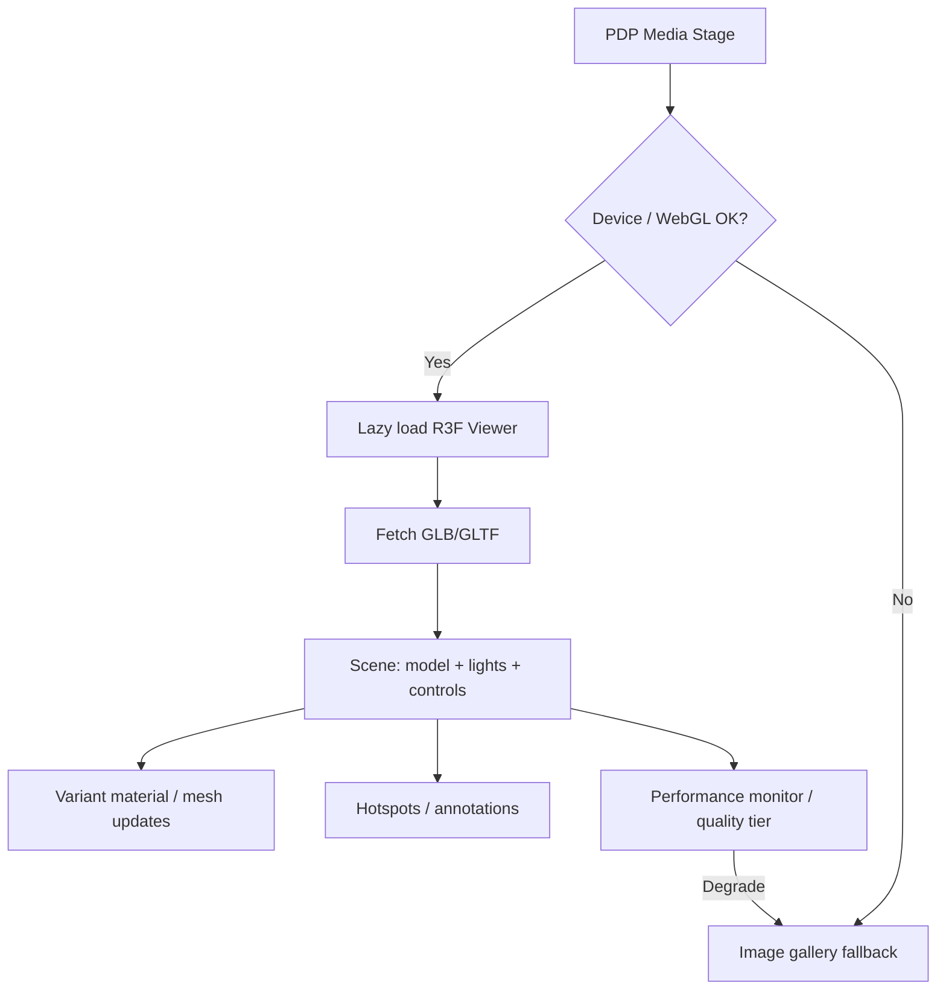

# 33 — Product 3D Viewer

## Purpose

Specify requirements for the interactive product 3D viewer (GLB/GLTF) embedded in product experiences: camera controls, lighting, materials, variants, hotspots, annotations, and mobile fallbacks. Implementation must align with the dedicated 3D engineering docs.

## Related Documents

- [80_3D_ARCHITECTURE.md](./80_3D_ARCHITECTURE.md) — overall 3D system architecture
- [81_THREE_JS_STANDARDS.md](./81_THREE_JS_STANDARDS.md) — Three.js / R3F coding standards
- [82_3D_MODEL_GUIDELINES.md](./82_3D_MODEL_GUIDELINES.md) — asset authoring guidelines
- [83_3D_PRODUCT_INTERACTIONS.md](./83_3D_PRODUCT_INTERACTIONS.md) — interaction patterns
- [84_3D_PERFORMANCE.md](./84_3D_PERFORMANCE.md) — performance budgets & fallbacks
- [30_PRODUCT_ARCHITECTURE.md](./30_PRODUCT_ARCHITECTURE.md)
- [32_PRODUCT_DETAILS.md](./32_PRODUCT_DETAILS.md)
- [34_PRODUCT_CONFIGURATOR.md](./34_PRODUCT_CONFIGURATOR.md)
- [36_PRODUCT_MEDIA.md](./36_PRODUCT_MEDIA.md)
- [19_MOUSE_INTERACTIONS.md](./19_MOUSE_INTERACTIONS.md)

## Requirements

1. Support GLB and GLTF product models delivered for web.
2. Provide rotate, zoom, and pan camera controls.
3. Support lighting suitable for premium product presentation.
4. Allow material/appearance changes tied to variants where authored.
5. Support hotspots and technical annotations.
6. Provide mobile-optimized experience or non-WebGL fallback.
7. Admin can attach models to products without code changes (see media/admin docs).

## Technical Decisions

| Decision | Choice | Rationale |
|---|---|---|
| Runtime | Three.js + React Three Fiber + Drei | Master stack |
| Formats | GLB preferred; GLTF supported | Binary packaging efficiency |
| Embedding | Lazy-loaded viewer on PDP media stage | Performance isolation |
| Controls | OrbitControls (or Drei equivalent) with limits | Predictable UX |
| HDR/env | Optional environment lighting — **TBD** asset set | Premium materials |
| Hotspots | Data-driven from viewerConfig JSON | CMS/admin extensibility |
| Fallback | Static images / poster frame + “View gallery” | Mobile/low-power devices |

## Viewer Capabilities

### Camera & controls

| Control | Requirement |
|---|---|
| Rotate | Drag / one-finger orbit |
| Zoom | Wheel / pinch; min/max distance clamped |
| Pan | Optional; enable when model requires inspection of large assemblies |
| Reset | Control to restore default camera |
| Auto-rotate | Optional, off by default for accessibility |

### Lighting & materials

| Topic | Requirement |
|---|---|
| Lighting | Studio-like product lighting; avoid crushing contrast |
| Materials | Respect authored PBR materials; variant swaps via material/mesh targets in config |
| Shadows | Optional contact shadows if performance allows |
| Tone mapping | Consistent with site visual system — details in Three.js standards |

### Variants

- Variant selection on PDP may swap:
  - Entire model URL, or
  - Material colors/textures on named meshes, or
  - Visibility of meshes (configuration)
- Mapping rules authored in `viewerConfig` and/or configurator rules ([34](./34_PRODUCT_CONFIGURATOR.md)).
- Business rules for which options change 3D — **TBD** per product family.

### Hotspots & annotations

| Feature | Behavior |
|---|---|
| Hotspots | Clickable markers in 3D space |
| Annotations | Labels/callouts for components or specs |
| Content | Title, short text, optional link to spec section or exploded highlight |
| A11y | Keyboard-reachable list alternative of hotspot contents |
| Exploded views / assembly | Supported when authored — details in [83](./83_3D_PRODUCT_INTERACTIONS.md) |



## Mobile & Fallback Policy

| Condition | Behavior |
|---|---|
| Touch device | Simplify cursor; touch orbit/pinch; consider reduced DPR |
| Low-power / small viewport | Auto quality tier or fallback poster — thresholds in [84](./84_3D_PERFORMANCE.md) |
| WebGL unavailable | Static media only |
| `prefers-reduced-motion` | Disable auto-rotate and non-essential motion |
| Load failure | Error state + fallback images |

## Viewer Config (Conceptual)

```json
{
  "modelUrl": "https://cdn.example/products/sku/model.glb",
  "format": "glb",
  "defaultCamera": { "position": [0, 1, 2], "target": [0, 0.5, 0] },
  "controls": { "enablePan": false, "minDistance": 0.5, "maxDistance": 4 },
  "hotspots": [
    { "id": "hs1", "position": [0.1, 0.2, 0.0], "title": "TBD", "body": "TBD" }
  ],
  "variantBindings": [
    { "optionCode": "color", "optionValue": "black", "type": "material", "target": "Body", "color": "#111111" }
  ]
}
```

Exact schema finalized with admin/3D architecture docs; sample values above are illustrative, not business content.

## Functional Requirements

| ID | Requirement |
|---|---|
| FR-3DV-01 | Viewer loads GLB/GLTF referenced by product/variant. |
| FR-3DV-02 | User can rotate, zoom, and pan per config flags. |
| FR-3DV-03 | Lighting presents materials clearly on desktop baseline devices. |
| FR-3DV-04 | Variant changes can update materials/models when bindings exist. |
| FR-3DV-05 | Hotspots/annotations render from config and have non-3D alternatives. |
| FR-3DV-06 | Mobile/low-power path uses optimized tier or fallback imagery. |
| FR-3DV-07 | Viewer fails soft to gallery on asset/WebGL errors. |

## Non-Functional Requirements

| ID | Requirement |
|---|---|
| NFR-3DV-01 | Initial viewer JS is code-split from core PDP bundle. |
| NFR-3DV-02 | Assets follow size/polygon budgets in model guidelines. |
| NFR-3DV-03 | No major main-thread jank during orbit on target devices (see perf doc). |

## Dependencies

- Product3DModel entity and CDN/storage
- R3F application module
- PDP media stage integration
- Admin media upload pipeline ([76_ADMIN_MEDIA_MANAGEMENT.md](./76_ADMIN_MEDIA_MANAGEMENT.md), [36](./36_PRODUCT_MEDIA.md))

## Constraints

- Do not ship unoptimized CAD exports directly to production.
- Do not invent hotspot educational copy per product here.
- Custom mouse “ROTATE/ZOOM” states must disable on touch ([19](./19_MOUSE_INTERACTIONS.md)).

## Acceptance Criteria

- [ ] Controls, lighting, materials, variants, hotspots, annotations, mobile fallback documented.
- [ ] Explicit links to docs `80`–`84`.
- [ ] Viewer config concept and FR/NFR listed.
- [ ] Integration with PDP and product architecture referenced.
