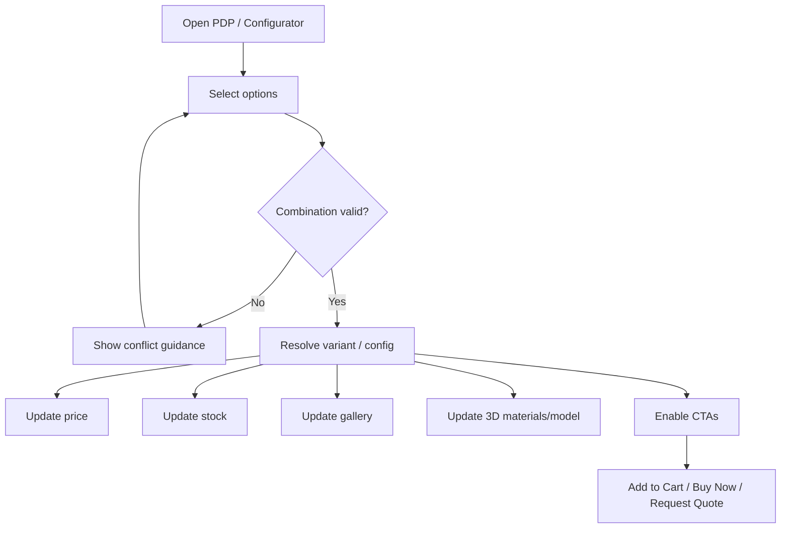

# 34 — Product Configurator

## Purpose

Define the product configurator experience where users select variants/options that affect visuals (including 3D), pricing, availability, and downstream cart/quote payloads. Business rules for option compatibility and pricing formulas are largely **TBD**.

## Related Documents

- [30_PRODUCT_ARCHITECTURE.md](./30_PRODUCT_ARCHITECTURE.md)
- [32_PRODUCT_DETAILS.md](./32_PRODUCT_DETAILS.md)
- [33_PRODUCT_3D_VIEWER.md](./33_PRODUCT_3D_VIEWER.md)
- [27_CONTACT_AND_ENQUIRY.md](./27_CONTACT_AND_ENQUIRY.md)
- [41_CART.md](./41_CART.md)
- [72_ADMIN_PRODUCTS.md](./72_ADMIN_PRODUCTS.md)

## Requirements

1. Allow option selection that resolves to a valid variant or configuration state.
2. Reflect configuration changes in price, stock, media, and 3D presentation when applicable.
3. Support Add to Cart / Buy Now / Request Quote using the configured selection.
4. Prevent invalid combinations (rules engine — **TBD** complexity).
5. Remain usable without 3D (2D swatches/images still update).

## Technical Decisions

| Decision | Choice | Rationale |
|---|---|---|
| Baseline | Variant option matrix on PDP | Covers most catalogs |
| Advanced configurator | Optional route `/.../configure` or PDP panel | For complex products only |
| Rule evaluation | Server-authoritative validation on add-to-cart/quote | Security and price integrity |
| Client UX state | Local selection state + derived resolved variant | Snappy UI |
| Price display | From resolved variant price | Avoid client-side price invention |
| 3D bindings | Via viewerConfig variantBindings | See 3D viewer doc |

## Configuration Model

```text
Product
  └── Option Groups (e.g. Color, Interface, Mount)   [TBD names]
        └── Option Values
              └── maps to Variant SKU and/or visual bindings
```

### Resolution strategies

| Strategy | When | Notes |
|---|---|---|
| Discrete variants | Finite SKU matrix | Select options → unique variant |
| Partial configuration | Some options cosmetic only | **TBD** whether cosmetic options share SKU |
| Rule-based BOM | Complex assemblies | Future; do not build unless approved |

## UX Flow



## Effects of Configuration

| Affected area | Behavior |
|---|---|
| Visuals (2D) | Swap primary image/gallery set for variant |
| Visuals (3D) | Material/mesh/model update per bindings |
| Pricing | Show resolved price if commerce-visible |
| Stock | Reflect variant inventory |
| SKU | Display resolved SKU |
| Documents | Optionally swap datasheet if variant-specific — **TBD** |
| CTAs | Re-evaluate enablement if variant overrides exist — **TBD** |

## Business Rules (TBD)

Explicitly unknown / not invented:

- Which products use advanced configurator vs simple variants
- Option dependency rules (e.g. Interface X disables Mount Y)
- Price modifiers vs fully priced SKUs
- Lead-time changes by option
- Minimum order quantities by configuration
- Whether quotes can include partially specified configs

Until approved, implement **discrete variant selection** only; design APIs so rule engines can be added later.

## Functional Requirements

| ID | Requirement |
|---|---|
| FR-CFG-01 | User can select available option values for a configurable product. |
| FR-CFG-02 | System resolves a variant or surfaces invalid combination state. |
| FR-CFG-03 | Price/stock/SKU update on valid resolution. |
| FR-CFG-04 | Gallery and 3D update when bindings/assets exist. |
| FR-CFG-05 | Cart and quote payloads include variant id and selected options snapshot. |
| FR-CFG-06 | Server rejects add-to-cart/quote for invalid/unpublished configurations. |

## Non-Functional Requirements

| ID | Requirement |
|---|---|
| NFR-CFG-01 | Option changes feel immediate (<100 ms UI feedback before network if data embedded). |
| NFR-CFG-02 | Configurator accessible via keyboard; options properly labeled. |
| NFR-CFG-03 | Works with reduced motion (no dependency on animation to convey state). |

## Dependencies

- Product variant matrix and attribute options
- Pricing/inventory services
- 3D viewer bindings
- Cart and enquiry APIs

## Constraints

- Do not invent compatibility matrices or surcharge tables.
- Do not trust client-only price calculations.
- Avoid building a full CPQ system in v1 without business approval.

## Acceptance Criteria

- [ ] Variant/config selection flow documented with Mermaid.
- [ ] Visual/price/stock effects listed.
- [ ] Business rules explicitly marked TBD.
- [ ] Links to PDP, 3D, cart, enquiry present.
