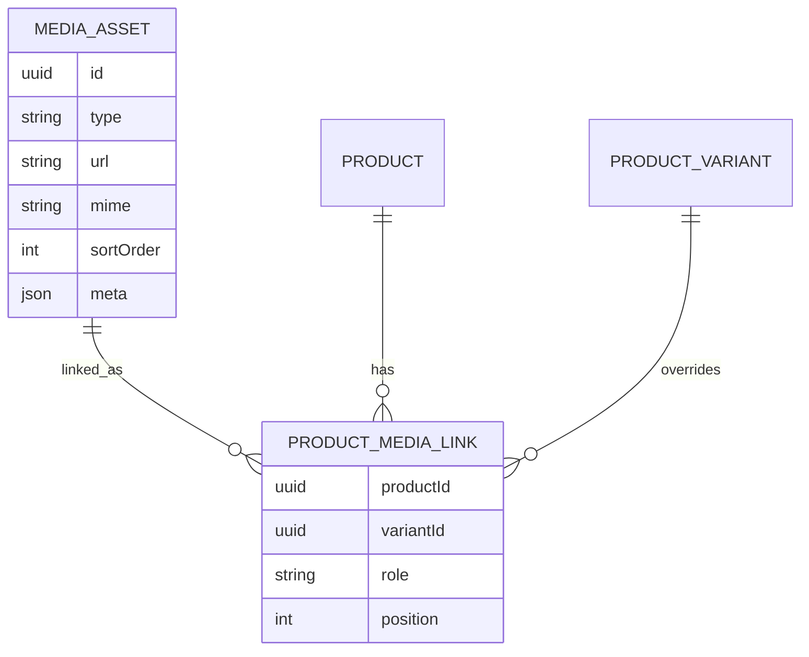
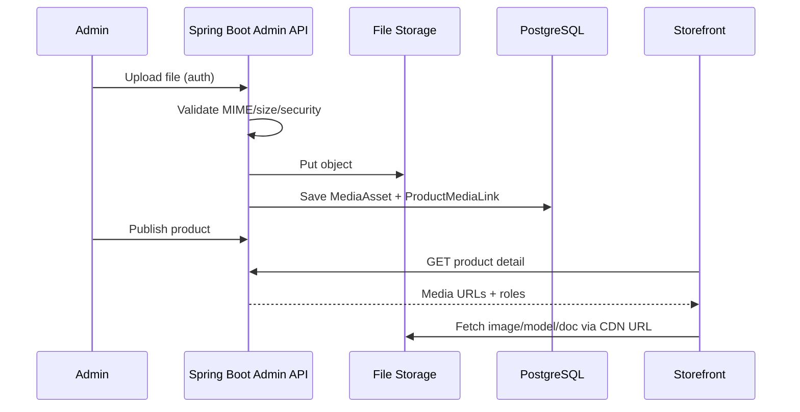

# 36 — Product Media

## Purpose

Define product media types (images, video, 3D, datasheets, manuals, technical drawings), how they attach to products/variants, public delivery behavior, and the admin upload path reference.

## Related Documents

- [30_PRODUCT_ARCHITECTURE.md](./30_PRODUCT_ARCHITECTURE.md)
- [32_PRODUCT_DETAILS.md](./32_PRODUCT_DETAILS.md)
- [33_PRODUCT_3D_VIEWER.md](./33_PRODUCT_3D_VIEWER.md)
- [17_IMAGE_GUIDELINES.md](./17_IMAGE_GUIDELINES.md)
- [68_FILE_STORAGE.md](./68_FILE_STORAGE.md)
- [76_ADMIN_MEDIA_MANAGEMENT.md](./76_ADMIN_MEDIA_MANAGEMENT.md)
- [72_ADMIN_PRODUCTS.md](./72_ADMIN_PRODUCTS.md)
- [93_FILE_UPLOAD_SECURITY.md](./93_FILE_UPLOAD_SECURITY.md)
- [82_3D_MODEL_GUIDELINES.md](./82_3D_MODEL_GUIDELINES.md)

## Requirements

1. Support rich media for engineering evaluation and premium commerce presentation.
2. Allow variant-specific media overrides when needed.
3. Deliver optimized images publicly; protect or control document downloads as required (**TBD** gating).
4. Enable admin upload and association without code deploys.
5. Align 3D assets with viewer and performance guidelines.

## Technical Decisions

| Decision | Choice | Rationale |
|---|---|---|
| Storage | Object storage via platform file storage module | Scalable CDN delivery |
| Media library | Shared library + product associations | Reuse across products/content |
| Image formats | Source upload JPEG/PNG/WebP; derive WebP/AVIF + responsive sizes | Performance |
| Video | Uploaded file and/or external URL embed — **TBD** provider policy | Flexibility |
| Documents | PDF primary for datasheets/manuals/drawings | Industry standard |
| 3D | GLB preferred; GLTF accepted | Viewer compatibility |
| Authz | Public read for published product images; documents may be public or gated — **TBD** | Security vs UX |

## Media Types

| Type | Extensions (typical) | Used on |
|---|---|---|
| Image | `.jpg`, `.png`, `.webp`, `.avif` (derived) | Gallery, listings, OG images |
| Video | `.mp4`, `.webm` and/or embed URL | PDP media stage |
| 3D model | `.glb`, `.gltf` (+ bin/textures if gltf) | 3D viewer |
| Datasheet | `.pdf` | PDP docs + Download Datasheet CTA |
| Manual | `.pdf` | PDP docs |
| Technical drawing | `.pdf`, optionally `.dwg`/`.dxf` — **TBD** if supported | PDP docs |
| Other certificate/doc | `.pdf` | Company/product trust assets |

## Association Model



### Roles

| Role | Purpose |
|---|---|
| `PRIMARY` | Default listing/PDP image |
| `GALLERY` | Additional images |
| `VIDEO` | Product video |
| `MODEL_3D` | Viewer asset |
| `DATASHEET` | Datasheet CTA target |
| `MANUAL` | User/install manual |
| `DRAWING` | Technical drawing |
| `OTHER_DOC` | Additional documents |

## Public Delivery Rules

| Media | Behavior |
|---|---|
| Images | CDN URLs; responsive `srcset`; lazy-load below fold |
| Video | Poster image required; lazy init player |
| 3D | Not preloaded until viewer open/idle policy; see [33](./33_PRODUCT_3D_VIEWER.md) / [84](./84_3D_PERFORMANCE.md) |
| Documents | Download endpoint with content-type and filename; optional auth gate **TBD** |

## Admin Upload Path (Reference)

End-to-end path for operators (details in admin/storage/security docs):

```text
Admin UI (Media Library / Product Editor)
        ↓
Authenticated Admin API (RBAC)
        ↓
Upload validation (type, size, malware scan hooks)
        ↓
File Storage service (68) — store object + metadata
        ↓
Media asset record persisted
        ↓
Associate to Product / Variant with role + sort order (72 / 76)
        ↓
Publish product → public catalog APIs expose media
        ↓
Storefront PDP / Listing / 3D viewer consume URLs
```



### Upload constraints (initial; finalize in security docs)

| Constraint | Guidance |
|---|---|
| Max image size | **TBD** (set in `93`) |
| Max 3D size | Per [82](./82_3D_MODEL_GUIDELINES.md) / [84](./84_3D_PERFORMANCE.md) |
| Max PDF size | **TBD** |
| Allowed MIME allowlist | Server-enforced |
| Filename sanitization | Required |
| Virus scanning | Required before public availability — tooling **TBD** |

## Functional Requirements

| ID | Requirement |
|---|---|
| FR-MED-01 | Admin can upload and tag media by type/role. |
| FR-MED-02 | Products can reference multiple gallery images and one primary. |
| FR-MED-03 | Variant may override primary/gallery/3D when configured. |
| FR-MED-04 | Datasheet role powers Download Datasheet CTA when enabled. |
| FR-MED-05 | 3D role powers viewer when present. |
| FR-MED-06 | Deleting/unlinking media does not break PDP (fallback to remaining assets). |
| FR-MED-07 | Unpublished product media is not exposed on public APIs. |

## Non-Functional Requirements

| ID | Requirement |
|---|---|
| NFR-MED-01 | Images served in modern formats with caching headers. |
| NFR-MED-02 | Uploads authenticated, authorized, and validated server-side. |
| NFR-MED-03 | Large assets do not block product save (async processing acceptable — **TBD** pipeline). |

## Dependencies

- File storage (`68`)
- Admin media (`76`) and products (`72`)
- Upload security (`93`)
- Image guidelines (`17`)
- 3D guidelines (`82`–`84`)

## Constraints

- Do not use random generic stock when authentic Neurolinx imagery exists.
- Do not accept arbitrary executable uploads.
- External video embed domains allowlist — **TBD**.

## Acceptance Criteria

- [ ] Media types cover images, video, 3D, datasheets, manuals, technical drawings.
- [ ] Association roles and variant overrides defined.
- [ ] Admin upload path referenced with sequence diagram.
- [ ] Security/storage cross-links present.
- [ ] TBD items for gating and size limits marked.
