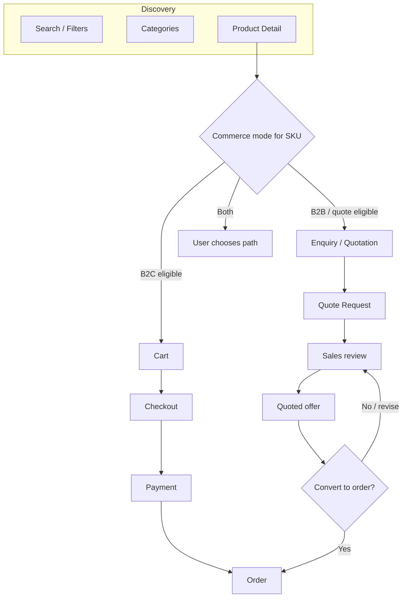
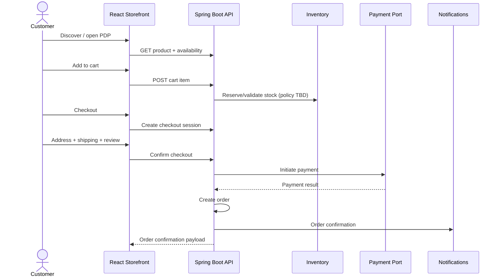
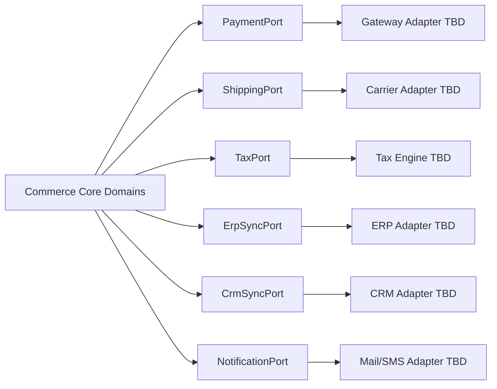

# 40 — E-Commerce Architecture

## Purpose

Define the overall commerce architecture for Neurolinx, supporting **B2C purchase flows** and **B2B enquiry/quotation workflows** on a shared product catalog, without coupling the platform to a single payment gateway, shipping provider, or ERP.

This document is the entry point for commerce design. Detailed behavior lives in sibling docs.

## Scope

| In scope | Out of scope |
| --- | --- |
| Dual-mode commerce model (B2C + B2B) | Specific gateway/shipping vendor selection |
| Discovery → cart → checkout → order flow | UI visual design (see design system docs) |
| Domain boundaries and integration hooks | Full ERP/CRM field mappings |
| Cross-cutting commerce NFRs | Admin UI screens (see [70_ADMIN_ARCHITECTURE.md](./70_ADMIN_ARCHITECTURE.md)) |

## Related documents

- [30_PRODUCT_ARCHITECTURE.md](./30_PRODUCT_ARCHITECTURE.md) — catalog, variants, stock
- [41_CART.md](./41_CART.md)
- [42_CHECKOUT.md](./42_CHECKOUT.md)
- [43_PAYMENT.md](./43_PAYMENT.md)
- [44_ORDER_MANAGEMENT.md](./44_ORDER_MANAGEMENT.md)
- [45_CUSTOMER_ACCOUNT.md](./45_CUSTOMER_ACCOUNT.md)
- [46_WISHLIST.md](./46_WISHLIST.md)
- [47_REVIEWS.md](./47_REVIEWS.md)
- [48_COUPONS.md](./48_COUPONS.md)
- [50_REACT_ARCHITECTURE.md](./50_REACT_ARCHITECTURE.md)
- [62_API_ARCHITECTURE.md](./62_API_ARCHITECTURE.md)
- [94_PAYMENT_SECURITY.md](./94_PAYMENT_SECURITY.md)

---

## Requirements

### Business requirements

1. Neurolinx must operate as both a **premium B2C shop** and a **B2B enquiry/quotation channel**.
2. Products may expose one or more of: Buy Now, Add to Cart, Request Quote, Contact Sales, Download Datasheet (eligibility **TBD** per product/category).
3. Commerce must feel premium and reliable; corporate credibility must not be undermined by a generic marketplace UX.
4. Architecture must allow future payment gateways, shipping providers, inventory systems, CRM, and ERP without redesigning core order/cart domains.

### Product capabilities (from master spec)

- Product discovery, search, filters, categories, product details
- Cart, wishlist, checkout, address management
- Payment, orders, order tracking
- Reviews, coupons, customer accounts
- Invoices and notifications

---

## Technical decisions

| Decision | Choice | Rationale |
| --- | --- | --- |
| Dual commerce modes | Shared catalog; divergent fulfillment paths | One product truth; different conversion paths |
| API style | REST via Spring Boot OpenAPI | Aligns with platform stack |
| Payment | Provider-agnostic payment port/adapter | Avoid lock-in; see [43_PAYMENT.md](./43_PAYMENT.md) |
| Shipping | Shipping quote/fulfillment port | Carrier TBD |
| ERP/CRM | Event/outbox-style integration hooks | Loose coupling |
| Stock authority | Backend inventory module is source of truth | Frontend never invents availability |
| Guest commerce | Supported for B2C where policy allows | Guest checkout policy **TBD** — see [42_CHECKOUT.md](./42_CHECKOUT.md) |
| Currency / tax / region | **TBD** | Business not yet defined |

### Recommended domain modules (backend)

```text
catalog | inventory | cart | checkout | orders | payments
shipping | quotes | coupons | reviews | customers | notifications
```

Public React app and Admin React app both consume the same REST API surface with role-scoped endpoints.

---

## Shipping (adapter module)

Shipping is a **first-class backend module** with a provider port/adapter — not a separate product catalog.

| Concern | Standard |
| --- | --- |
| Source of truth | Checkout/order docs for UX; backend Shipping module for rates/labels/tracking |
| Checkout | Address → **shipping selection** → review → pay ([42_CHECKOUT.md](./42_CHECKOUT.md)) |
| Orders | Tracking numbers / shipment status on order ([44_ORDER_MANAGEMENT.md](./44_ORDER_MANAGEMENT.md)) |
| Coupons | Free-shipping type capability when enabled ([48_COUPONS.md](./48_COUPONS.md)) |
| Provider | Carrier/gateway **TBD**; architecture must not hard-code one vendor |
| B2B quotes | Shipping terms may be negotiated offline — do not force B2C shipping UI onto quote-only SKUs |

There is no separate `docs/4x_SHIPPING.md` file; shipping requirements live here plus checkout/orders. Expand into a dedicated doc only if provider complexity warrants it.

---

## Dual-mode model



### Mode rules (known vs TBD)

| Topic | Status |
| --- | --- |
| A SKU may support cart, quote, or both | Required capability |
| Who decides eligibility (admin flags, category rules, price thresholds) | **TBD** |
| Whether B2B accounts get different pricing | **TBD** |
| Minimum order quantities / pack sizes | **TBD** |
| Tax-inclusive vs exclusive display | **TBD** |

---

## Primary B2C flow



---

## Expansion hooks (no tight coupling)

Integrations must be behind ports/adapters (or equivalent module boundaries). Core domains emit domain events; adapters translate to external systems.

| Hook | Interface responsibility | Concrete vendor |
| --- | --- | --- |
| Payment gateway | Authorize, capture, refund, webhook verify | **TBD** — [43_PAYMENT.md](./43_PAYMENT.md) |
| Shipping | Rate quotes, label/create shipment, tracking ingest | **TBD** |
| Tax calculation | Compute tax for cart/checkout | **TBD** (engine vs manual) |
| ERP | Sync products, stock, orders, invoices | **TBD** |
| CRM | Sync customers, quotes, follow-ups | **TBD** |
| Inventory systems | External stock authority sync | **TBD** |
| Notifications | Email/SMS/push templates | Provider **TBD** |



**Constraint:** Do not embed vendor-specific SDKs or field names inside cart/order aggregate logic.

---

## Functional requirements

| ID | Requirement |
| --- | --- |
| FR-EC-01 | Customers can discover products via search, filters, categories, and PDP. |
| FR-EC-02 | Eligible products support Add to Cart / Buy Now paths. |
| FR-EC-03 | Eligible products support Request Quote / Contact Sales paths. |
| FR-EC-04 | Cart persists for guest and authenticated users per [41_CART.md](./41_CART.md). |
| FR-EC-05 | Checkout collects address, shipping, and review steps per [42_CHECKOUT.md](./42_CHECKOUT.md). |
| FR-EC-06 | Payments go through an abstracted payment module per [43_PAYMENT.md](./43_PAYMENT.md). |
| FR-EC-07 | Orders have trackable lifecycle states per [44_ORDER_MANAGEMENT.md](./44_ORDER_MANAGEMENT.md). |
| FR-EC-08 | Customer accounts expose profile, addresses, orders, wishlist, quotes per [45_CUSTOMER_ACCOUNT.md](./45_CUSTOMER_ACCOUNT.md). |
| FR-EC-09 | Wishlist, reviews, and coupons are supported per sibling docs. |
| FR-EC-10 | Commerce domains emit integration events suitable for future ERP/CRM/shipping adapters. |

## Non-functional requirements

| ID | Requirement |
| --- | --- |
| NFR-EC-01 | Cart/checkout APIs must be idempotent where money or stock is affected. |
| NFR-EC-02 | Stock and price shown at checkout must be revalidated server-side before order creation. |
| NFR-EC-03 | Payment and PII handling must comply with [90_SECURITY_ARCHITECTURE.md](./90_SECURITY_ARCHITECTURE.md) and [94_PAYMENT_SECURITY.md](./94_PAYMENT_SECURITY.md). |
| NFR-EC-04 | Storefront commerce flows must meet Core Web Vitals targets in [54_FRONTEND_PERFORMANCE.md](./54_FRONTEND_PERFORMANCE.md) / [102_PERFORMANCE_STANDARDS.md](./102_PERFORMANCE_STANDARDS.md). |
| NFR-EC-05 | Commerce modules must remain independently deployable at the *logical* module boundary even if shipped in one Spring Boot app initially. |

## Dependencies

- Product/catalog and inventory modules
- Auth/RBAC ([63_AUTHENTICATION.md](./63_AUTHENTICATION.md), [64_AUTHORIZATION_RBAC.md](./64_AUTHORIZATION_RBAC.md))
- Notifications module
- Frontend storefront routes and state ([50_REACT_ARCHITECTURE.md](./50_REACT_ARCHITECTURE.md), [52_FRONTEND_STATE_MANAGEMENT.md](./52_FRONTEND_STATE_MANAGEMENT.md))
- OpenAPI contract ([53_FRONTEND_API_INTEGRATION.md](./53_FRONTEND_API_INTEGRATION.md))

## Constraints

1. Do not invent pricing rules, tax regimes, return policies, or MOQs — mark **TBD**.
2. Do not hard-code a payment or shipping vendor in core domains.
3. Admin and public storefronts share APIs; do not duplicate business rules only in the UI.
4. 3D/visualization enhancements must not block add-to-cart or quote CTAs.

## Open questions (TBD)

- Supported selling regions and currencies
- Tax calculation approach
- Guest checkout eligibility and fraud controls
- Stock reservation timing (add-to-cart vs checkout vs payment)
- Quote-to-order conversion commercial rules
- Returns/RMA policy
- Partial shipment / backorder policy

## Acceptance criteria

- [ ] Architecture doc describes both B2C and B2B paths with a clear divergence after PDP.
- [ ] Discovery → cart → checkout → order flow is documented with Mermaid.
- [ ] Payment, shipping, tax, ERP, CRM hooks are documented as ports without vendor lock-in.
- [ ] Sibling commerce docs are cross-referenced; no contradictory ownership of domains.
- [ ] All unknown business rules are listed as TBD (not invented).
