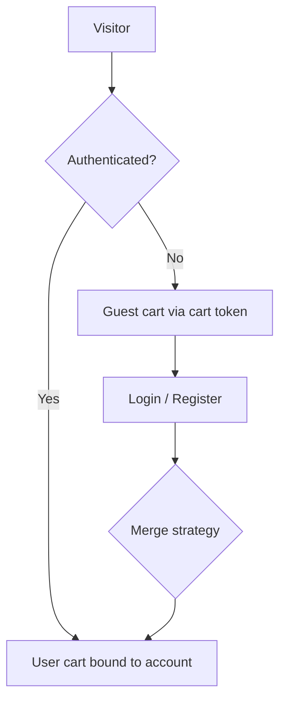
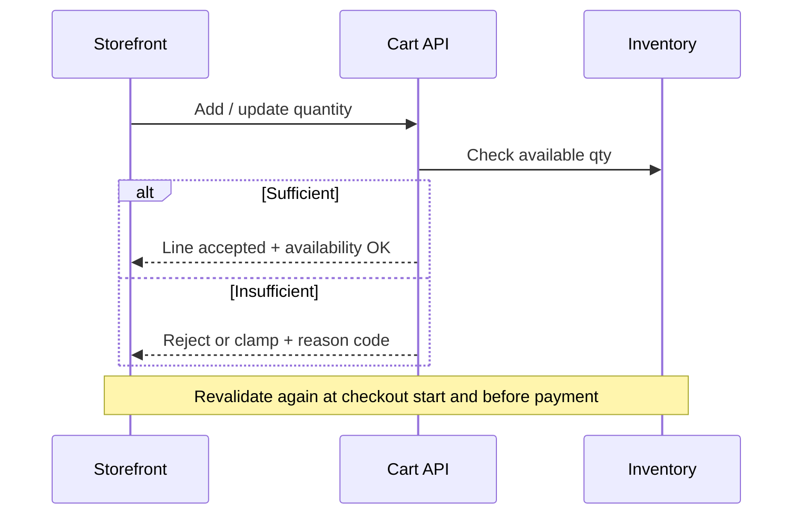

# 41 — Cart

## Purpose

Define the shopping cart model for Neurolinx B2C commerce: line items, guest vs authenticated behavior, persistence, and stock validation. Quote/enquiry carts are **out of scope** here (see quotation flow in [40_ECOMMERCE_ARCHITECTURE.md](./40_ECOMMERCE_ARCHITECTURE.md)).

## Related documents

- [40_ECOMMERCE_ARCHITECTURE.md](./40_ECOMMERCE_ARCHITECTURE.md)
- [42_CHECKOUT.md](./42_CHECKOUT.md)
- [30_PRODUCT_ARCHITECTURE.md](./30_PRODUCT_ARCHITECTURE.md)
- [48_COUPONS.md](./48_COUPONS.md)
- [52_FRONTEND_STATE_MANAGEMENT.md](./52_FRONTEND_STATE_MANAGEMENT.md)
- [66_DATABASE_SCHEMA.md](./66_DATABASE_SCHEMA.md)

---

## Requirements

1. Customers can add eligible SKUs/variants to a cart, update quantities, and remove lines.
2. Cart works for **guests** and **authenticated** customers.
3. Cart state must survive page refresh; merge rules apply on login.
4. Backend is the authority for price, stock eligibility, and totals.
5. Coupons may attach to cart/checkout — application rules **TBD** ([48_COUPONS.md](./48_COUPONS.md)).

---

## Technical decisions

| Decision | Choice | Rationale |
| --- | --- | --- |
| Cart ownership | Server-side cart resource with client cache | Prevents price/stock spoofing |
| Guest identity | Opaque cart token (cookie/header) | Survives refresh without account |
| Client cache | Zustand for UI cart mirror | Fast UX; server revalidates |
| Server sync | TanStack Query mutations + invalidate | Aligns with frontend state strategy |
| Totals | Computed on server | Tax/coupon/shipping may change totals |

### Cart entity (conceptual)

```text
Cart
├── id
├── ownerType: GUEST | USER
├── ownerId / guestToken
├── currency (TBD default)
├── lines[]
│   ├── productId / variantId
│   ├── quantity
│   ├── unitPriceSnapshot (display; revalidated)
│   └── availabilityStatus
├── couponCodes[] (optional)
├── updatedAt
└── expiresAt (guest TTL TBD)
```

Exact schema: [66_DATABASE_SCHEMA.md](./66_DATABASE_SCHEMA.md).

---

## Guest vs authenticated



| Scenario | Behavior |
| --- | --- |
| Guest adds items | Create/update guest cart; persist token securely |
| Guest refreshes | Restore cart via token |
| Guest logs in | Merge guest lines into user cart |
| Merge conflict (same SKU) | Sum quantities, then clamp to available stock (**TBD** if business prefers replace) |
| Guest cart expiry | **TBD** TTL |
| Multi-device authenticated | Single server cart per user (latest wins); conflict UX **TBD** |

---

## Persistence

| Layer | Responsibility |
| --- | --- |
| Browser | Cart token cookie/local storage policy **TBD** (prefer HttpOnly cookie if feasible) |
| Zustand | Optimistic UI for qty/add/remove |
| API | Durable cart CRUD |
| Redis (optional) | Session/cart cache — see [67_REDIS_ARCHITECTURE.md](./67_REDIS_ARCHITECTURE.md) |
| PostgreSQL | Source of truth for authenticated carts (and guest if persisted) |

**Constraint:** Never trust client-only prices for checkout.

---

## Stock validation



| Checkpoint | Required |
| --- | --- |
| Add to cart | Yes — soft validation |
| Update quantity | Yes |
| Open cart drawer/page | Recommended revalidate |
| Enter checkout | Mandatory revalidate |
| Place order / pay | Mandatory revalidate |

Stock reservation (hard hold) timing: **TBD** (none / checkout / payment authorization).

Unavailable lines must surface clear reason codes (e.g. `OUT_OF_STOCK`, `QTY_REDUCED`) without inventing backorder policy.

---

## Functional requirements

| ID | Requirement |
| --- | --- |
| FR-CART-01 | Add eligible product/variant with quantity ≥ 1. |
| FR-CART-02 | Update and remove line items. |
| FR-CART-03 | Display line count and subtotal from server totals. |
| FR-CART-04 | Block or adjust adds when stock insufficient. |
| FR-CART-05 | Persist guest cart across sessions per token policy. |
| FR-CART-06 | Merge guest cart into user cart on authentication. |
| FR-CART-07 | Exclude non-purchasable / quote-only SKUs from cart adds (eligibility flags). |
| FR-CART-08 | Support Buy Now as cart-with-single-intent into checkout (**TBD** whether Buy Now uses ephemeral cart). |

## Non-functional requirements

| ID | Requirement |
| --- | --- |
| NFR-CART-01 | Cart mutations are authenticated by cart token or user session; no cross-cart access. |
| NFR-CART-02 | Cart read/update p95 latency target **TBD** (document once SLOs exist). |
| NFR-CART-03 | Optimistic UI must reconcile with server response within the same interaction. |
| NFR-CART-04 | Cart APIs rate-limited to reduce abuse. |

## Dependencies

- Inventory / product variant APIs
- Auth session for user carts
- Coupon module (optional attachment)
- Frontend Zustand + Query integration

## Constraints

1. Do not allow negative quantities or fractional units unless product UOM policy defines them (**TBD**).
2. Do not store payment instruments on the cart.
3. Do not invent discount stacking rules here.

## Open questions (TBD)

- Guest cart TTL and cleanup job
- Hard stock reservation timing
- Merge strategy preference (sum vs replace)
- Max lines / max quantity per line
- Whether carts are multi-currency

## Acceptance criteria

- [ ] Guest and authenticated cart behaviors are documented and implementable.
- [ ] Persistence layers and authority (server totals) are explicit.
- [ ] Stock validation checkpoints are defined for add, checkout, and order.
- [ ] Merge-on-login behavior is specified with TBD only where business choice remains open.
- [ ] Cross-refs to checkout, coupons, and schema docs are present.
