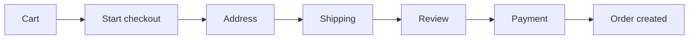
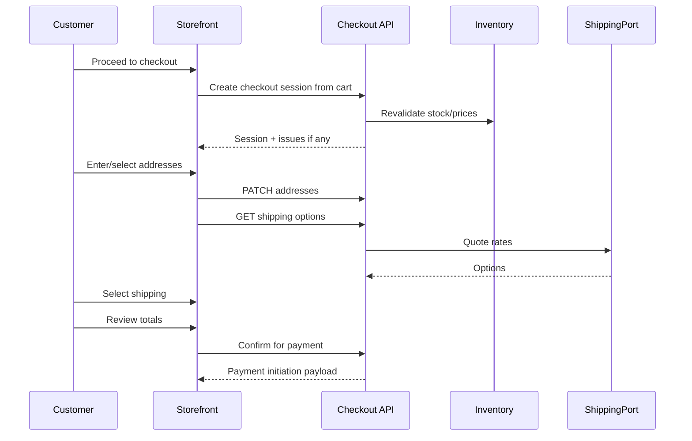

# 42 — Checkout

## Purpose

Define the Neurolinx checkout experience: address capture, shipping selection, order review, and guest checkout considerations. Payment execution is covered in [43_PAYMENT.md](./43_PAYMENT.md).

## Related documents

- [40_ECOMMERCE_ARCHITECTURE.md](./40_ECOMMERCE_ARCHITECTURE.md)
- [41_CART.md](./41_CART.md)
- [43_PAYMENT.md](./43_PAYMENT.md)
- [44_ORDER_MANAGEMENT.md](./44_ORDER_MANAGEMENT.md)
- [45_CUSTOMER_ACCOUNT.md](./45_CUSTOMER_ACCOUNT.md)
- [94_PAYMENT_SECURITY.md](./94_PAYMENT_SECURITY.md)

---

## Requirements

1. Checkout converts a validated cart into a payable (or COD/**TBD**) order intent.
2. Steps include **address**, **shipping**, and **review** before payment.
3. Authenticated users can reuse saved addresses.
4. Guest checkout may be allowed — **policy TBD**.
5. Server revalidates stock, pricing, coupons, and shipping before confirmation.

---

## Technical decisions

| Decision | Choice | Rationale |
| --- | --- | --- |
| Checkout model | Explicit checkout session derived from cart | Stable snapshot for review/pay |
| Step UX | Linear steps (Address → Shipping → Review → Pay) | Clear premium flow; can collapse on desktop later |
| Totals authority | Server | Prevents client manipulation |
| Address validation | Provider **TBD** (manual entry minimum) | Do not block MVP on external AVS |
| Shipping rates | Via ShippingPort | Carrier TBD |

### Checkout session (conceptual)

```text
CheckoutSession
├── id
├── cartId
├── customer (userId | guest contact)
├── billingAddress
├── shippingAddress
├── shippingMethod
├── lineSnapshots[]
├── priceSummary (subtotal, discounts, shipping, tax, total)
├── status: OPEN | LOCKED_FOR_PAYMENT | COMPLETED | EXPIRED | CANCELLED
└── expiresAt
```

---

## Flow





---

## Address

| Requirement | Detail |
| --- | --- |
| Shipping address | Required for physical goods |
| Billing address | Required; may default to shipping (**TBD** UX) |
| Saved addresses | Authenticated users only — see [45_CUSTOMER_ACCOUNT.md](./45_CUSTOMER_ACCOUNT.md) |
| Fields | Name, lines, city, region, postal, country, phone — exact validation **TBD** by region |
| Digital-only SKUs | Shipping step may be skipped if cart is entirely non-physical (**TBD** product types) |

---

## Shipping

| Topic | Status |
| --- | --- |
| Shipping methods from ShippingPort | Required abstraction |
| Free shipping thresholds | **TBD** |
| International shipping | **TBD** |
| Pickup / store collection | **TBD** |
| Delivery ETA display | Preferred; source **TBD** |
| Shipping to billing-only | Disallowed for physical goods unless policy says otherwise (**TBD**) |

If no shipping options return, checkout must block progress with a clear error (not a silent zero).

---

## Review

Review step must show:

- Line items (name, variant, qty, unit/line price)
- Address summary
- Shipping method and cost
- Discounts/coupons applied
- Tax line (**TBD** calculation)
- Grand total
- Editable navigation back to prior steps

Customer must explicitly confirm before payment initiation.

---

## Guest checkout considerations

| Topic | Guidance | Status |
| --- | --- | --- |
| Allow guest checkout | Common for B2C conversion | **TBD** business decision |
| Required guest fields | Email (+ phone **TBD**) | Email required if guests allowed |
| Order access after purchase | Magic link / order token | **TBD** |
| Force account creation | Optional prompt; do not invent mandatory signup | **TBD** |
| Fraud controls | Rate limits, CAPTCHA, velocity checks | **TBD** thresholds — see security docs |
| Guest PII retention | Privacy policy dependent | **TBD** |

Until guest policy is decided, architecture must support both: authenticated-only checkout **or** guest checkout behind a feature flag.

---

## Functional requirements

| ID | Requirement |
| --- | --- |
| FR-CHK-01 | Create checkout session from current cart. |
| FR-CHK-02 | Capture/select shipping and billing addresses. |
| FR-CHK-03 | Present shipping options and persist selection. |
| FR-CHK-04 | Show review summary with server-calculated totals. |
| FR-CHK-05 | Block confirm when stock/price/shipping invalid. |
| FR-CHK-06 | Hand off to payment module without collecting raw card data in app code (PCI). |
| FR-CHK-07 | Support return-to-cart if customer abandons. |
| FR-CHK-08 | Expire stale checkout sessions (**TTL TBD**). |

## Non-functional requirements

| ID | Requirement |
| --- | --- |
| NFR-CHK-01 | Checkout confirmation is idempotent (double-submit safe). |
| NFR-CHK-02 | PII transmitted only over HTTPS; stored per [92_DATA_SECURITY.md](./92_DATA_SECURITY.md). |
| NFR-CHK-03 | Checkout UX usable on mobile-first breakpoints ([55_RESPONSIVE_DESIGN.md](./55_RESPONSIVE_DESIGN.md)). |
| NFR-CHK-04 | No payment card PAN/CVV in Neurolinx logs or databases. |

## Dependencies

- Cart module
- Customer addresses
- ShippingPort / TaxPort
- Payment module
- Notifications (order confirmation)

## Constraints

1. Do not invent tax rates, shipping prices, or return policies.
2. Do not skip server revalidation because the client “already checked.”
3. Do not collect unrestricted card data in custom forms — use gateway-hosted/fields approach per [94_PAYMENT_SECURITY.md](./94_PAYMENT_SECURITY.md).

## Open questions (TBD)

- Guest checkout enabled?
- COD / invoice / bank transfer methods for B2B
- Tax engine
- Checkout session TTL
- Whether billing must differ from shipping
- Address autocomplete provider

## Acceptance criteria

- [ ] Address, shipping, and review steps are specified.
- [ ] Guest checkout is treated as a configurable policy with TBD, not assumed.
- [ ] Revalidation and idempotency requirements are explicit.
- [ ] Handoff to payment and order creation is clear.
- [ ] Mermaid flow documents the happy path.
