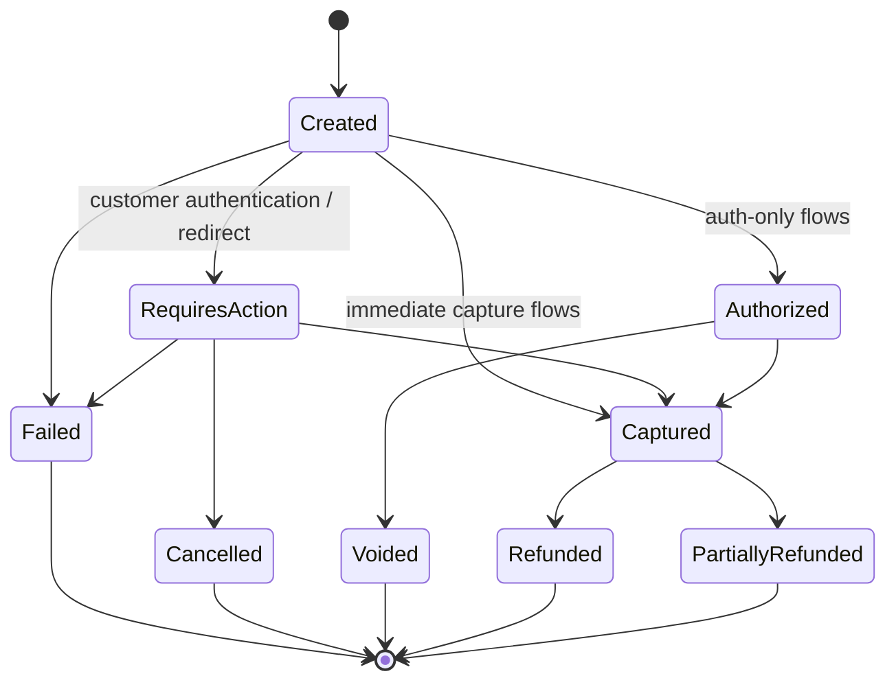
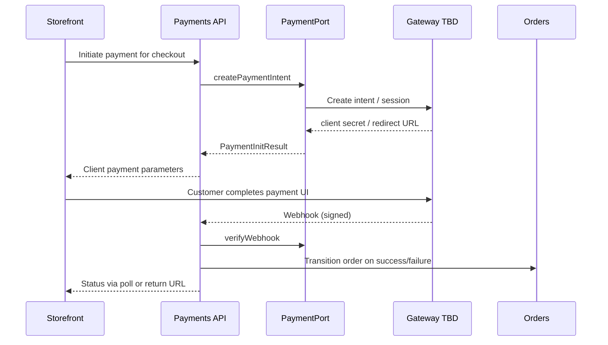

# 43 — Payment

## Purpose

Define the payment abstraction for Neurolinx commerce: provider-agnostic payment operations, webhook handling, and PCI-related constraints. Concrete gateway selection is **TBD**. Security controls are owned by [94_PAYMENT_SECURITY.md](./94_PAYMENT_SECURITY.md).

## Related documents

- [40_ECOMMERCE_ARCHITECTURE.md](./40_ECOMMERCE_ARCHITECTURE.md)
- [42_CHECKOUT.md](./42_CHECKOUT.md)
- [44_ORDER_MANAGEMENT.md](./44_ORDER_MANAGEMENT.md)
- [90_SECURITY_ARCHITECTURE.md](./90_SECURITY_ARCHITECTURE.md)
- [91_API_SECURITY.md](./91_API_SECURITY.md)
- [94_PAYMENT_SECURITY.md](./94_PAYMENT_SECURITY.md)

---

## Requirements

1. Support initiating payment for a confirmed checkout session.
2. Record payment attempts and final states against orders.
3. Support refunds/cancellations at the API boundary (business rules **TBD**).
4. Remain gateway-replaceable via a `PaymentPort` adapter.
5. Never store raw card PAN/CVV in Neurolinx systems.

---

## Technical decisions

| Decision | Choice | Rationale |
| --- | --- | --- |
| Integration style | Port/adapter (`PaymentPort`) | Future gateways without core rewrites |
| Card UI | Hosted fields / redirect / wallet per gateway capabilities | Reduces PCI scope — see [94_PAYMENT_SECURITY.md](./94_PAYMENT_SECURITY.md) |
| Webhooks | Signed inbound events update payment + order | Source of truth for async outcomes |
| Idempotency | Idempotency keys on initiate/capture/refund | Safe retries |
| Multi-method | Interface supports CARD, WALLET, BANK, INVOICE, COD placeholders | Methods enabled **TBD** |

### PaymentPort (conceptual)

```text
PaymentPort
├── createPaymentIntent(checkoutId, amount, currency, metadata)
├── confirm/capture (as required by method)
├── refund(paymentId, amount?, reason?)
├── getStatus(paymentId)
└── verifyWebhook(signature, payload) → PaymentEvent
```

Gateway SDK details live only inside adapters.

---

## Payment lifecycle



Exact mapping from gateway statuses → internal statuses is adapter responsibility.



---

## Functional requirements

| ID | Requirement |
| --- | --- |
| FR-PAY-01 | Initiate payment from a locked checkout session. |
| FR-PAY-02 | Persist payment records with amount, currency, status, gateway reference. |
| FR-PAY-03 | Process verified webhooks to update payment status. |
| FR-PAY-04 | Expose payment status to storefront for success/failure UX. |
| FR-PAY-05 | Support refund API for authorized operators (policy **TBD**). |
| FR-PAY-06 | Reject payment initiation when checkout totals/stock invalid. |
| FR-PAY-07 | Support feature-flagged methods (e.g. invoice for B2B) without rewriting core. |

## Non-functional requirements

| ID | Requirement |
| --- | --- |
| NFR-PAY-01 | No PAN/CVV storage or logging — [94_PAYMENT_SECURITY.md](./94_PAYMENT_SECURITY.md). |
| NFR-PAY-02 | Webhook endpoints authenticate sender signatures; reject invalid payloads. |
| NFR-PAY-03 | Secrets (API keys) only in secure config/secret store. |
| NFR-PAY-04 | Payment operations audited (who/what/when). |
| NFR-PAY-05 | Timeouts and retries must not double-charge (idempotency). |

## PCI considerations (summary)

Full controls: **[94_PAYMENT_SECURITY.md](./94_PAYMENT_SECURITY.md)**.

Minimum architecture commitments:

1. Prefer gateway-hosted or embedded fields so Neurolinx remains outside full card-data environment scope where possible.
2. TLS everywhere; HSTS at edge.
3. Restrict payment admin actions via RBAC.
4. Do not persist full webhook payloads if they contain sensitive artifacts beyond operational need.
5. SAQ / PCI level and chosen integration model: **TBD** after gateway selection.

---

## B2B note

B2B quotation conversion may use:

- Online card/wallet payment after quote acceptance, and/or
- Invoice / purchase-order / bank transfer methods (**TBD**)

Payment module must model `methodType` so B2B can enable non-card rails without a separate order system.

---

## Dependencies

- Checkout sessions
- Orders module
- Notification on payment success/failure
- Secret management / config
- [94_PAYMENT_SECURITY.md](./94_PAYMENT_SECURITY.md)

## Constraints

1. Gateway vendor is **TBD** — do not hard-code Stripe/Razorpay/etc. into domain types.
2. Do not invent surcharge, installment, or EMI rules.
3. Frontend must not implement “fake success” without server confirmation.

## Open questions (TBD)

- Primary gateway and region
- Auth-capture vs sale
- Partial capture / multi-capture
- Enabled methods per channel (B2C vs B2B)
- Refund windows and restocking fees
- 3-D Secure / SCA requirements by market
- Currency conversion

## Acceptance criteria

- [ ] PaymentPort operations are documented.
- [ ] Lifecycle states and webhook-driven updates are clear.
- [ ] PCI obligations are linked to 94_PAYMENT_SECURITY.md (not duplicated as soft claims).
- [ ] Gateway remains swappable.
- [ ] Idempotency and no-PAN constraints are explicit.
