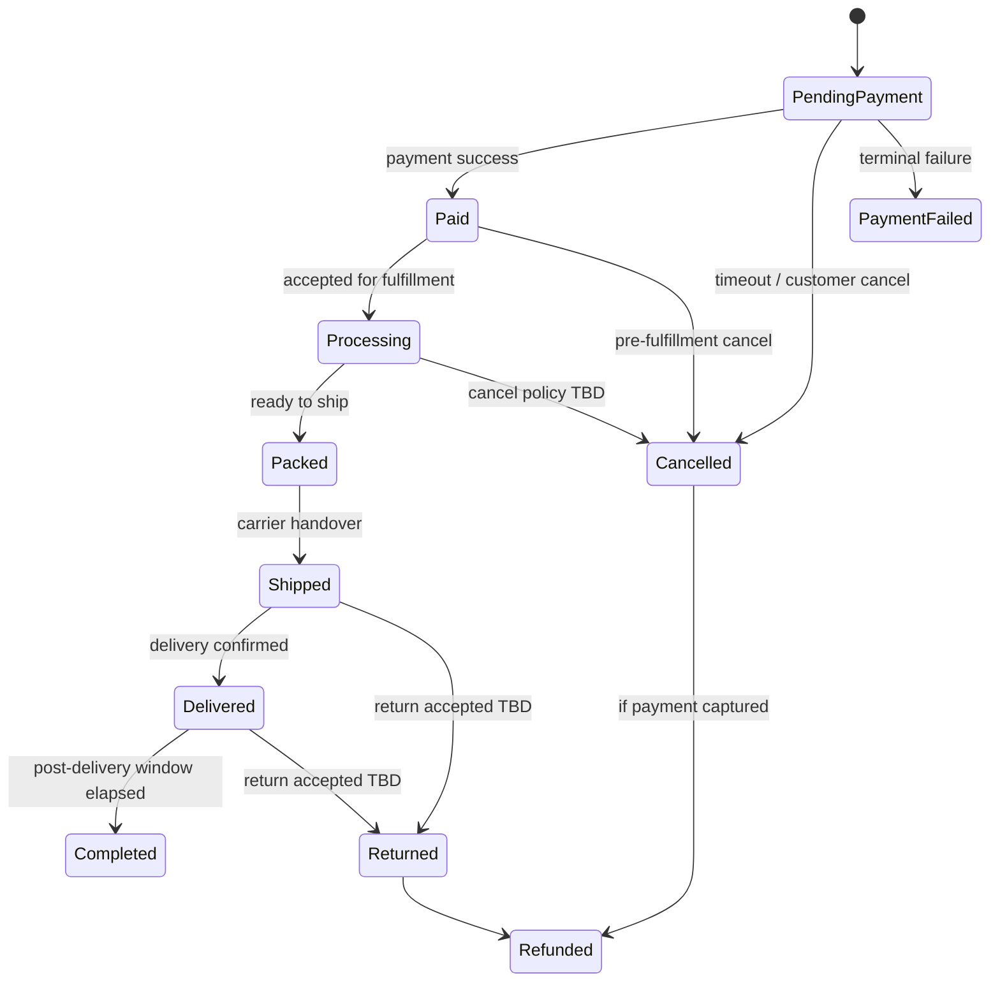
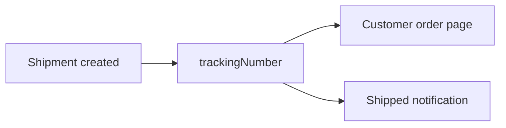

# 44 — Order Management

## Purpose

Define order lifecycle, customer tracking, invoices, and notifications for Neurolinx commerce (B2C orders and quote-converted B2B orders).

## Related documents

- [40_ECOMMERCE_ARCHITECTURE.md](./40_ECOMMERCE_ARCHITECTURE.md)
- [42_CHECKOUT.md](./42_CHECKOUT.md)
- [43_PAYMENT.md](./43_PAYMENT.md)
- [45_CUSTOMER_ACCOUNT.md](./45_CUSTOMER_ACCOUNT.md)
- [73_ADMIN_ORDERS.md](./73_ADMIN_ORDERS.md)
- [94_PAYMENT_SECURITY.md](./94_PAYMENT_SECURITY.md)

---

## Requirements

1. Every successful checkout/payment (or approved alternate method) produces an order.
2. Orders have explicit states visible to customers and admins.
3. Customers can track order progress and access invoices when available.
4. Status changes trigger notifications.
5. Admin can manage fulfillment actions (detailed UI in [73_ADMIN_ORDERS.md](./73_ADMIN_ORDERS.md)).

---

## Technical decisions

| Decision | Choice | Rationale |
| --- | --- | --- |
| Order identity | Stable `orderId` + human `orderNumber` | Support/ops friendly |
| State machine | Explicit finite states | Prevents illegal transitions |
| Line snapshots | Immutable product/price snapshot at order time | Catalog changes must not rewrite history |
| Invoices | Generated document artifact (PDF **TBD** engine) | Customer + accounting needs |
| Notifications | NotificationPort templates per event | Channel providers TBD |

### Order (conceptual)

```text
Order
├── orderId / orderNumber
├── channel: B2C | B2B_QUOTE_CONVERSION
├── customerId | guestContact
├── lines[] (snapshots)
├── addresses
├── shipping
├── paymentSummary
├── status
├── timeline[] / events
├── invoiceRefs[]
└── trackingRefs[]
```

---

## Order states

Recommended core states (adjust only with documented migration):



| State | Customer meaning |
| --- | --- |
| PendingPayment | Awaiting successful payment |
| Paid | Payment received; preparing |
| Processing | Being picked/packed |
| Packed | Ready / awaiting pickup |
| Shipped | In transit |
| Delivered | Delivered |
| Completed | Closed successfully |
| Cancelled | Cancelled |
| PaymentFailed | Payment did not complete |
| Returned / Refunded | Post-fulfillment reversal paths |

Additional states (on hold, backorder, partially shipped): **TBD**.

Illegal transitions must be rejected by the domain service.

---

## Tracking

| Capability | Requirement |
| --- | --- |
| Customer order detail | Status + timeline of key events |
| Shipment tracking | Carrier code + tracking number when shipped |
| Tracking URL | From ShippingPort when available |
| Guest order access | Tokenized link if guest checkout enabled (**TBD**) |
| Multi-parcel | **TBD** |



---

## Invoices

| Topic | Requirement | Status |
| --- | --- | --- |
| Invoice on paid/fulfilled | Generate invoice artifact | Required capability |
| Numbering scheme | Sequential / fiscal rules | **TBD** |
| Tax breakdown | Lines + tax totals | Tax rules **TBD** |
| Customer download | From account order detail | Required |
| Credit notes | For refunds | **TBD** |
| ERP sync of invoices | Via ErpSyncPort | Future hook |

Do not invent legal invoice field requirements for specific countries until markets are chosen.

---

## Notifications

| Event | Typical recipients |
| --- | --- |
| Order confirmed / paid | Customer |
| Payment failed | Customer |
| Shipped (+ tracking) | Customer |
| Delivered | Customer (**TBD**) |
| Cancelled / refunded | Customer |
| Quote converted to order | Customer + sales (**TBD**) |
| Ops alerts | Admin roles **TBD** |

Channels (email/SMS/push): provider **TBD**. Templates must be manageable without code deploys where practical (CMS/admin **TBD**).

---

## Functional requirements

| ID | Requirement |
| --- | --- |
| FR-ORD-01 | Create order from successful checkout/payment (or approved alternate method). |
| FR-ORD-02 | Persist immutable line snapshots. |
| FR-ORD-03 | Enforce documented state transitions. |
| FR-ORD-04 | Expose order list/detail to the owning customer. |
| FR-ORD-05 | Attach tracking data when shipment exists. |
| FR-ORD-06 | Generate/store invoice references for download when available. |
| FR-ORD-07 | Emit notification events on key transitions. |
| FR-ORD-08 | Support admin fulfillment actions via secured APIs. |

## Non-functional requirements

| ID | Requirement |
| --- | --- |
| NFR-ORD-01 | Order creation is idempotent relative to payment/checkout ids. |
| NFR-ORD-02 | Order PII access is RBAC-scoped and audited. |
| NFR-ORD-03 | Historical orders remain readable after catalog changes. |
| NFR-ORD-04 | High-volume status webhooks from carriers handled asynchronously. |

## Dependencies

- Payments, shipping, inventory deduction policies (**TBD** timing)
- Customer accounts
- NotificationPort
- Admin orders module
- Optional ERP sync hook

## Constraints

1. Do not rewrite historical prices when catalog prices change.
2. Do not invent return windows or restocking fees.
3. Customer cancellation eligibility by state is **TBD** — implement as policy hooks.

## Open questions (TBD)

- Partial shipment / split fulfillment
- Backorders
- Automatic completion delay after delivery
- Return/RMA workflow
- Invoice legal format by country
- Inventory decrement timing

## Acceptance criteria

- [ ] State diagram covers primary happy path and cancel/refund hooks.
- [ ] Tracking and invoice capabilities are specified without fake legal rules.
- [ ] Notification events are listed.
- [ ] Idempotent creation and snapshot immutability are required.
- [ ] Cross-refs to payment, account, and admin docs exist.
