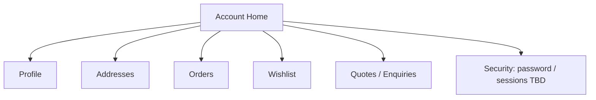
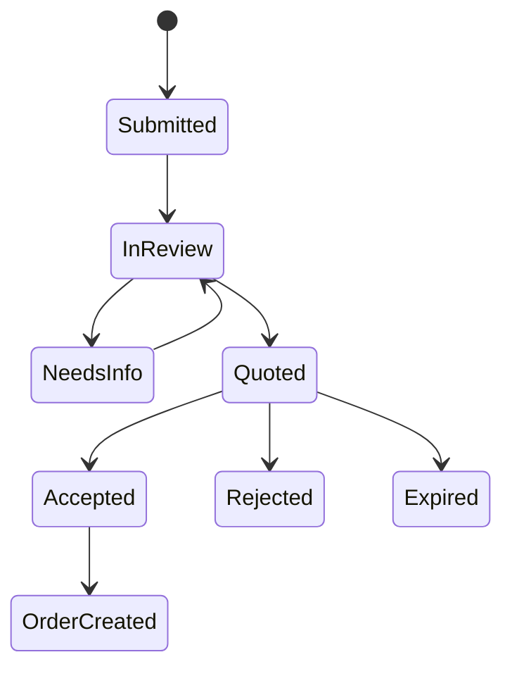

# 45 — Customer Account

## Purpose

Define the authenticated customer account area: profile, addresses, orders, wishlist, and quotes/enquiries. This is the customer-facing hub for both B2C and B2B engagement.

## Related documents

- [04_USER_ROLES.md](./04_USER_ROLES.md)
- [40_ECOMMERCE_ARCHITECTURE.md](./40_ECOMMERCE_ARCHITECTURE.md)
- [41_CART.md](./41_CART.md)
- [44_ORDER_MANAGEMENT.md](./44_ORDER_MANAGEMENT.md)
- [46_WISHLIST.md](./46_WISHLIST.md)
- [63_AUTHENTICATION.md](./63_AUTHENTICATION.md)
- [64_AUTHORIZATION_RBAC.md](./64_AUTHORIZATION_RBAC.md)

---

## Requirements

1. Authenticated customers can manage profile and addresses.
2. Customers can view order history and order detail (tracking, invoices).
3. Customers can manage wishlist items.
4. Customers can view quote/enquiry history and status.
5. Account APIs are private to the owning user unless an admin role applies.

---

## Technical decisions

| Decision | Choice | Rationale |
| --- | --- | --- |
| Account surface | Dedicated `/account/*` routes in public React app | Clear IA separation |
| Auth | JWT/session per [63_AUTHENTICATION.md](./63_AUTHENTICATION.md) | Platform standard |
| B2B fields | Optional company profile attributes | Support quotes without separate app |
| Guest upgrades | Link guest orders on register/login when token proves ownership (**TBD**) | Conversion path |

### Account information architecture



---

## Profile

| Field group | Notes |
| --- | --- |
| Identity | Name, email (verified), phone **TBD** |
| Preferences | Marketing opt-in **TBD**, locale/currency **TBD** |
| Company (B2B) | Company name, tax id **TBD**, role/title **TBD** |
| Avatar | Optional; media rules per upload security docs |

Email change and verification flow: **TBD** (must remain secure).

---

## Addresses

| Capability | Requirement |
| --- | --- |
| CRUD | Create, read, update, delete saved addresses |
| Defaults | Default shipping / default billing |
| Checkout reuse | Pre-fill checkout selectors |
| Validation | Same field rules as checkout ([42_CHECKOUT.md](./42_CHECKOUT.md)) |
| Max addresses | **TBD** |

---

## Orders

| Capability | Requirement |
| --- | --- |
| List | Paginated order history with status badges |
| Detail | Lines, totals, addresses, timeline, tracking |
| Invoice download | When artifact exists |
| Reorder | **TBD** (nice-to-have; do not assume) |
| Cancel request | **TBD** by state policy |

Ownership: customers see only their orders.

---

## Wishlist

Full requirements: [46_WISHLIST.md](./46_WISHLIST.md).

Account area provides list UI and move-to-cart / request-quote actions where eligible.

---

## Quotes / enquiries

Supports B2B workflow from master spec:

```text
Customer details | Company | Quantity | Product | Requirements
Attachments | Notes | Sales status | Assignment | Follow-up
```

| Customer capability | Requirement |
| --- | --- |
| Submit quote from PDP/account | Yes (product eligibility **TBD**) |
| List own quote requests | Yes |
| View status | Yes (status model **TBD** with sales) |
| Message/follow-up thread | **TBD** |
| Accept quote → checkout/order | **TBD** conversion rules |
| Attachments | Yes, with [93_FILE_UPLOAD_SECURITY.md](./93_FILE_UPLOAD_SECURITY.md) |



Exact statuses and SLAs: **TBD**.

---

## Functional requirements

| ID | Requirement |
| --- | --- |
| FR-ACC-01 | View/update profile fields permitted by policy. |
| FR-ACC-02 | Manage saved addresses with defaults. |
| FR-ACC-03 | List and open own orders. |
| FR-ACC-04 | Access wishlist from account. |
| FR-ACC-05 | List and open own quotes/enquiries. |
| FR-ACC-06 | Deny cross-account data access. |
| FR-ACC-07 | Authenticated session required for account routes. |

## Non-functional requirements

| ID | Requirement |
| --- | --- |
| NFR-ACC-01 | Account pages meet accessibility baseline ([101_ACCESSIBILITY.md](./101_ACCESSIBILITY.md)). |
| NFR-ACC-02 | PII edits audited where security policy requires. |
| NFR-ACC-03 | Account APIs rate-limited. |
| NFR-ACC-04 | Responsive account UX per [55_RESPONSIVE_DESIGN.md](./55_RESPONSIVE_DESIGN.md). |

## Dependencies

- Auth/RBAC
- Orders, wishlist, quotes modules
- File upload for quote attachments
- Frontend routing/state

## Constraints

1. Do not expose admin-only sales notes to customers unless explicitly marked customer-visible.
2. Do not invent loyalty points or wallet balances.
3. Password/session security follows auth docs — not redefined here.

## Open questions (TBD)

- Company account vs individual user (multi-user orgs)
- Marketing preferences / consent model
- Reorder and cancel-request features
- Quote acceptance commercial terms
- Linking historical guest orders

## Acceptance criteria

- [ ] Account IA covers profile, addresses, orders, wishlist, quotes.
- [ ] B2B quote visibility for customers is specified with TBD statuses.
- [ ] Authorization boundary (own data only) is explicit.
- [ ] Cross-refs to wishlist, orders, and auth docs exist.
