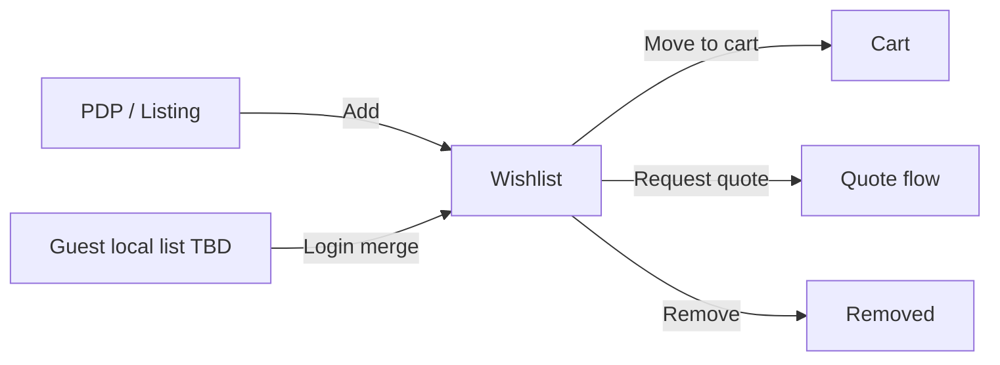

# 46 — Wishlist

## Purpose

Define wishlist requirements for Neurolinx storefront customers: save products for later, manage lists, and convert items to cart or quote where eligible.

## Related documents

- [40_ECOMMERCE_ARCHITECTURE.md](./40_ECOMMERCE_ARCHITECTURE.md)
- [41_CART.md](./41_CART.md)
- [45_CUSTOMER_ACCOUNT.md](./45_CUSTOMER_ACCOUNT.md)
- [30_PRODUCT_ARCHITECTURE.md](./30_PRODUCT_ARCHITECTURE.md)

---

## Requirements

1. Customers can add/remove products (and variants when applicable) to a wishlist.
2. Wishlist is available from PDP, listing actions, and account area.
3. Wishlist items can move to cart or start a quote when the SKU allows those actions.
4. Guest wishlist behavior is supported in a limited form or deferred — **TBD**.

---

## Technical decisions

| Decision | Choice | Rationale |
| --- | --- | --- |
| Primary ownership | Authenticated user wishlist on server | Durable across devices |
| Guest wishlist | Local-only until login **or** disabled | **TBD** product decision |
| Multiple lists | Single default list for v1 | Multi-list **TBD** |
| Variant handling | Store variantId when product has variants | Correct later purchase |

### Wishlist (conceptual)

```text
Wishlist
├── userId
├── items[]
│   ├── productId
│   ├── variantId?
│   ├── addedAt
│   └── notes? (TBD)
└── updatedAt
```

---

## Flows



| Action | Rule |
| --- | --- |
| Add | Idempotent for same product/variant |
| Remove | Soft or hard delete — implementation choice; UX is remove |
| Move to cart | Respect cart eligibility + stock validation |
| Request quote | Respect quote eligibility |
| Out of stock item | Remain on wishlist; show availability badge |
| Discontinued product | Show unavailable; allow remove (**TBD** auto-prune) |

---

## Functional requirements

| ID | Requirement |
| --- | --- |
| FR-WL-01 | Authenticated user can add eligible catalog items to wishlist. |
| FR-WL-02 | Authenticated user can list and remove wishlist items. |
| FR-WL-03 | Wishlist entry preserves variant selection when provided. |
| FR-WL-04 | Move-to-cart invokes cart rules and stock checks. |
| FR-WL-05 | Request-quote action available when product supports quotes. |
| FR-WL-06 | Account wishlist page reflects server state. |
| FR-WL-07 | Duplicate add does not create duplicate rows. |

## Non-functional requirements

| ID | Requirement |
| --- | --- |
| NFR-WL-01 | Wishlist APIs are private to the owning user. |
| NFR-WL-02 | Add/remove interactions feel immediate (optimistic UI allowed with reconciliation). |
| NFR-WL-03 | Wishlist reads should not block critical PDP rendering (defer/lazy acceptable). |

## Dependencies

- Auth (for server wishlist)
- Product catalog availability flags
- Cart and quote modules
- Account UI

## Constraints

1. Wishlist is not a cart substitute for inventory reservation.
2. Do not invent social/public wishlists or sharing unless later required (**TBD**).
3. Do not invent price-drop alert rules unless product later requests them (**TBD**).

## Open questions (TBD)

- Guest wishlist enabled?
- Merge strategy on login
- Multiple named lists
- Sharing links
- Price-drop / back-in-stock notifications
- Max items

## Acceptance criteria

- [ ] Add/remove/list and conversion actions are specified.
- [ ] Guest behavior is explicitly TBD or deferred, not silently assumed.
- [ ] Stock does not remove items silently without UX rules.
- [ ] Cross-refs to cart, account, and product docs exist.
