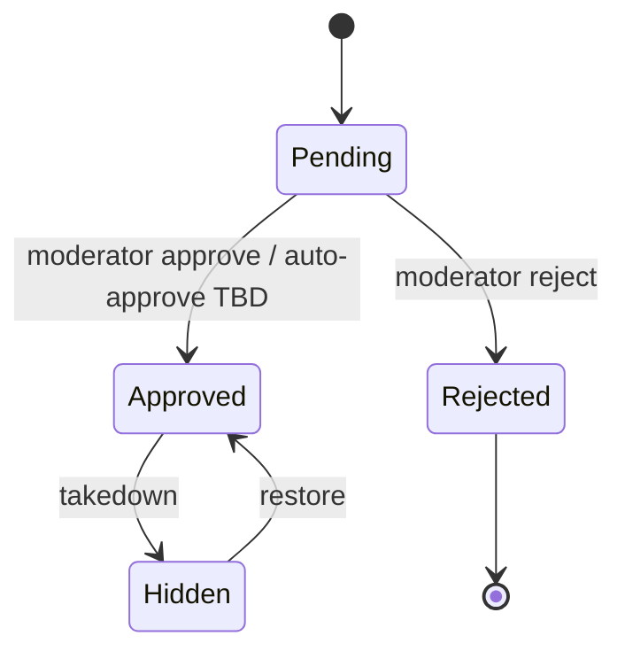

# 47 — Reviews

## Purpose

Define product review capabilities for Neurolinx: submission, display, moderation, and eligibility constraints. Business eligibility rules that are not yet decided are marked **TBD**.

## Related documents

- [30_PRODUCT_ARCHITECTURE.md](./30_PRODUCT_ARCHITECTURE.md)
- [32_PRODUCT_DETAILS.md](./32_PRODUCT_DETAILS.md)
- [44_ORDER_MANAGEMENT.md](./44_ORDER_MANAGEMENT.md)
- [45_CUSTOMER_ACCOUNT.md](./45_CUSTOMER_ACCOUNT.md)
- [70_ADMIN_ARCHITECTURE.md](./70_ADMIN_ARCHITECTURE.md)
- [04_USER_ROLES.md](./04_USER_ROLES.md)

---

## Requirements

1. Customers can submit product reviews (rating + text; media **TBD**).
2. Reviews are moderated before or after public visibility per policy (**TBD**).
3. PDP displays approved reviews and aggregate rating.
4. Abuse, spam, and ineligible submissions must be controllable by admins.
5. Eligibility to review (e.g. verified purchase) is **TBD** — architecture must support both open and purchase-gated modes.

---

## Technical decisions

| Decision | Choice | Rationale |
| --- | --- | --- |
| Review target | Product (variant-level **TBD**) | Matches PDP aggregation |
| Moderation | Explicit status workflow | Brand safety for premium company |
| Aggregation | Server-computed average + count | Consistent across surfaces |
| Identity | Authenticated author required for v1 recommendation | Reduces spam; guests **TBD** |

### Review (conceptual)

```text
Review
├── id
├── productId
├── authorUserId
├── rating (1–5)
├── title?
├── body
├── status: PENDING | APPROVED | REJECTED | HIDDEN
├── verifiedPurchase: boolean (computation TBD)
├── createdAt / moderatedAt
└── moderatorNotes (admin-only)
```

---

## Moderation workflow



| Policy option | Description | Status |
| --- | --- | --- |
| Pre-moderation | Visible only after approve | Candidate |
| Post-moderation | Visible immediately, hide later | Candidate |
| Auto-approve trusted buyers | Heuristic | **TBD** |
| Profanity/spam filters | Automated assist | **TBD** |

Admin tooling lives under admin platform docs; APIs must support list/filter by status.

---

## Eligibility (TBD)

| Question | Notes |
| --- | --- |
| Must reviewer have purchased the product? | **TBD** — support `verifiedPurchase` flag regardless |
| One review per user per product? | Recommended yes; edits **TBD** |
| Can reviewers update/delete own review? | **TBD** |
| Minimum account age / order completion wait | **TBD** |
| Staff reviews allowed? | **TBD** disclosure rules |
| Ratings without text | **TBD** |

Until decided, implement eligibility as a pluggable policy (`ReviewEligibilityPolicy`) with a conservative default documented in config (e.g. authenticated-only), not hard-coded business myth.

---

## Display rules

| Surface | Content |
| --- | --- |
| PDP | Aggregate rating, count, approved list (paginated) |
| Listing cards | Optional aggregate snippet — performance permitting |
| SEO | AggregateRating structured data when enough reviews — see [100_SEO_STRATEGY.md](./100_SEO_STRATEGY.md) |
| Sorting | Most recent / highest / lowest — **TBD** default |

Rejected/pending reviews never appear on public PDP.

---

## Functional requirements

| ID | Requirement |
| --- | --- |
| FR-REV-01 | Authenticated user can submit a rating and review body for a product. |
| FR-REV-02 | System assigns initial moderation status per configured policy. |
| FR-REV-03 | Public APIs return only approved reviews. |
| FR-REV-04 | Admins can approve, reject, or hide reviews. |
| FR-REV-05 | PDP can render aggregate rating from approved reviews. |
| FR-REV-06 | Eligibility policy is enforced server-side. |
| FR-REV-07 | Author cannot spoof another user’s identity on a review. |

## Non-functional requirements

| ID | Requirement |
| --- | --- |
| NFR-REV-01 | Review submission rate-limited. |
| NFR-REV-02 | Moderation actions audited. |
| NFR-REV-03 | UGC sanitized against XSS on render and store. |
| NFR-REV-04 | Aggregation queries remain efficient (materialized summary **TBD**). |

## Dependencies

- Auth/RBAC
- Product module
- Optional orders module for verified purchase
- Admin review management
- Accessibility for rating widgets

## Constraints

1. Do not invent star incentives, review gating copy, or legal disclosure text.
2. Do not display pending reviews publicly.
3. Do not allow HTML-rich arbitrary markup in review bodies.

## Open questions (TBD)

- Pre- vs post-moderation
- Verified purchase requirement
- Media attachments
- Edit/delete by author
- Variant-specific reviews
- Syndicated reviews / imports

## Acceptance criteria

- [ ] Moderation states and public visibility rules are documented.
- [ ] Eligibility is explicitly TBD with a pluggable policy approach.
- [ ] Aggregation and PDP display requirements are clear.
- [ ] Security (XSS, auth, rate limit) constraints are listed.
- [ ] Cross-refs to product, admin, and SEO docs exist.
