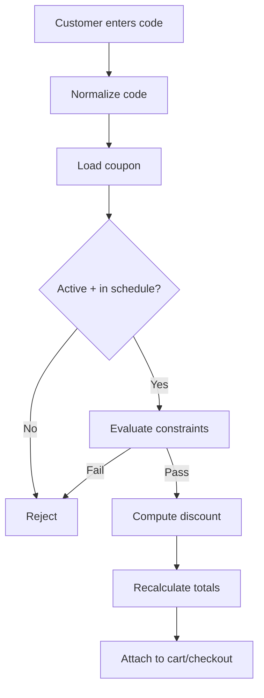

# 48 — Coupons

## Purpose

Define coupon/discount capabilities for Neurolinx checkout and cart: coupon types, application pipeline, and constraints. Specific commercial business rules (stacking, exclusivity, eligibility matrices) are **TBD** and must not be invented.

## Related documents

- [40_ECOMMERCE_ARCHITECTURE.md](./40_ECOMMERCE_ARCHITECTURE.md)
- [41_CART.md](./41_CART.md)
- [42_CHECKOUT.md](./42_CHECKOUT.md)
- [70_ADMIN_ARCHITECTURE.md](./70_ADMIN_ARCHITECTURE.md)
- [04_USER_ROLES.md](./04_USER_ROLES.md)

---

## Requirements

1. Admins can create coupon codes with type, value, schedule, and constraints.
2. Customers can apply a coupon during cart/checkout.
3. Server validates coupons and recalculates totals.
4. Redeemed usage is tracked to prevent abuse.
5. Business rule details (stacking, segments, exclusions) remain configurable / TBD.

---

## Technical decisions

| Decision | Choice | Rationale |
| --- | --- | --- |
| Authority | Server-side validation only | Clients cannot forge discounts |
| Application point | Cart and/or checkout session | Consistent totals before payment |
| Types (capability) | Percent, fixed amount, free shipping | Common commerce set; enablement **TBD** |
| Code format | Case-insensitive unique codes | UX convenience |
| Audit | Store applied coupon snapshot on order | History integrity |

### Coupon (conceptual)

```text
Coupon
├── code
├── type: PERCENT | FIXED_AMOUNT | FREE_SHIPPING | (TBD others)
├── value
├── currency (for fixed)
├── startsAt / endsAt
├── active
├── usageLimitTotal?
├── usageLimitPerCustomer?
├── minSubtotal?
├── constraints (see TBD)
└── metadata
```

---

## Coupon types

| Type | Meaning | Notes |
| --- | --- | --- |
| PERCENT | Percentage off eligible subtotal | Cap **TBD** |
| FIXED_AMOUNT | Fixed currency off | Currency must match cart |
| FREE_SHIPPING | Shipping amount waived / reduced | Interaction with ShippingPort |
| Buy-X-Get-Y / bundle | Not assumed | **TBD** if ever required |
| Gift cards / store credit | Out of scope unless later specified | **TBD** |

---

## Application pipeline



Order of operations relative to tax/shipping: **TBD** (document when tax policy exists). Typical safe approach: validate → apply discount to eligible basis → shipping → tax, but do **not** treat this as a locked business rule until confirmed.

---

## Constraints (TBD business rules)

The platform must support constraint *fields*, but values/policies are TBD:

| Constraint | Support as data | Business value |
| --- | --- | --- |
| Minimum subtotal | Yes | **TBD** |
| Maximum discount | Yes | **TBD** |
| First order only | Yes | **TBD** |
| Specific products/categories | Yes | **TBD** |
| Exclude sale items | Yes | **TBD** |
| Customer segments / B2B only | Yes | **TBD** |
| Stacking multiple coupons | Yes/No flag | **TBD** — default recommend single code until decided |
| Combinable with automatic promotions | Flag | **TBD** (automatic promos themselves TBD) |
| Geographic eligibility | Flag | **TBD** |
| Total / per-customer redemption caps | Yes | **TBD** numbers |


---

## Functional requirements

| ID | Requirement |
| --- | --- |
| FR-CPN-01 | Admin can create/update/deactivate coupons. |
| FR-CPN-02 | Customer can apply a code to cart/checkout. |
| FR-CPN-03 | Customer can remove an applied code. |
| FR-CPN-04 | Invalid/expired/ineligible codes return clear error codes. |
| FR-CPN-05 | Totals update only after server validation. |
| FR-CPN-06 | Redemption increments usage counters atomically. |
| FR-CPN-07 | Order stores coupon code and discount amount snapshot. |
| FR-CPN-08 | Free-shipping type integrates with shipping quote totals. |

## Non-functional requirements

| ID | Requirement |
| --- | --- |
| NFR-CPN-01 | Apply endpoint rate-limited (brute-force codes). |
| NFR-CPN-02 | Concurrent redemptions cannot exceed usage limits. |
| NFR-CPN-03 | Admin coupon changes do not mutate historical orders. |
| NFR-CPN-04 | Coupon secrets/campaigns are admin-RBAC protected. |

## Dependencies

- Cart/checkout totals engine
- ShippingPort for free-shipping type
- Auth for per-customer limits
- Admin coupon management UI
- Orders snapshot persistence

## Constraints

1. Do not invent stacking matrices or marketing campaign calendars.
2. Do not trust client-sent discount amounts.
3. Do not allow negative payable totals unless explicitly approved (**TBD**; recommend clamp to zero).

## Open questions (TBD)

- Single vs multiple simultaneous codes
- Auto-applied promotions vs codes
- B2B quote discounts vs storefront coupons
- Referral/affiliate codes
- Tax treatment of discounts
- Partial refunds with coupon reallocation

## Acceptance criteria

- [ ] Coupon types and validation pipeline are documented.
- [ ] Constraint dimensions are listed as supported fields with TBD values.
- [ ] Server authority and abuse controls are explicit.
- [ ] Order snapshot requirement is clear.
- [ ] Cross-refs to cart/checkout/admin exist.
