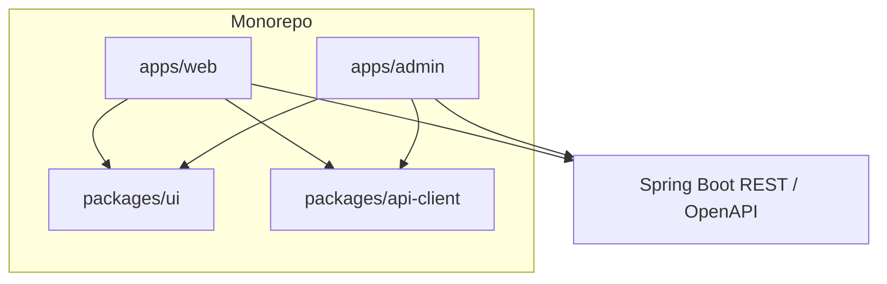
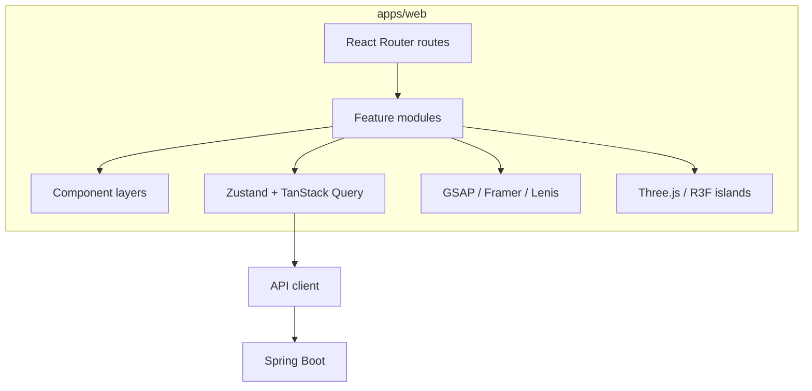
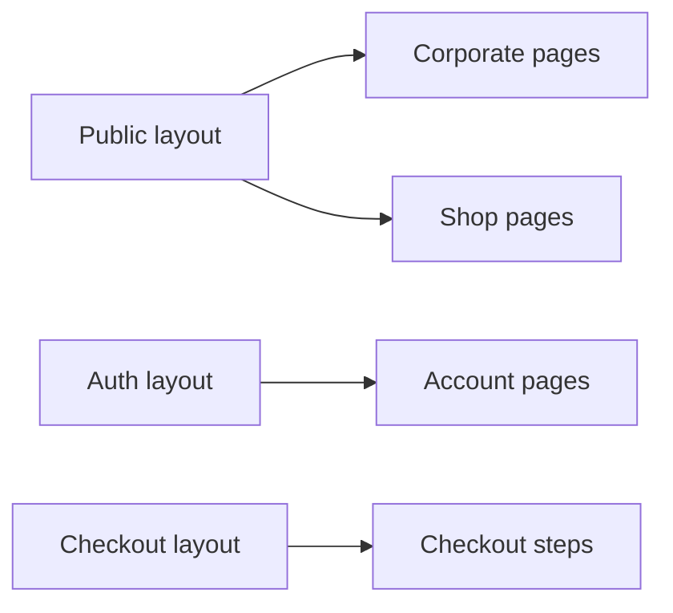

# 50 — React Architecture

## Purpose

Define the Neurolinx React frontend architecture: application boundaries (public vs admin), component layers, routing overview, and alignment with the documented stack (React, TypeScript, Vite, React Router, Tailwind, Zustand, TanStack Query, GSAP, Framer Motion, Lenis, Three.js/R3F).

## Related documents

- [51_FRONTEND_FOLDER_STRUCTURE.md](./51_FRONTEND_FOLDER_STRUCTURE.md)
- [52_FRONTEND_STATE_MANAGEMENT.md](./52_FRONTEND_STATE_MANAGEMENT.md)
- [53_FRONTEND_API_INTEGRATION.md](./53_FRONTEND_API_INTEGRATION.md)
- [54_FRONTEND_PERFORMANCE.md](./54_FRONTEND_PERFORMANCE.md)
- [55_RESPONSIVE_DESIGN.md](./55_RESPONSIVE_DESIGN.md)
- [11_DESIGN_SYSTEM.md](./11_DESIGN_SYSTEM.md)
- [18_MOTION_DESIGN.md](./18_MOTION_DESIGN.md)
- [80_3D_ARCHITECTURE.md](./80_3D_ARCHITECTURE.md)
- [40_ECOMMERCE_ARCHITECTURE.md](./40_ECOMMERCE_ARCHITECTURE.md)
- [70_ADMIN_ARCHITECTURE.md](./70_ADMIN_ARCHITECTURE.md)

---

## Requirements

1. Frontend is component-driven, typed, responsive, accessible, and production-ready.
2. Public storefront/corporate site and Admin platform are both React apps consuming the same Spring Boot REST API.
3. Premium motion/3D must not compromise performance, accessibility, or mobile usability.
4. Commerce (B2C) and enquiry/quotation (B2B) flows share design system primitives but diverge in route modules.

---

## Technical decision: app structure

### Recommendation

**Use a monorepo with an `apps/` folder** (Vite apps) plus shared packages:

```text
apps/
  web/        # Public platform (corporate + shop + account)
  admin/      # Admin platform
packages/
  ui/         # Design-system components
  config/     # ESLint, TSConfig, Tailwind presets
  api-client/ # OpenAPI-generated or hand-maintained client types
  three-utils/# Shared R3F helpers (optional)
```

| Option | Pros | Cons |
| --- | --- | --- |
| **A. `apps/web` + `apps/admin` (locked)** | Separate bundles, deploy targets, auth surfaces; shared UI via packages | Requires monorepo tooling |
| B. Single app with `/admin` routes | Simpler repo | Larger bundle risk, weaker blast-radius isolation, easier to leak admin code |
| C. Fully separate repos | Strong isolation | Duplicated design system drift |

**Decision:** Option A. Public and admin are separate Vite React TypeScript applications with shared packages. Do not ship admin UI inside the public bundle.



**Monorepo tooling (locked):** **pnpm workspaces**. Optional Turborepo/Nx later for task caching — **TBD**, not required for v1 structure. See [ADR-001-FRONTEND-STACK.md](./ADR/ADR-001-FRONTEND-STACK.md).

---

## Application architecture



### Component layers

| Layer | Responsibility | Examples |
| --- | --- | --- |
| `app` | Shell, providers, router | `AppProviders`, route config |
| `pages` / route entries | Thin route-level composition | `ProductDetailsPage` |
| `features` | Domain UI + hooks | `cart`, `checkout`, `quotes`, `auth` |
| `entities` (optional) | Domain display units | `ProductCard`, `OrderSummary` |
| `shared/ui` | Design-system primitives | Button, Input, Dialog |
| `shared/lib` | Pure utilities | formatMoney, cn() |
| `widgets` (optional) | Composed blocks | SiteHeader, ProductGallery |

Keep business rules out of pure UI primitives; call APIs via feature hooks.

---

## Routing overview (`apps/web`)

High-level route groups (paths illustrative; final IA in [20_WEBSITE_INFORMATION_ARCHITECTURE.md](./20_WEBSITE_INFORMATION_ARCHITECTURE.md)):

| Group | Examples |
| --- | --- |
| Corporate | `/`, `/about`, `/technologies`, `/industries`, `/engineering`, `/rd`, `/projects`, `/resources`, `/blog`, `/contact` |
| Commerce | `/shop`, `/shop/:category`, `/product/:slug`, `/cart`, `/checkout/*` |
| B2B | `/enquiry`, `/product/:slug/quote`, `/account/quotes` |
| Account | `/account/*` (auth-gated) |
| Legal | `/privacy`, `/terms` (**TBD**) |



Admin routing is owned by [70_ADMIN_ARCHITECTURE.md](./70_ADMIN_ARCHITECTURE.md) (`apps/admin`).

---

## Cross-cutting frontend concerns

| Concern | Approach |
| --- | --- |
| Styling | Tailwind CSS + design tokens |
| Server state | TanStack Query — [52_FRONTEND_STATE_MANAGEMENT.md](./52_FRONTEND_STATE_MANAGEMENT.md) |
| Client/UI state | Zustand (cart mirror, UI chrome, cursor mode) |
| Motion | Framer Motion for UI; GSAP for complex timelines; Lenis for smooth scroll |
| 3D | R3F islands, lazy-loaded — [80_3D_ARCHITECTURE.md](./80_3D_ARCHITECTURE.md) |
| Custom cursor | Desktop only; disable on touch / reduced motion — [55_RESPONSIVE_DESIGN.md](./55_RESPONSIVE_DESIGN.md) |
| Auth | Token/session via API integration doc |
| Errors/loading | Shared patterns in [53_FRONTEND_API_INTEGRATION.md](./53_FRONTEND_API_INTEGRATION.md) |

---

## Functional requirements

| ID | Requirement |
| --- | --- |
| FR-FE-01 | `apps/web` implements public corporate + commerce + account UX. |
| FR-FE-02 | `apps/admin` is a separate app for administration. |
| FR-FE-03 | Shared UI lives in packages consumed by both apps. |
| FR-FE-04 | Routing supports corporate, shop, checkout, account, and quote flows. |
| FR-FE-05 | 3D/motion features degrade gracefully on constrained devices. |
| FR-FE-06 | TypeScript strictness enabled for app code (**exact tsconfig TBD** but no `any`-by-default). |

## Non-functional requirements

| ID | Requirement |
| --- | --- |
| NFR-FE-01 | Code-split by route; see [54_FRONTEND_PERFORMANCE.md](./54_FRONTEND_PERFORMANCE.md). |
| NFR-FE-02 | WCAG-oriented accessibility baseline ([101_ACCESSIBILITY.md](./101_ACCESSIBILITY.md)). |
| NFR-FE-03 | Mobile-first responsive behavior ([55_RESPONSIVE_DESIGN.md](./55_RESPONSIVE_DESIGN.md)). |
| NFR-FE-04 | No admin-only code in the public deployment artifact. |

## Dependencies

- Vite + React + TS toolchain
- Backend OpenAPI
- Design system / content model docs
- 3D asset pipeline

## Constraints

1. Do not start implementation before documentation acceptance (per master spec).
2. Do not tightly couple components to a single payment SDK.
3. Do not use default system font stacks for brand surfaces — follow design system typography.

## Open questions (TBD)

- Optional Turborepo/Nx task caching (pnpm workspaces already locked)
- SSR/SSG later for SEO vs pure CSR + prerender
- Exact public base path and admin subdomain vs path

## Acceptance criteria

- [ ] Locked `apps/` + `packages/` structure is documented with rationale.
- [ ] Component layers and routing groups are defined.
- [ ] Stack libraries are mapped to concerns.
- [ ] Public vs admin separation is explicit.
- [ ] Cross-refs to state, API, performance, and responsive docs exist.
